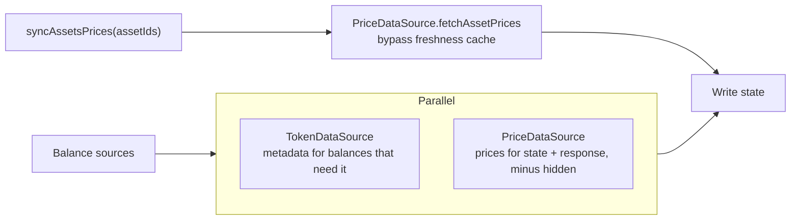

# Remove DetectionMiddleware

- Date: 2026-10-20
- Status: Accepted
- Package: `@metamask/assets-controller`

`DetectionMiddleware` no longer builds a shared list for metadata and prices.
`TokenDataSource` and `PriceDataSource` each choose their own assets from the
request, controller state, and the current balance response.

This is not RPC token detection. `TokenDetector` and `tokenDetectionEnabled`
still decide which ERC-20s a balance source reports. This note is only about
the enrichment step that used to sit between those balances and Token / Price.

## What detection used to do

`DetectionMiddleware` ran on the balance data type, before Token and Price,
and wrote two bags those sources then read:

- `response.detectedAssets`: assets that were genuinely new. A balance on the
  response was included only when it was absent from both `state.assetsBalance`
  and `state.assetsInfo`. Custom assets were included on the same rule. Anything
  already tracked was left out on purpose. The price subscription was supposed
  to refresh those later.
- `request.assetsForPriceUpdate`: detected assets that had no price yet, plus
  every balance on the response that still had no price (for example a native
  seeded before the first price poll).

Token and Price could not run until that list existed, and neither source
could see a tracked balance that was missing metadata, or a hidden asset that
should have been skipped. Callers that wanted prices for an explicit list
passed `assetsForPriceUpdate` into `getAssets`, which dragged the list through
the balance pipeline.

## What replaced it

Fast, update, and websocket lanes no longer insert a detection step. After
balances (and graduation / RPC fallback / the websocket occurrence filter,
where those still apply), Token and Price run in parallel. Each reads state
itself.

An explicit price refresh is `AssetsController.syncAssetsPrices(assetIds)`.
It calls `PriceDataSource.fetchAssetPrices`, which invalidates the freshness
cache for those ids, and merges the result into `assetsPrice`. It does not
take an account or chain, and it does not run the balance pipeline.
`setSelectedCurrency` uses it after invalidating the cache, passing every
asset id currently in `assetsBalance`.

## PriceDataSource

The middleware runs when the request asks for `price`.

Candidates, scoped to the request's accounts and chains:

| Source | Account filter | Chain filter |
| --- | --- | --- |
| `state.assetsBalance` | Yes | Yes |
| `state.customAssets` | Yes | Yes |
| `state.assetsInfo` | No | Yes |
| `response.assetsBalance` | Yes | Yes |

Then drop:

- hidden assets (`assetPreferences.hidden`)
- non-priceable ids (`isPriceableAsset`: staking synthetics such as
  `slip44:*-*`, and Tron bandwidth / energy resources)
- chains the price API does not support. An empty supported-network response
  keeps the candidates rather than pricing nothing

The remaining ids go through the price freshness cache (`DedupingBatchFetcher`,
TTL from `priceFreshnessTtlMs`, otherwise the poll interval). A price fetched
recently is not requested again. Concurrent callers share the in-flight
request. The subscription poll uses the same cache, so a middleware fetch and
a poll do not double-hit the API.

`fetchAssetPrices` is the exception: it invalidates those keys first, then
fetches. That is the path `syncAssetsPrices` and a currency change need,
because the cached numbers are stale or in the wrong currency.

## TokenDataSource

The middleware runs when the request asks for `metadata`.

`#collectMetadataAssetIds` builds two sets:

- **Needs metadata.** A state balance or a response balance that has no image
  in the response or in `state.assetsInfo`, is not a staking-contract id, and
  is not hidden. State balances are also limited to the request's accounts and
  chains. Response balances are not re-filtered by account or chain; they are
  whatever the balance source just returned.
- **Balance heals.** State balances in the set above, plus response balances
  that are already in `state.assetsBalance` or `state.assetsInfo`. A heal is
  enriched and not spam-filtered. A response balance that is new to state is
  spam-filtered.

Native asset ids from `getNativeAssetIds()` are always added, even when no
balance mentioned them.

Supported networks are applied before the Tokens API v3 call. After the
response:

| Asset | Spam rule |
| --- | --- |
| Native | Always kept |
| Custom asset (user import) | Always kept |
| mUSD | Always kept |
| Balance heal | Kept, no occurrence filter |
| New EVM ERC-20 | Kept only when occurrences meet the per-chain suggested floor (default 3). Missing occurrence data counts as zero and is dropped |
| New non-EVM token | Blockaid scan |

Fetched metadata is merged onto the response. A fetch failure logs and leaves
the response otherwise unchanged.

## What changed for callers

| Before | After |
| --- | --- |
| `getAssets` option `assetsForPriceUpdate` | `syncAssetsPrices(assetIds)` |
| Import `DetectionMiddleware` | Drop it. Token and Price select assets themselves |
| `FastFetchSources` / `UpdateSources` / `WsUpdateSources` take `detectionMiddleware` | Those types no longer have that field |
| Only brand-new assets (absent from balance and metadata) were enriched in the pipeline pass | Tracked balances that still lack metadata are healed. Prices cover the scoped state set plus the response, and the freshness cache skips recent ones |
| Hidden assets could still be queued | Hidden assets are excluded by both sources |

## Where the code lives

| Concern | Location |
| --- | --- |
| Explicit price refresh | `AssetsController.syncAssetsPrices` |
| Currency change | `AssetsController.setSelectedCurrency` |
| Price candidate set | `PriceDataSource.#getAssetIdsForPriceFetch` |
| Price freshness cache | `DedupingBatchFetcher` inside `PriceDataSource` |
| Metadata candidate set | `TokenDataSource.#collectMetadataAssetIds` |
| Metadata middleware | `TokenDataSource.assetsMiddleware` |
| Lane composition | `buildFastFetchSources`, `buildUpdateSources`, `buildWsUpdateSources` |
