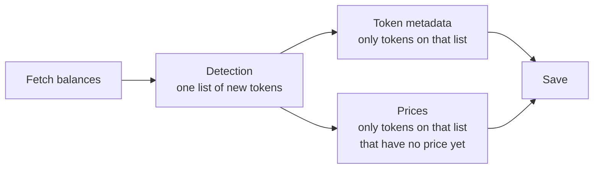
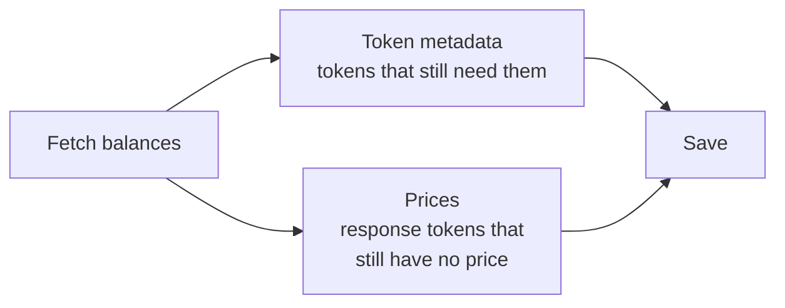
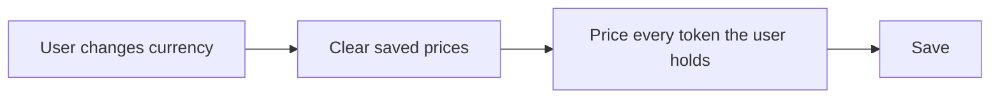

# How the wallet fetch and picks token metadata and prices

- Date: 2026-10-20
- Status: Accepted
- Package: `@metamask/assets-controller`

For each token, the wallet shows three things: how much the user holds, the
token's name and icon, and a fiat price. Different steps fetch those three
things. This note is about the name/icon step and the price step.

There used to be a step in between, called detection. It built one shared list
of "new" tokens, and both later steps could only work from that list. That
step is gone. The name/icon step and the price step now each decide which
tokens they need.

This is not the "token detection" setting. That setting still controls which
Ethereum tokens the wallet scans for. This note is only about what happens
after a balance has already been found.

## Words used below

| Word           | Meaning                                                                                                          |
| -------------- | ---------------------------------------------------------------------------------------------------------------- |
| Balance        | How much of a token an account holds.                                                                            |
| Token metadata | Symbol, name, decimals, and image.                                                                               |
| Price          | The token's value in the user's currency, such as USD.                                                           |
| Custom token   | A token the user added by hand. We keep it even if it looks unpopular.                                           |
| Hidden token   | A token the user chose to hide. We do not fetch it.                                                              |
| Native token   | The chain's own coin, such as ETH on Ethereum or BNB on BNB Chain.                                               |
| Spam           | A token that showed up in the wallet without the user asking for it, often an airdrop. We try not to show those. |

## What happens on a refresh

Balances are fetched first. Names, icons, and prices are filled in after that,
then saved together.

### Before

Detection ran after balances and built one list of new tokens. Names and prices
could only use that list. A token the user already held was left off, even when
it had no name or no price. Names and prices waited for the list, then ran
together.

### After

Detection is gone. Names and prices start as soon as balances are back, and
each one chooses its own tokens. Hidden tokens are skipped by both.

Changing the display currency does not fetch balances again. Saved prices are
cleared, then every token the user holds is priced in the new currency.

## Prices

A balance refresh and the price poll retrieve different tokens.

**On a balance refresh**, prices come only from tokens on this response. A
token is retrieved when all of these are true:

- It is on this response's balances. The balance step already limited that
  list to the accounts and chains this refresh asked about.
- The user has not hidden it.
- It can have a market price. A staking placeholder (a `slip44` id with a
  suffix after the coin type) and Tron bandwidth or energy are skipped.
- Its chain is one the price service supports. If that service cannot be
  reached, this check is skipped and the remaining tokens are still asked for.
- The wallet does not already have a price stored for it.

A token that already has a stored price is left alone on a refresh.

**On the price poll**, the list is built from saved state, not from the
response. It includes every one of these, then drops the same hidden,
non-priceable, and unsupported-chain tokens as a refresh:

- Every token in saved balances, on the accounts and chains this poll asked
  about.
- Every custom token on those accounts.
- Every token we already have saved metadata for, on those chains.

An empty account list means every account. An empty chain list means every
chain. Tokens that already have a price stay on this list, so the poll can
refresh them.

A price fetched in the last minute is not fetched again. Two requests that
need the same price share one request. A request that forces an update clears
that one-minute cache for the tokens it is about to ask for.

A caller that names specific tokens uses `syncAssetsPrices`, which fetches
them again even when a price is already stored.

Changing the display currency is separate from both of the lists above. Those
prices are in the wrong currency, so the cache is cleared and every token the
user holds is priced again.

## Token metadata

A name and icon are fetched for a token that does not already have an image.
The list is built from two places.

**From saved balances.** Every token an account holds in state, limited to the
accounts and chains this refresh asked about. An empty account list means
every account. An empty chain list means every chain. Each of these is a heal:
the missing name or icon is filled in, and the token is not spam-filtered.

**From this refresh's balances.** Every token on the response. The balance
step already limited that response to this refresh. A response token is a heal
when it is already in saved balances, or when we already have any saved
metadata for it. A response token that is in neither is new.

A token is left off both lists when any of these is true:

- The user hid it.
- This response already includes an image for it.
- Saved metadata already includes an image for it.
- It is a staking-contract placeholder.

Of what remains, only chains the token service supports are asked for. If none
of the tokens are on a supported chain, nothing is fetched.

After the token service answers, each returned token is kept or dropped:

| Token                                                          | What we do                                                                                                                                |
| -------------------------------------------------------------- | ----------------------------------------------------------------------------------------------------------------------------------------- |
| The chain's own coin                                           | Always keep it                                                                                                                            |
| A token the user added                                         | Always keep it                                                                                                                            |
| mUSD                                                           | Always keep it                                                                                                                            |
| A heal (a saved balance, or a response token we already track) | Keep it, and fill in the missing name or icon                                                                                             |
| A new Ethereum-style token                                     | Keep it only if enough other sources list it. The bar is that chain's suggested floor, usually 3. No count is treated as zero and dropped |
| A new token on another chain                                   | Ask Blockaid, and drop it if that scan says it is malicious                                                                               |
| Any other token the service returned                           | Keep it                                                                                                                                   |

If the name-and-icon request fails, balances already fetched are left as they
are.

## Trade-offs

What we gain:

- A simpler pipeline. One step and one shared list are gone, so there are
  fewer places for a token to be dropped by mistake.
- The existing metadata-healing behavior is preserved. Tokens in balances
  that have no image remain candidates for name and icon fetching, without
  relying on a detection list.
- Each step can be tested on its own, because it picks its own tokens from
  state and the current balances.

What it costs:

- More calls to the token service. Held tokens that are missing a name or icon
  are asked for on every refresh. A token the service has no image for is asked
  for again each time. Prices are fetched only for tokens on this response that
  have no price yet. The one-minute price cache and the shared in-flight
  request limit repeat price calls, but do not remove them.
- The two steps each decide which accounts, chains, and hidden tokens count.
  That logic now lives in two places and has to be kept in line.

## If you call this package

| You used to                                           | Do this now                                                   |
| ----------------------------------------------------- | ------------------------------------------------------------- |
| Pass `assetsForPriceUpdate` into `getAssets`          | Call `AssetsController:syncAssetsPrices` with those token ids |
| Import `DetectionMiddleware`                          | Delete it. Names and prices are chosen on their own           |
| Pass `detectionMiddleware` when building a fetch lane | Stop passing it. The lane types no longer have that field     |

## Where to read the code

| Question                            | Start here                                                            |
| ----------------------------------- | --------------------------------------------------------------------- |
| Refresh prices for a list of tokens | `AssetsController:syncAssetsPrices`                                   |
| User changed currency               | `AssetsController.setSelectedCurrency`                                |
| Which tokens a refresh prices       | `getUnpricedResponseAssetIds`                                         |
| Which tokens the price poll prices  | `getAssetIdsForPriceFetch`                                            |
| Which tokens get token metadata     | `getAssetIdsForMetadataFetch`                                         |
| How those lists are fetched         | `PriceDataSource`, `TokenDataSource`                                  |
| Order of a refresh                  | `buildFastFetchSources`, `buildUpdateSources`, `buildWsUpdateSources` |
