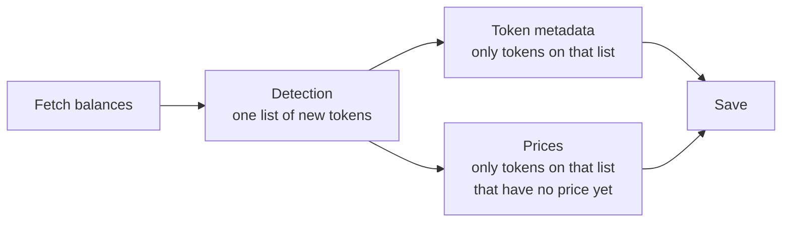
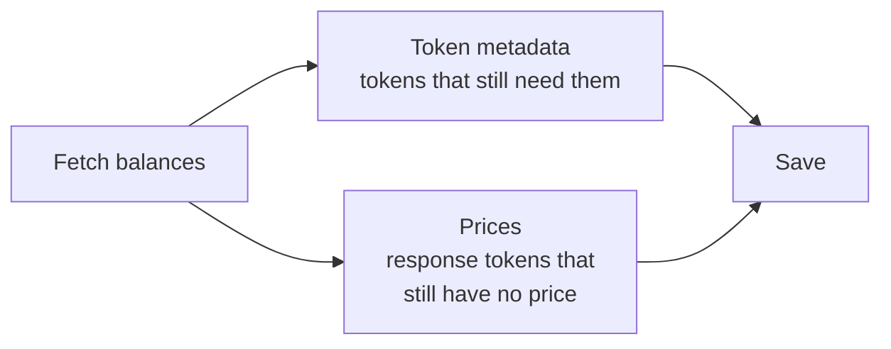
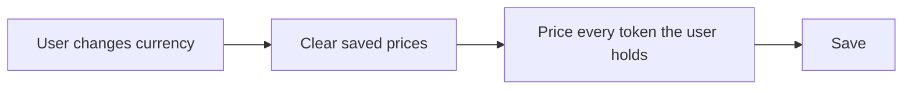

# How the wallet fetch and picks token metadata and prices

- Date: 2026-10-20
- Status: Accepted
- Package: `@metamask/assets-controller`

For each token, the wallet shows three things: how much the user holds, the
token's name and icon, and a fiat price. Different steps fetch those three
things. This note is about the name/icon step and the price step.

There used to be a step in between, called detection. It built one shared list
of "new" tokens, and both later steps could only work from that list. That
step is gone. The name/icon step and the price step now each decide which
tokens they need.

This is not the "token detection" setting. That setting still controls which
Ethereum tokens the wallet scans for. This note is only about what happens
after a balance has already been found.

## Words used below

| Word           | Meaning                                                                                                          |
| -------------- | ---------------------------------------------------------------------------------------------------------------- |
| Balance        | How much of a token an account holds.                                                                            |
| Token metadata | Symbol, name, decimals, and image.                                                                               |
| Price          | The token's value in the user's currency, such as USD.                                                           |
| Custom token   | A token the user added by hand. We keep it even if it looks unpopular.                                           |
| Hidden token   | A token the user chose to hide. We do not fetch it.                                                              |
| Native token   | The chain's own coin, such as ETH on Ethereum or BNB on BNB Chain.                                               |
| Spam           | A token that showed up in the wallet without the user asking for it, often an airdrop. We try not to show those. |

## What happens on a refresh

Balances are fetched first. Names, icons, and prices are filled in after that,
then saved together.

### Before

Detection ran after balances and built one list of new tokens. Names and prices
could only use that list. A token the user already held was left off, even when
it had no name or no price. Names and prices waited for the list, then ran
together.

### After

Detection is gone. Names and prices start as soon as balances are back, and
each one chooses its own tokens. Hidden tokens are skipped by both.

Changing the display currency does not fetch balances again. Saved prices are
cleared, then every token the user holds is priced in the new currency.

## Prices

A balance refresh fetches a price only for tokens on that response that the
wallet does not have a price for yet, on the accounts and chains this refresh
asked about.

A token that already has a price is left alone. The price poll updates those,
and it also prices held tokens, custom tokens, and tokens we already have
metadata for when this response did not include them. A caller that names
specific tokens uses `syncAssetsPrices`, which fetches them again even when a
price is already stored.

Hidden tokens are skipped. So are tokens that cannot have a market price, such
as staking placeholders and Tron bandwidth or energy. Tokens on a chain the
price service does not support are skipped too. If that service cannot be
reached, we still ask for the tokens we had, rather than pricing nothing.

A price the poll fetched in the last minute is not fetched again. Two polls
that need the same price share one request.

Changing the display currency is the exception. Those prices are in the wrong
currency, so the cache is cleared and every token the user holds is priced
again.

## Token metadata

A name and icon are fetched when we do not already have an image for the token.
That includes tokens the user already holds, and tokens that just arrived in
this refresh. Hidden tokens and staking placeholders are skipped. The chain's
own coin is always included, even when this refresh did not mention it.

A token the user already holds is filled in and kept. A token that just
appeared for the first time is checked so spam does not land in the wallet:

| Token                          | What we do                                                                                                       |
| ------------------------------ | ---------------------------------------------------------------------------------------------------------------- |
| The chain's own coin           | Always keep it                                                                                                   |
| A token the user added         | Always keep it                                                                                                   |
| mUSD                           | Always keep it                                                                                                   |
| A token the user already holds | Keep it, and fill in the missing name or icon                                                                    |
| A new Ethereum-style token     | Keep it only if enough other sources list it. The usual bar is 3. Unknown tokens are treated as spam and dropped |
| A new token on another chain   | Ask Blockaid, and drop it if that scan says it is malicious                                                      |

If the name-and-icon request fails, balances already fetched are left as they
are.

## Trade-offs

What we gain:

- A simpler pipeline. One step and one shared list are gone, so there are
  fewer places for a token to be dropped by mistake.
- The existing metadata-healing behavior is preserved. Tokens in balances
  that have no image remain candidates for name and icon fetching, without
  relying on a detection list.
- Each step can be tested on its own, because it picks its own tokens from
  state and the current balances.

What it costs:

- More calls to the token service. Held tokens that are missing a name or icon
  are asked for on every refresh. A token the service has no image for is asked
  for again each time. Prices are fetched only for tokens on this response that
  have no price yet. The one-minute price cache and the shared in-flight
  request limit repeat price calls, but do not remove them.
- The two steps each decide which accounts, chains, and hidden tokens count.
  That logic now lives in two places and has to be kept in line.

## If you call this package

| You used to                                           | Do this now                                                   |
| ----------------------------------------------------- | ------------------------------------------------------------- |
| Pass `assetsForPriceUpdate` into `getAssets`          | Call `AssetsController:syncAssetsPrices` with those token ids |
| Import `DetectionMiddleware`                          | Delete it. Names and prices are chosen on their own           |
| Pass `detectionMiddleware` when building a fetch lane | Stop passing it. The lane types no longer have that field     |

## Where to read the code

| Question                            | Start here                                                            |
| ----------------------------------- | --------------------------------------------------------------------- |
| Refresh prices for a list of tokens | `AssetsController:syncAssetsPrices`                                   |
| User changed currency               | `AssetsController.setSelectedCurrency`                                |
| Which tokens get a price            | `PriceDataSource`                                                     |
| Which tokens get token metadata     | `TokenDataSource`                                                     |
| Order of a refresh                  | `buildFastFetchSources`, `buildUpdateSources`, `buildWsUpdateSources` |
