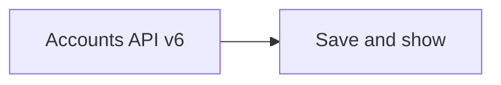
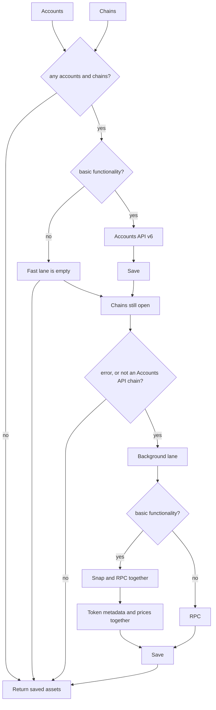
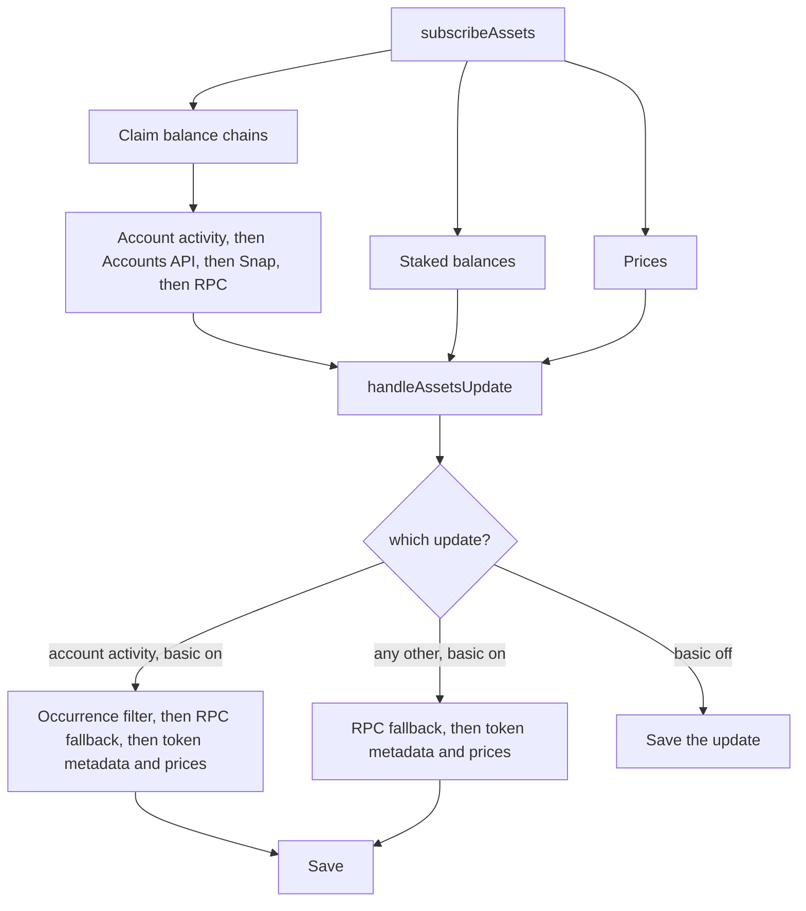

# The Accounts API v6 fast lane is one call

- Date: 2026-10-26
- Status: Accepted
- Package: `@metamask/assets-controller`

A forced refresh on the Accounts API v6 path runs a fast lane and then a
background lane. The fast lane is only the Accounts API v6 balances call. It
does not call the token service or the price service.

That is safe because a v6 balance row already has `symbol`, `name`, and
`decimals`, which is enough to show the token. Compared with current main,
the row adds `pricePercentChange1d`. That is the only extra field. The fast
lane saves that price with the balance and stops after Accounts API v6.

Chains the v6 call does not finish are retried on the background lane, which
still uses Snap, RPC, the token service, and prices. The snapshot below is
that refresh and the later subscribe path. The token-service step itself is
described in
[how the wallet fetches token metadata and prices](./2026-10-20-remove-detection-middleware.md).

## What the fast lane treats as complete

`getAssetIdsForMetadataFetch` decides whether a later step still needs the
token service.

| Field      | Required to skip the token service |
| ---------- | ---------------------------------- |
| `symbol`   | Yes, and it must be non-empty      |
| `name`     | Yes, and it must be non-empty      |
| `decimals` | Yes, and it must be `0` or more    |

`symbol` and `name` have to be non-empty strings. `decimals` has to be a
finite number greater than or equal to zero. The row's price is saved with
the balance, including `pricePercentChange1d` when the row has one.

## What still calls the token service

- The background lane, for a token that is still missing a symbol, a name, or
  decimals. A new Ethereum-style token from that answer is kept only when its
  occurrence count meets the chain's suggested floor. No count is treated as
  zero and the token is dropped. A token the user already holds is kept and
  filled in.
- Account-activity updates. `occurrenceFilterMiddleware` asks for occurrence
  counts for new Ethereum-style balances and drops the ones under the floor
  before metadata enrichment.

A token the v6 fast lane already saved with a symbol, a name, and decimals is
not sent to the token service again.

## High-level architecture snapshot

`getAssets` reads what is already saved. With `forceUpdate` it refreshes
first. `#subscribeAssets` keeps the selected accounts current after that.

### getAssets

No accounts, no chains, or no `forceUpdate`: return the saved assets.

With `forceUpdate`, the fast lane runs and is saved. Chains still open then
run the background lane, and the method returns after that lane saves.

The fast lane is the Accounts API v6 call when basic functionality is on, and
empty when it is off. The background lane takes a requested chain when that
chain is in `fastResponse.errors`, or when Accounts API does not list it as
active. With basic functionality on, that lane runs Snap and RPC together,
then the token service and prices together. With basic functionality off, it
runs RPC only.

`getAssets` returns on the `Return saved assets` arrows, after the background
lane when that lane runs.

### subscribeAssets

`#subscribeAssets` runs for the selected accounts and the enabled chains. It
starts balance updates, staked-balance updates, and price updates. Price
updates start only when basic functionality is on.

Balance chains are claimed once, in order: account activity, Accounts API,
Snap, then RPC. The first source that supports a chain keeps it. With basic
functionality off, only RPC is subscribed. Staked balances are a separate
subscription and do not take a chain away from those four.

Each of those updates is passed to `handleAssetsUpdate` before it is saved.
An account-activity update runs the occurrence filter, then RPC fallback,
then the token service and prices together. Any other update runs RPC
fallback, then the token service and prices together. With basic
functionality off, the update is saved as it arrived.

RPC fallback refetches a chain when that chain is in both `response.errors`
and `request.chainIds`. The Accounts API poll passes only the response into
`handleAssetsUpdate`, so this fallback has no request chain ids and leaves
those errors alone. A later `getAssets` with `forceUpdate` retries them on
the background lane.
