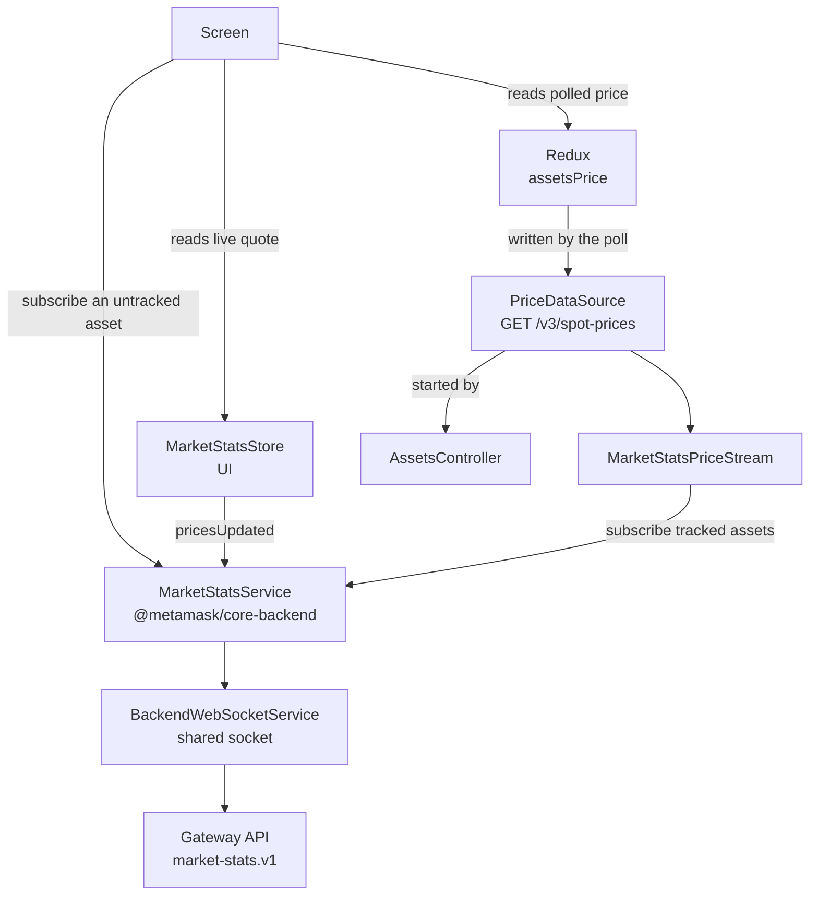
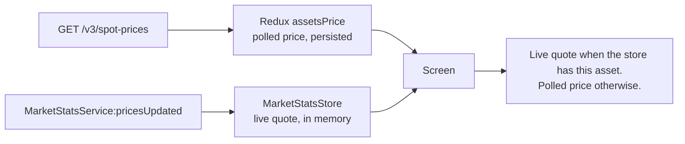
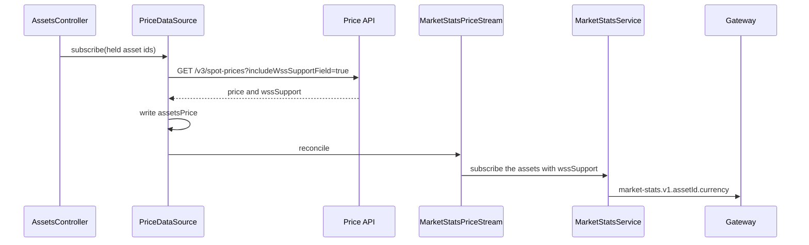
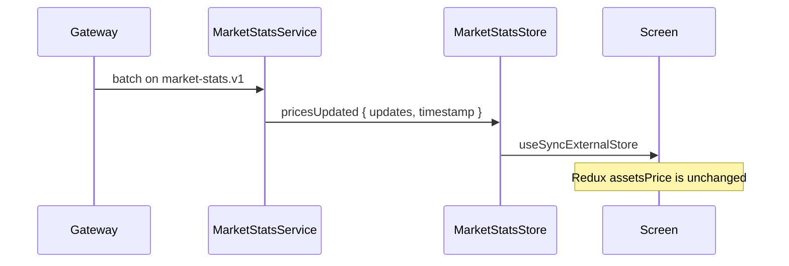
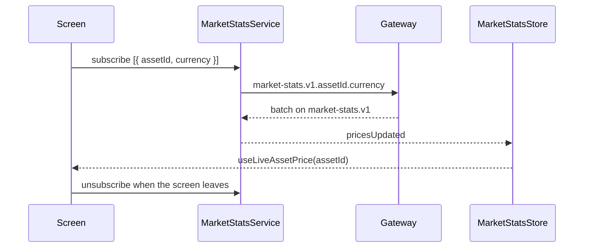

# Market stats

- Date: 2026-11-05
- Package: `@metamask/assets-controller`

How a live spot price gets from the WebSocket gateway to a screen.

The gateway sends price changes for channels the wallet has open. The wallet keeps two prices:

- **Redux** holds the polled price in `AssetsController` state (`assetsPrice`).
- **`MarketStatsStore`** holds the latest socket quote. It lives in the UI. A tick updates that store and leaves Redux alone.

A screen shows the live quote when the store has one for that asset. Otherwise it shows the polled price.

## Layers



| Layer                     | Package                       | Role                                                                                                                                                                                                                              |
| ------------------------- | ----------------------------- | --------------------------------------------------------------------------------------------------------------------------------------------------------------------------------------------------------------------------------- |
| Gateway API               | gateway-api                   | Holds one channel per asset and currency. Sends price changes as one batch on `market-stats.v1`, about every 30 seconds. Sends chain health on `system-notifications.v1.market-stats.v1`. A session can hold 200 channels.        |
| `BackendWebSocketService` | `@metamask/core-backend`      | The shared socket. `MarketStatsService` sends subscribe and unsubscribe frames through it.                                                                                                                                        |
| `MarketStatsService`      | `@metamask/core-backend`      | The list of open channels. `subscribe` / `unsubscribe` take `{ assetId, currency }`. Price batches are published as `MarketStatsService:pricesUpdated`. `Wallet` constructs this service. The first `subscribe` starts listening. |
| `PriceDataSource`         | `@metamask/assets-controller` | Polls `GET /v3/spot-prices` for assets the account tracks and writes `assetsPrice`, including `wssSupport`.                                                                                                                       |
| `MarketStatsPriceStream`  | `@metamask/assets-controller` | After each poll, opens channels for tracked assets whose price has `wssSupport: true`. Leaves every other tracked asset on the poll.                                                                                              |
| `AssetsController`        | `@metamask/assets-controller` | Starts that poll for balances and custom assets on the selected accounts and chains. Hidden assets stay out.                                                                                                                      |
| `MarketStatsStore`        | `@metamask/assets-controller` | The UI cache of live quotes. One currency. Keyed by CAIP-19 asset id.                                                                                                                                                             |
| Screen                    | Extension or Mobile           | Reads both stores. The homepage and the token list only read. A screen for an asset the account does not hold calls `subscribe` itself.                                                                                           |

`Wallet` registers `MarketStatsService` on the root messenger. The host registers `BackendWebSocketService` and its actions on that same messenger. `AssetsController` calls `MarketStatsService:subscribe`, `unsubscribe`, `getSubscriptions`, `getChainStatuses`, and listens to `chainStatusChanged`.

## The two prices a screen reads



|                    | Redux `assetsPrice`              | `MarketStatsStore`                                                        |
| ------------------ | -------------------------------- | ------------------------------------------------------------------------- |
| Written by         | `PriceDataSource`, on each poll  | `ingestPrices` on `pricesUpdated`                                         |
| Who it covers      | Assets `AssetsController` tracks | Every asset the session subscribed, tracked or not                        |
| Lifetime           | Controller state                 | Cleared on currency change. Quotes for a chain reported down are dropped. |
| How React reads it | `useSelector`                    | `useSyncExternalStore` through `useLiveAssetPrices`                       |

Extension: `ui/hooks/assets/market-stats-live-prices.ts`.
Mobile: `app/hooks/assets/market-stats-live-prices.ts`.
Both keep one `MarketStatsStore` for the app.

The token list calls `useLiveAssetPrices`, looks up the row with `readLiveQuote`, and replaces that row's fiat balance with `balance * livePrice` (`applyLiveTokenFiat`). The account total adds the same difference on top of the polled total (`liveFiatDelta`). Until the first tick, the row is the Redux price.

The asset page calls `useLiveAssetPrice`. Its price is the live quote, then the Redux price, then a one-shot spot-price fetch.

## Subscribing assets the account tracks

`AssetsController` does this. Screens that show the token list do not call `subscribe`.



The channel is `market-stats.v1.<caip-19 asset id>.<currency>`. Example: `market-stats.v1.eip155:1/slip44:60.usd`.

One reconcile sends the whole streamable list in one `subscribe` call. A channel that is already open is left as it is. An asset that left the tracked set is unsubscribed. A channel the gateway rejects stays closed, so the next poll retries it and the Price API keeps writing `assetsPrice` for that asset.

| Tracked asset                          | Channel                          | Price the screen shows                                                                          |
| -------------------------------------- | -------------------------------- | ----------------------------------------------------------------------------------------------- |
| `wssSupport: true`, channel open       | Open                             | Live quote after the first tick. Polled price until then.                                       |
| `wssSupport: false`                    | None                             | Polled price from Redux.                                                                        |
| Gateway rejected the subscribe         | None until a later poll opens it | Polled price from Redux.                                                                        |
| Chain reported down                    | Stays open                       | Polled price. The store drops that chain's quotes, and the poll runs again after a short delay. |
| `MarketStatsService` is not registered | None                             | Polled price for every tracked asset.                                                           |

The poll asks for `includeWssSupportField=true`. Without that flag the Price API omits `wssSupport`, and no channel opens.

## Receiving a quote

Subscribe and delivery use different channels. The wallet subscribes per asset. The gateway sends every change in one batch on `market-stats.v1`.



Each update has `assetId`, `currency`, `price`, and `pricePercentChange1d`. The store keeps updates in the selected currency and ignores the rest. A chain reported `down` removes that chain's quotes, so the screen falls back to Redux until a new tick arrives.

## Assets AssetsController does not track

Explore, search, and the asset page for a token with no balance row subscribe on `MarketStatsService` directly. `PriceDataSource` does not poll that asset, and nothing is written to `assetsPrice`.

The quote still arrives on `pricesUpdated` and lands in the same `MarketStatsStore`. The screen reads it with the same hooks.



One asset, from a screen:

```typescript
useWatchAssetPrice(assetId);
const price = useLiveAssetPrice(assetId);
```

`useWatchAssetPrice` calls `MarketStatsService:subscribe` on mount and `unsubscribe` on unmount, with the selected currency. A currency change closes the old pair and opens the new one.

The same calls without the hook:

```typescript
await messenger.call('MarketStatsService:subscribe', [
  { assetId, currency }, // CAIP-19, e.g. "usd"
]);

// on leave
await messenger.call('MarketStatsService:unsubscribe', [{ assetId, currency }]);
```

Read the quote from the store. `readLiveQuote` keys the id the same way the tick was stored.

```typescript
const live = readLiveQuote(useLiveAssetPrices(), assetId)?.price;
```

A list subscribes the visible ids once, from the screen. Subscribe the ids that were added and unsubscribe the ids that left. A per-row subscribe opens and closes channels as a virtualized row scrolls. Those channels share the gateway's 200-channel session limit with the tracked stream.

This path has no Price API fallback. The screen keeps its own last price until a tick arrives. The asset page still does a one-shot `GET /v3/spot-prices` when Redux has no price for that asset, then prefers the live quote once it exists.

Subscribing a channel that is already open leaves that channel as it is. It does not add a second hold. The screen's `unsubscribe` then closes it. If the asset is also in the tracked set, the next price-poll reconcile opens it again.
