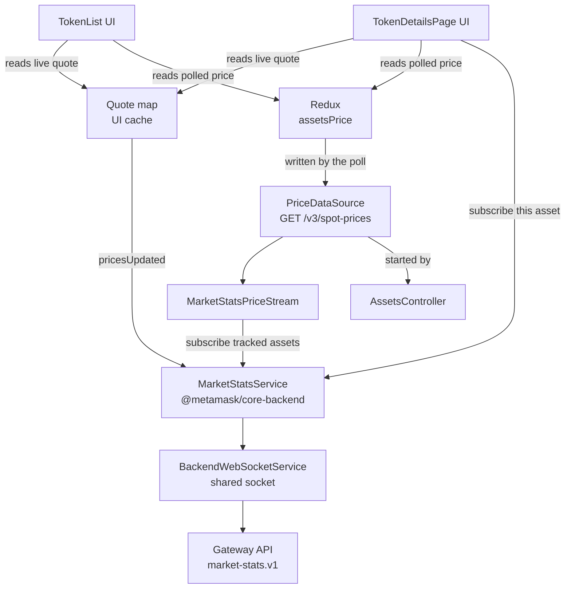
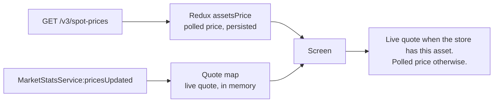
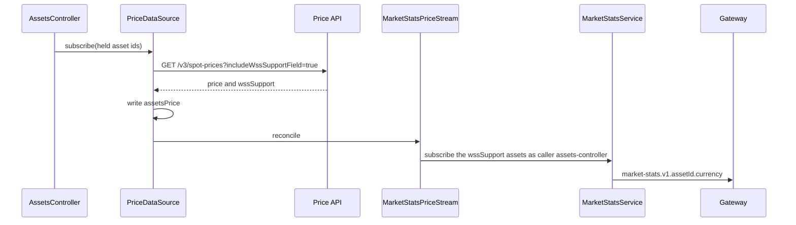
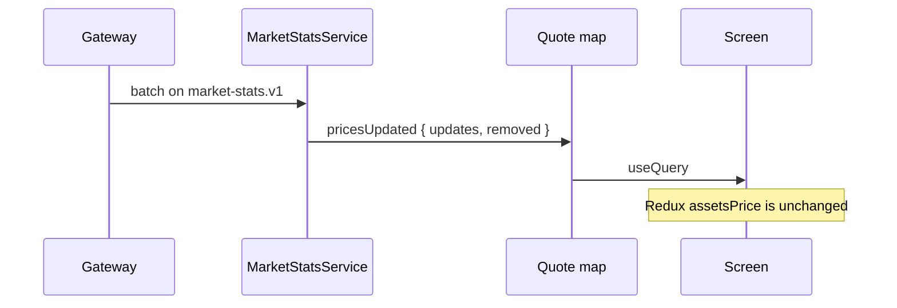

# Market stats

- Date: 2026-11-05
- Package: `@metamask/assets-controller`

How a live spot price gets from the WebSocket gateway to a screen.

The gateway sends price changes for channels the wallet has open. The wallet keeps two prices:

- **Redux** holds the polled price in `AssetsController` state (`assetsPrice`).
- **The UI quote map** holds the latest socket quote. The screen keeps it in its own cache. A tick updates that map and leaves Redux alone. `subscribeLiveQuotes` folds each tick in. The caller passes its messenger subscribe, because extension and mobile do not share one.

A screen shows the live quote when the map has one for that asset. Otherwise it shows the polled price.

## Layers



| Layer                     | Package                       | Role                                                                                                                                                                                                                                                                                                                                                                                                                            |
| ------------------------- | ----------------------------- | ------------------------------------------------------------------------------------------------------------------------------------------------------------------------------------------------------------------------------------------------------------------------------------------------------------------------------------------------------------------------------------------------------------------------------- |
| Gateway API               | gateway-api                   | Holds one channel per asset and currency. Sends price changes as one batch on `market-stats.v1`, about every 30 seconds. Sends chain health on `system-notifications.v1.market-stats.v1`. A session can hold 200 channels.                                                                                                                                                                                                      |
| `BackendWebSocketService` | `@metamask/core-backend`      | The shared socket. `MarketStatsService` sends subscribe and unsubscribe frames through it.                                                                                                                                                                                                                                                                                                                                      |
| `MarketStatsService`      | `@metamask/core-backend`      | The list of open channels and the callers on each. `subscribe` takes `{ assetId, currency }` or a list and a `caller` name, and replaces that caller's channels. `unsubscribe` removes the caller from the listed channels. The socket channel closes when the last caller leaves. Price batches are published as `MarketStatsService:pricesUpdated`. `Wallet` constructs this service. The first `subscribe` starts listening. |
| `PriceDataSource`         | `@metamask/assets-controller` | Polls `GET /v3/spot-prices` for assets the account tracks and writes `assetsPrice`, including `wssSupport`.                                                                                                                                                                                                                                                                                                                     |
| `MarketStatsPriceStream`  | `@metamask/assets-controller` | After each poll, and after a balance is written to state, opens channels for assets whose price has `wssSupport: true`. The poll still prices every tracked asset.                                                                                                                                                                                                                                                              |
| `AssetsController`        | `@metamask/assets-controller` | Starts that poll for balances and custom assets on the selected accounts and chains. Hidden assets stay out.                                                                                                                                                                                                                                                                                                                    |
| Quote map                 | Extension or Mobile           | The UI cache of live quotes, held in the screen's query cache. One currency. Keyed by CAIP-19 asset id. `applyMarketStatsPrices` writes a tick.                                                                                                                                                                                                                                                                                 |
| TokenList UI              | Extension or Mobile           | Reads both stores. It does not call `subscribe`. Tracked assets are opened by the price stream.                                                                                                                                                                                                                                                                                                                                 |
| TokenDetailsPage UI       | Extension or Mobile           | Reads both stores. It does not call `subscribe`. A token the account does not hold stays on the one-shot spot price.                                                                                                                                                                                                                                                                                                            |

`Wallet` registers `MarketStatsService` on the root messenger. The host registers `BackendWebSocketService` and its actions on that same messenger. `AssetsController` calls `MarketStatsService:subscribe`, `unsubscribe`, and `getSubscriptions`. The UI listens to `pricesUpdated`. An open channel does not remove the asset from the price poll.

## The two prices a screen reads



|                    | Redux `assetsPrice`              | Quote map                                                           |
| ------------------ | -------------------------------- | ------------------------------------------------------------------- |
| Written by         | `PriceDataSource`, on each poll  | `subscribeLiveQuotes` on `pricesUpdated`                            |
| Who it covers      | Assets `AssetsController` tracks | Every asset the session subscribed, tracked or not                  |
| Lifetime           | Controller state                 | One map per currency. Quotes for a chain reported down are dropped. |
| How React reads it | `useSelector`                    | `useQuery` through `useMarketStats`                                 |

The quote helpers (`subscribeLiveQuotes`, `readLiveQuotes`, `marketStatsAssetKey`, and the fiat helpers) live in `@metamask/core-backend`, next to `MarketStatsService`. `@metamask/assets-controller` re-exports them.

Extension: `ui/hooks/assets/marketstats.ts`.
Mobile: `app/hooks/assets/marketstats.ts`.
Each app keeps the quote map in its TanStack Query cache.

The token list calls `useMarketStats` with `readLiveQuotes` for the rows it shows, and replaces each row's fiat balance with `balance * livePrice` (`applyLiveTokenFiat`). The account total adds the same difference on top of the polled total (`liveFiatDelta`). Until the first tick, the row is the Redux price.

The asset page calls `useMarketStats` and reads that asset with `readLiveQuotes`. Its price is the live quote, then the Redux price, then a one-shot spot-price fetch.

## Subscribing assets the account tracks

`AssetsController` does this. Screens that show the token list do not call `subscribe`.



The channel is `market-stats.v1.<caip-19 asset id>.<currency>`. Example: `market-stats.v1.eip155:1/slip44:60.usd`.

Reconcile sends the streamable assets as the `assets-controller` caller, in one `subscribe` call. The service replaces that caller's channels, so a repeated list opens nothing new, and an asset that left the tracked set drops out. A channel another caller also holds stays open.

A channel the gateway refuses is not kept, so the next poll tries it again. The Price API keeps writing `assetsPrice` for that asset either way. A subscribe that fails because the socket is down stays in the local set and is sent when the socket connects.

A balance update reconciles after `AssetsController` writes the balance and its spot price into state, so a new holding does not wait for the next poll. The price poll still reconciles at the end of its own tick. A price-only write does not reconcile again.

| Tracked asset                          | Channel                          | Price the screen shows                                                                     |
| -------------------------------------- | -------------------------------- | ------------------------------------------------------------------------------------------ |
| `wssSupport: true`, channel open       | Open                             | Live quote after the first tick. The poll keeps writing `assetsPrice` for this asset.      |
| `wssSupport: false`                    | None                             | Polled price from Redux.                                                                   |
| Gateway rejected the subscribe         | None until a later poll opens it | Polled price from Redux.                                                                   |
| Chain reported down                    | Stays open                       | Polled price. The quote map drops that chain's quotes. The poll keeps its normal interval. |
| `MarketStatsService` is not registered | None                             | Polled price for every tracked asset.                                                      |

The poll asks for `includeWssSupportField=true`. Without that flag the Price API omits `wssSupport`, and no channel opens.

## Receiving a quote

Subscribe and delivery use different channels. The wallet subscribes per asset. The gateway sends every change in one batch on `market-stats.v1`.



Each update has `assetId`, `currency`, `price`, and `pricePercentChange1d`. `applyMarketStatsPrices` keeps updates in the selected currency and ignores the rest.

A closed channel, and each open channel on a chain reported down, uses the same event. The payload is `{ updates: [], removed: [{ assetId, currency }] }`. A channel closes when its last caller leaves or the gateway refuses it. A chain reported down does not close the channel; the next tick writes the quote again. A channel another caller still holds is not listed. `applyMarketStatsPrices` deletes those quotes. A later batch entry for a channel that is no longer open is ignored.

## Assets AssetsController does not track

`PriceDataSource` polls the assets the account tracks, and `MarketStatsPriceStream` opens those channels. A token with no balance row is not in that set, so nothing is written to `assetsPrice`.

The asset page subscribes the asset on screen as its own caller, including one the account does not hold, and unsubscribes that caller on leave. A channel the price poll also holds stays open. The page still does a one-shot `GET /v3/spot-prices` when Redux has no price for that asset. It reads the live quote from the same map:

```typescript
const [quote] = useMarketStats((quotes) => readLiveQuotes(quotes, [assetId]));
```

`readLiveQuotes` lowercases EVM addresses in each id, the same way the tick is stored. A screen with several assets passes that list. `shareMarketStatsData` keeps the previous list when a tick does not change any quote in it.
