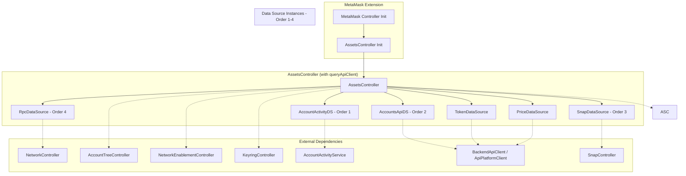
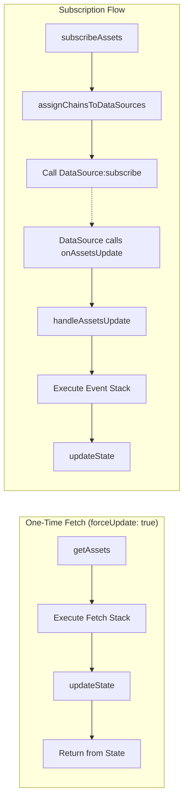

# AssetsController

## Overview

The `AssetsController` is a unified asset management system that provides real-time balance tracking across all blockchain networks (EVM and non-EVM) and all asset types (native tokens, ERC-20, NFTs, etc.). It follows a **middleware architecture**.

---

## Architecture

```
┌──────────────────────────────────────────────────────────────────────────────┐
│                              AssetsController                                │
├──────────────────────────────────────────────────────────────────────────────┤
│                                                                              │
│        Fetch Stack                          Event Stack                      │
│  ┌───────────────────┐               ┌───────────────────┐                   │
│  │    AccountsAPI    │               │                   │                   │
│  ├───────────────────┤               │                   │                   │
│  │       Snap        │               │                   │                   │
│  ├───────────────────┤               │                   │                   │
│  │       RPC         │               │                   │                   │
│  ├───────────────────┤               ├───────────────────┤                   │
│  │     Detection     │               │     Detection     │                   │
│  ├───────────────────┤               ├───────────────────┤                   │
│  │       Token       │               │       Token       │                   │
│  ├───────────────────┤               ├───────────────────┤                   │
│  │       Price       │               │       Price       │                   │
│  └───────────────────┘               └───────────────────┘                   │
│                                                                              │
│  On-demand data fetch                Process incoming updates                │
│  (forceUpdate: true)                 (enrichment only)                       │
│                                                                              │
│  Subscription Sources: AccountActivity, AccountsApi, Snap, RPC              │
│  Push updates via: onAssetsUpdate callback                                   │
└──────────────────────────────────────────────────────────────────────────────┘
```

---

## Lifecycle Stages

### 1. Initialization

When the `AssetsController` constructor is called, it performs the following steps **synchronously**:

#### 1.1 Base Controller Setup

```typescript
super({
  name: 'AssetsController',
  messenger,
  metadata: stateMetadata,
  state: { ...defaultState, ...providedState },
});
```

#### 1.2 Initialize Internal State

```typescript
initializeState()
├── enabledChains = extractEnabledChains(NetworkEnablementController.getState())
└── assetsPrice = {}  // In-memory price cache

// Note: selectedAccounts is a getter that calls AccountTreeController
get selectedAccounts(): InternalAccount[]
└── return messenger.call('AccountTreeController:getAccountsFromSelectedAccountGroup')
```

#### 1.3 Subscribe to External Events

| Event                                              | Handler                          | Purpose                                |
| -------------------------------------------------- | -------------------------------- | -------------------------------------- |
| `AccountTreeController:selectedAccountGroupChange` | `handleAccountGroupChanged()`    | Refresh when the user switches groups  |
| `AccountTreeController:initialized`                | `updateActive()`                 | Start tracking once the tree is built  |
| `AccountTreeController:uninitialized`              | `updateActive()`                 | Stop tracking when the tree is cleared |
| `NetworkEnablementController:stateChange`          | `handleEnabledNetworksChanged()` | Track enabled chains                   |
| `KeyringController:unlock`                         | `start()`                        | Start subscriptions                    |
| `KeyringController:lock`                           | `stop()`                         | Stop subscriptions                     |

#### 1.4 Register Action Handlers

```typescript
registerActionHandlers()
├── AssetsController:getAssets
├── AssetsController:getExchangeRatesForBridge
├── AssetsController:getStateForTransactionPay
├── AssetsController:addCustomAsset
└── AssetsController:setSelectedCurrency
```

#### 1.5 Balance data source priority

Built-in balance data sources are fixed and processed in priority order: AccountActivityDataSource, AccountsApiDataSource, SnapDataSource, RpcDataSource. Earlier sources get first pick for chain assignment; later sources act as fallbacks. Data sources report active chains via the `onActiveChainsUpdated` callback passed at construction.

#### 1.6 Middleware Chains

Middlewares are called inline rather than registered separately. Two different chains are used:

**Fetch Stack** (used in `getAssets` with `forceUpdate: true`):

```typescript
executeMiddlewares([
  AccountsApiDataSource:getAssetsMiddleware,  // Balance from API
  SnapDataSource:getAssetsMiddleware,         // Balance from Snaps
  RpcDataSource:getAssetsMiddleware,          // Balance from RPC
  TokenDataSource:getAssetsMiddleware,        // Metadata missing from state
  PriceDataSource:getAssetsMiddleware,        // Prices missing from state
])
```

**Event Stack** (used in `handleAssetsUpdate` for async updates):

```typescript
executeMiddlewares([
  TokenDataSource:getAssetsMiddleware,        // Metadata missing from state
  PriceDataSource:getAssetsMiddleware,        // Prices missing from state
])
```

**Order matters**: Middlewares are stacked with `reduceRight`. Token and Price run in parallel after balances. Each fetches only when its own state is missing the asset: metadata when `assetsInfo` has no image, prices when `assetsPrice` has no entry.

---

### 2. Start (Keyring Unlock)

When the keyring unlocks:

```
start()  // Called by KeyringController:unlock
│
├── subscribeAssets()
│   │
│   ├── subscribeAssetsBalance(selectedAccounts, enabledChains)
│   │   │
│   │   ├── Build chain → accounts mapping based on account scopes
│   │   ├── assignChainsToDataSources(enabledChains)  // Order-based assignment
│   │   │
│   │   └── For each dataSource (in registration order):
│   │       └── subscribeDataSource(sourceId, accounts, chains)
│   │           └── Call {sourceId}:subscribe via Messenger
│   │
│   └── subscribeAssetsPrice(selectedAccounts, enabledChains)
│       └── Call PriceDataSource:subscribe
│
└── getAssets(selectedAccounts, { chainIds: enabledChains, forceUpdate: true })
    │
    └── executeMiddlewares(Fetch Stack)
        ├── AccountsApiDataSource fetches balances from API
        ├── SnapDataSource handles solana:*, bip122:*...
        ├── RpcDataSource handles any remaining EVM chains
        ├── TokenDataSource fetches metadata missing from state
        └── PriceDataSource fetches prices missing from state
```

---

### 3. Runtime

#### 3.1 One-Time Fetch (Sync)

Used for initial load, force refresh, or on-demand queries:

```typescript
async getAssets(accounts, { chainIds, forceUpdate })
│
├── If forceUpdate:
│   ├── executeMiddlewares(middlewares, request)
│   └── updateState(response)
│
└── Return getAssetsFromState(accounts, chainIds)
```

#### 3.2 Async Subscriptions

Data sources push updates through the `onAssetsUpdate` callback passed when the controller subscribes. All data types (balance, metadata, price) flow through the same unified handler:

```
DataSource calls: onAssetsUpdate(response, sourceId)
│
└── handleAssetsUpdate(response, sourceId)
    │
    │   Response contains any combination of:
    │   ├── assetsBalance   - Balance updates
    │   ├── assetsInfo  - Metadata updates
    │   └── assetsPrice     - Price updates
    │
    ├── executeMiddlewares(Event Stack, request, response)
    │   ├── TokenDataSource - Fetches metadata missing from assetsInfo
    │   └── PriceDataSource - Fetches prices missing from assetsPrice
    │
    └── updateState(enrichedResponse)
        ├── Normalize asset IDs (checksum EVM addresses)
        ├── Merge into persisted state
        │   ├── assetsInfo[assetId] = metadata
        │   └── assetsBalance[accountId][assetId] = balance
        ├── Update in-memory price cache (assetsPrice)
        │
        └── Publish events:
            └── AssetsController:stateChange
```

#### 3.3 Chain Assignment Algorithm

```typescript
assignChainsToDataSources(requestedChains)
│
├── remainingChains = Set(requestedChains)
│
└── For each dataSource (in registration order):
    │
    ├── availableChains = dataSources.get(sourceId)
    │
    ├── chainsForThisSource = remainingChains ∩ availableChains
    │
    ├── remainingChains = remainingChains - chainsForThisSource
    │
    └── assignment.set(sourceId, chainsForThisSource)

Result: Earlier registered sources get first pick; later sources act as fallbacks
```

#### 3.4 Event Handlers

| Event                      | Action                                                  |
| -------------------------- | ------------------------------------------------------- |
| Account group changed      | Refresh subscriptions + fetch for new accounts          |
| Enabled networks changed   | Update subscriptions, fetch new chains, cleanup removed |
| Data source chains changed | Refresh subscriptions, fetch for newly available chains |
| App opened                 | Start subscriptions + initial fetch                     |
| App closed                 | Stop all subscriptions                                  |
| Keyring unlock             | Refresh subscriptions                                   |
| Keyring lock               | Unsubscribe all                                         |

---

### 4. Stop (Keyring Lock)

When the keyring locks:

```
stop()  // Called by KeyringController:lock
│
├── For each activeSubscription:
│   └── subscription.unsubscribe()
│
├── activeSubscriptions.clear()
│
└── unsubscribeAssetsPrice()
    └── Call PriceDataSource:unsubscribe
```

**Note**: State is preserved; only subscriptions are stopped to conserve resources.

---

### 5. Destroy (Cleanup)

When the controller is destroyed:

```
destroy()
│
├── Clear data sources
│   └── dataSources.clear()
│
├── Stop all active subscriptions
│   └── stop()
│
└── Unregister action handlers
    ├── AssetsController:getAssets
    ├── AssetsController:getExchangeRatesForBridge
    ├── AssetsController:getStateForTransactionPay
    ├── AssetsController:addCustomAsset
    └── AssetsController:setSelectedCurrency
```

---

## State Structure

### Persisted State

```typescript
{
  // Shared metadata (stored once per asset)
  assetsInfo: {
    "eip155:1/slip44:60": { type: "native", symbol: "ETH", ... },
    "eip155:1/erc20:0xA0b8...": { type: "erc20", symbol: "USDC", ... },
  },

  // Per-account balances
  assetsBalance: {
    "account-uuid-1": {
      "eip155:1/slip44:60": { amount: "1" },
      "eip155:1/erc20:0xA0b8...": { amount: "1" },
    },
    "account-uuid-2": { ... },
  },
}
```

---

## Public API

This section documents the public API available for **other controllers** (via Messenger) and **UI components** (via selectors/hooks).

---

### Messenger Actions

Other controllers can call these actions via the Messenger pattern:

#### `AssetsController:getState`

Returns the current persisted state.

```typescript
const state = messenger.call('AssetsController:getState');
// Returns: AssetsControllerState
```

**Return Type:**

```typescript
interface AssetsControllerState {
  assetsInfo: { [assetId: string]: AssetMetadata };
  assetsBalance: { [accountId: string]: { [assetId: string]: AssetBalance } };
}
```

---

#### `AssetsController:getAssets`

Get complete asset data including balance, metadata, and price with computed fiat value.

```typescript
const assets = await messenger.call(
  'AssetsController:getAssets',
  accounts,      // InternalAccount[]
  options?       // GetAssetsOptions
);
```

**Parameters:**

| Parameter             | Type                | Required | Description                                             |
| --------------------- | ------------------- | -------- | ------------------------------------------------------- |
| `accounts`            | `InternalAccount[]` | Yes      | Accounts to fetch assets for                            |
| `options.chainIds`    | `ChainId[]`         | No       | Filter by chains (default: all enabled chains)          |
| `options.assetTypes`  | `AssetType[]`       | No       | `'fungible'` \| `'nft'` (default: `['fungible']`)       |
| `options.forceUpdate` | `boolean`           | No       | Force fresh fetch from data sources                     |
| `options.dataTypes`   | `DataType[]`        | No       | `'balance'` \| `'metadata'` \| `'price'` (default: all) |

**Return Type:**

```typescript
Record<AccountId, Record<Caip19AssetId, Asset>>;

interface Asset {
  id: Caip19AssetId; // "eip155:1/erc20:0xA0b8..."
  chainId: ChainId; // "eip155:1"
  balance: AssetBalance; // { amount: "1.5" } (human-readable format)
  metadata: AssetMetadata; // { type, symbol, name, decimals, image, ... }
  price: AssetPrice; // { price: 2500, priceChange24h: 2.5, ... }
  fiatValue: number; // Computed: balance.amount * price
}
```

**Example:**

```typescript
// Get all fungible assets for selected accounts on Ethereum mainnet
const assets = await messenger.call('AssetsController:getAssets', accounts, {
  chainIds: ['eip155:1'],
  assetTypes: ['fungible'],
  forceUpdate: true,
});

// Access ETH balance for first account
const ethAsset = assets[accounts[0].id]['eip155:1/slip44:60'];
console.log(`ETH Balance: ${ethAsset.fiatValue} USD`);
```

---

#### `AssetsController:activeChainsUpdate`

Called by data sources to report when their active chains change.

```typescript
messenger.call(
  'AssetsController:activeChainsUpdate',
  dataSourceId, // string - The data source identifier
  activeChains, // ChainId[] - Currently active chains for this source
);
```

**Example:**

```typescript
// Data source reports its active chains
messenger.call(
  'AssetsController:activeChainsUpdate',
  'AccountActivityDataSource',
  ['eip155:1', 'eip155:137', 'eip155:42161'],
);
```

---

### Published Events

Subscribe to these events for real-time updates.

#### `AssetsController:stateChange`

Emitted on any state change.

```typescript
messenger.subscribe('AssetsController:stateChange', (state) => {
  console.log('State updated:', state);
});
```

**Payload:**

```typescript
{
  assetsInfo: { [assetId: string]: AssetMetadata };
  assetsBalance: { [accountId: string]: { [assetId: string]: AssetBalance } };
}
```

---

### Type Definitions

#### Identifier Types

```typescript
// CAIP-19 asset identifier
// Format: "{chainId}/{assetNamespace}:{assetReference}"
type Caip19AssetId = string;
// Examples:
// - Native ETH: "eip155:1/slip44:60"
// - USDC on Ethereum: "eip155:1/erc20:0xA0b86991c6218b36c1d19D4a2e9Eb0cE3606eB48"
// - SOL: "solana:5eykt4UsFv8P8NJdTREpY1vzqKqZKvdp/slip44:501"
// - SPL Token: "solana:5eykt4UsFv8P8NJdTREpY1vzqKqZKvdp/token:EPjFWdd5..."

// CAIP-2 chain identifier
type ChainId = string;
// Examples: "eip155:1", "eip155:137", "solana:5eykt4UsFv8P8NJdTREpY1vzqKqZKvdp"

// Account UUID (from AccountsController, NOT the blockchain address)
type AccountId = string;
// Example: "c3c7f9a2-8b1d-4e5f-9a2c-1b3d4e5f6a7b"
```

#### Asset Types

```typescript
// Asset type for filtering
type AssetType = 'fungible' | 'nft' | 'collectible';

// Data types for selective fetching
type DataType = 'balance' | 'metadata' | 'price';
```

---

### Usage Examples

#### For Other Controllers

```typescript
// In another controller that needs asset data
class MyController {
  constructor({ messenger }) {
    this.messenger = messenger;
  }

  async getAccountValue(account: InternalAccount): Promise<number> {
    const assets = await this.messenger.call(
      'AssetsController:getAssets',
      [account],
      { assetTypes: ['fungible'] },
    );

    // Sum all fiat values
    return Object.values(assets[account.id]).reduce(
      (total, asset) => total + asset.fiatValue,
      0,
    );
  }
}
```

#### For UI Components (React)

```typescript
// Selector for getting assets from Redux state
export const selectAssetsForAccount = (state, accountId) => {
  const { assetsInfo, assetsBalance } = state.AssetsController;
  const { assetsPrice } = state; // In-memory prices from a separate slice

  const accountBalances = assetsBalance[accountId] || {};

  return Object.entries(accountBalances).map(([assetId, balance]) => {
    const metadata = assetsInfo[assetId];
    const price = assetsPrice[assetId] || { price: 0 };

    // balance.amount is already in human-readable format (e.g., "1.5" for 1.5 ETH)
    const fiatValue = parseFloat(balance.amount) * price.price;

    return {
      id: assetId,
      balance,
      metadata,
      price,
      fiatValue,
    };
  });
};
```

#### Force Refresh Pattern

```typescript
// Pull-to-refresh handler
async function handleRefresh(accounts) {
  await messenger.call('AssetsController:getAssets', accounts, {
    forceUpdate: true,
    dataTypes: ['balance', 'metadata', 'price'],
  });
}
```

#### Filtering by Chain

```typescript
// Get only Polygon assets
const polygonAssets = await messenger.call(
  'AssetsController:getAssets',
  accounts,
  {
    chainIds: ['eip155:137'],
  },
);

// Get assets across multiple chains
const multiChainAssets = await messenger.call(
  'AssetsController:getAssets',
  accounts,
  {
    chainIds: ['eip155:1', 'eip155:137', 'eip155:42161'],
  },
);
```

---

## Data Source Order

### Primary Data Sources (Balance Providers)

| Order | Data Source               | Update Mechanism         | Chains                |
| ----- | ------------------------- | ------------------------ | --------------------- |
| 1     | AccountActivityDataSource | Real-time WebSocket push | API-supported EVM     |
| 2     | AccountsApiDataSource     | HTTP polling             | API-supported chains  |
| 3     | SnapDataSource            | Snap keyring events      | Solana, Bitcoin, Tron |
| 4     | RpcDataSource             | Direct RPC polling       | Any EVM chain         |

**Fallback behavior**: Data sources are processed in registration order. Earlier sources get first pick for chain assignment; later sources handle remaining chains.

### Middlewares (Enrichment)

These middlewares process responses after primary data sources fetch balance data:

| Middleware      | Purpose                                    | When It Runs        |
| --------------- | ------------------------------------------ | ------------------- |
| TokenDataSource | Fetches metadata missing from `assetsInfo` | After balance fetch |
| PriceDataSource | Fetches prices missing from `assetsPrice`  | After balance fetch |

All middlewares are part of the unified `subscribeAssets` flow—there are no separate subscription mechanisms.

---

## Diagrams

### Initialization & Dependencies



### Runtime Data Flow



---

## Quick Start

### Initialization (Extension/Mobile)

```typescript
import { AssetsController } from '@metamask/assets-controller';

const assetsController = new AssetsController({
  messenger: controllerMessenger,
  queryApiClient,
  subscribeToBasicFunctionalityChange: (onChange) => {
    // Extension: subscribe to PreferencesController:stateChange, call onChange(useExternalServices ?? true).
    // Mobile: subscribe to your app's basic-functionality setting and call onChange(isBasic).
  },
  state: existingState, // Optional: restore persisted state
  defaultUpdateInterval: 30_000, // Optional: polling hint (30s default)
});
```

### Basic Usage (Controllers)

```typescript
// Get all assets with fiat values
const assets = await messenger.call('AssetsController:getAssets', accounts, {
  forceUpdate: true,
});

// Get state directly
const state = messenger.call('AssetsController:getState');
```

### Cleanup

```typescript
assetsController.destroy();
```
