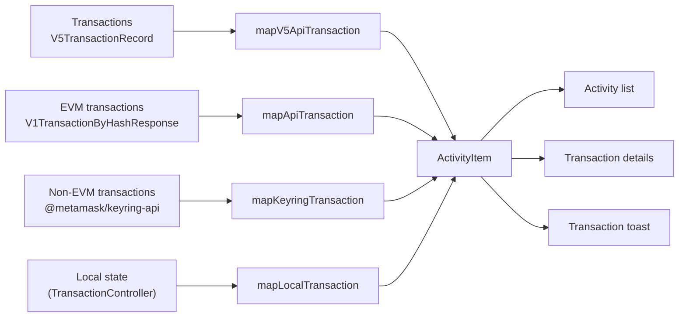

# Activity Mappers

These mappers normalize different shapes from various data sources, currently:

- EVM transactions from the Metamask Account Transactions REST endpoint
- Non-EVM transactions
- Local transaction state

Each mapper is a pure function that returns the shared `ActivityItem` shape consumed by MetaMask clients (extension and mobile) for activity lists and transaction details.

Ultimately, the goal is for the MetaMask API to provide both EVM and non-EVM data in a shape closer to what the UI needs. Until then, we adapt these different data sources.

> ### A note on local transaction mapping
>
> Mapping local transaction state is only meant to support rendering while a transaction is pending and has not been indexed by the API, or in special cases where we want to enrich the UI with local-only data.
>
> Do **not** rely on it for primary rendering. Activity opened on another instance will not be consistent, since that instance will not have the local-only state.

---

## Table of contents

- [Architecture](#architecture)
- [Mappers](#mappers)
  - [EVM transactions: API mapper](#evm-transactions-api-mapper)
  - [Non-EVM transactions: keyring mapper](#non-evm-transactions-keyring-mapper)
  - [Local state: TransactionController mapper](#local-state-transactioncontroller-mapper)
- [Where mappers are used](#where-mappers-are-used)
- [Adding a new activity type](#adding-a-new-activity-type)
- [Adding a new mapper / data source](#adding-a-new-mapper--data-source)

---

## Architecture

1. **Single output type** — every mapper returns `ActivityItem`
2. **Pure functions** — mappers do not touch Redux or client stores. Clients fetch state before calling these functions

---

## Mappers

### EVM transactions: API mapper

File: `api-transaction-mapper.ts`

Input: `V1TransactionByHashResponse` from `@metamask/core-backend`

The Accounts API classifies each transaction with a `transactionCategory`. The mapper further classifies and maps each item to the UI-facing activity kind.

Notes:

- Backend API improvements are ongoing
- Native tokens and network fees include slip44 `assetId` when a symbol is available (for example from an indexed native value transfer)
- When no symbol is available, mappers still set `assetType: 'native'` but omit `assetId` — clients should resolve icons from chain metadata
- Fungible `TokenAmount.amount` values are raw base units and are **omitted** when decimals are unknown (Accounts API enrichment missing). Pass optional `getKnownTokenDecimals(chainId, contractAddress)` to recover decimals/symbol from on-device token state. NFT amounts are counts and are never fail-closed.

#### V5 records: `mapV5ApiTransaction`

Input: `V5TransactionRecord` from `@metamask/core-backend` (`GET /v5/multiaccount/transactions`)

Both mappers adapt their input into one internal shape (`helpers/indexed-transaction.ts`) and share the same classification, so the same transaction maps to the same `ActivityItem` from either endpoint. Differences in the input:

- The subject account comes from the record's CAIP-10 `accountId`, so there is no `subjectAddress` option
- `assetClass` + the CAIP-19 `assetId` namespace replace `transferType` (`eip155Internal` → `internal`, `slip44` → `normal`, `erc20`/`erc721`/`erc1155` as-is). EVM token addresses are read from the `assetId` reference
- Network fees come from the record's `fee` instead of `gasUsed × effectiveGasPrice`
- `tx.status` maps `confirmed` → `success`, `failed` → `failed`, anything else → `pending`
- Request with `includeTxMetadata: true`; without it the API omits `transactionCategory` and most items map to `contractInteraction`
- Non-EVM records keep the API `assetId` on token amounts

---

### Non-EVM transactions: keyring mapper

File: `keyring-transaction-mapper.ts`

Input: `Transaction` from `@metamask/keyring-api`

Notes:

The mapper is chain-agnostic. Clients should patch missing / `UNKNOWN` asset units from `AssetsController` (or equivalent) metadata before calling it when needed.

---

### Local state: TransactionController mapper

File: `local-transaction-mapper.ts`

Input: a `TransactionGroup` from `helpers/transactions.ts` — the shape the EVM `TransactionController` produces after grouping by nonce (`initialTransaction`, `primaryTransaction`, plus cancel/retry siblings), optionally enriched by the client (`sourceToken`, `destinationToken`, fees, `contractTokenMetadata`, `getKnownTokenDecimals`, etc.)

This mapper only classifies `ActivityKind`. It is a stand-in until the indexed API picks up the transaction; clients should defer accurate token/amount/asset details to the API mapper on refetch.

ERC-20 amounts follow the same fail-closed rule as the API mapper: omit `amount` unless decimals are known, and stamp `assetType: 'erc20'` on contract token legs.

---

## Adding a new activity type

1. **Define the kind** in [`../types.ts`](../types.ts): add the literal to `ActivityKind`, add a matching `ActivityData<…>` variant with that kind's fields.
2. **Emit it** from one or more mappers.
3. **Render it** in each client’s activity row / details templates.

---

## Adding a new mapper / data source

Use a new mapper when a source has its own data model and can't be reasonably squeezed through one of the three existing mappers.

1. Create a mapper file with a pure function returning a single `ActivityItem`.
2. Export it from [`../index.ts`](../index.ts).
3. Wire the client to read the data source and call the mapper once per item, then include the result in the client's activity list dedupe path.
4. Update this README.
