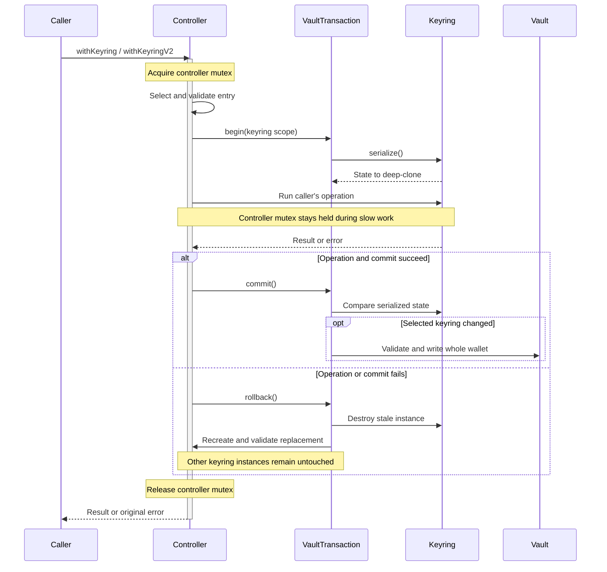
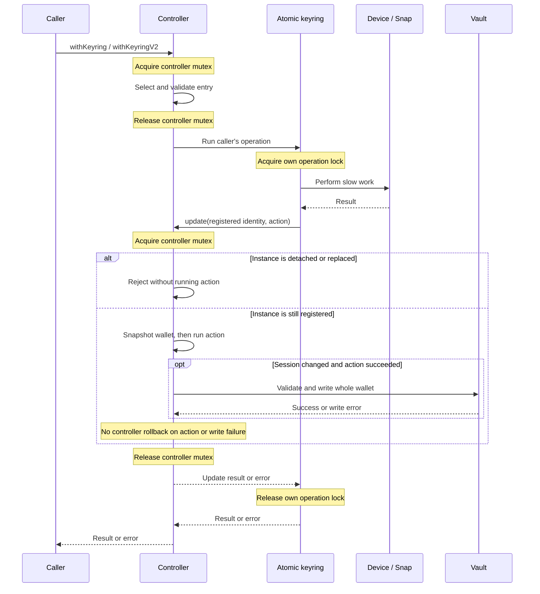

# Vault transactions and atomic keyrings

For normal keyrings, the controller serializes operations and restores state after a failure.
Atomic keyrings manage their own concurrency. They acquire the controller mutex only
when selecting a keyring or committing state, so slow work does not block unrelated operations.

**Scope:** this document describes the combined PR stack. [#11119](https://github.com/MetaMask/core/pull/11119)
introduces `VaultTransaction`. Later PRs move rollback and commit logic into it,
then add atomic keyrings and diagnostics. Those sections describe the intended design
after the full stack lands, not behavior already available in #11119.

## Transaction scopes

A transaction defines an in-memory restore point and persistence policy. It cannot
undo remote side effects.

| Scope     | Snapshot                                                      | Commit                                                           | Rollback                                                        |
| --------- | ------------------------------------------------------------- | ---------------------------------------------------------------- | --------------------------------------------------------------- |
| `keyring` | The selected normal keyring, unless it is new                 | Write if the selected keyring changed, was added, or was removed | Rebuild the existing keyring, or destroy and remove the new one |
| `wallet`  | All keyrings, unsupported keyrings, and cached encryption key | Follow the operation's persistence policy                        | Reconcile the wallet against its snapshot                       |
| `atomic`  | None                                                          | Persist a new keyring's registration only                        | Restore nothing                                                 |

**A transaction scoped to one keyring still writes the whole vault.** The scope
limits which keyrings are compared and restored, not which keyrings are persisted.
Writing the vault still validates, serializes, and encrypts the whole wallet.

Wallet persistence policies can write on change, force a write, skip it, or use an
operation-specific condition. The controller checks for changes only if the policy needs that information.

## Normal keyring flow

`withKeyring` and `withKeyringV2` share this path. Callbacks must mutate **only the
keyring that they receive**. The transaction does not track or restore changes to other keyrings.

The diagram shows an existing keyring. If setup or snapshotting fails, the controller
returns the error without attempting rollback.

After a successful operation, the controller keeps the same instances. There is one
exception: if a non-primary keyring loses its last account, the controller removes
and destroys it.

### Rollback rules

| Concern                    | Rule                                                                                                                                                                      |
| -------------------------- | ------------------------------------------------------------------------------------------------------------------------------------------------------------------------- |
| Failure within one keyring | Always rebuild the existing keyring on which the operation ran, even if its serialized data is unchanged. This resets runtime-only state and detaches the stale instance. |
| Wallet failure             | Keep unchanged instances. Rebuild changed, removed, or destroyed entries. Restore cached credentials and unsupported keyrings.                                            |
| Shared resources           | Destroy any instances that the failed transaction created before recreating wallet keyrings. Destroy each stale instance before creating its replacement.                 |
| Partial destruction        | Treat the instance as destroyed even if `destroy()` throws.                                                                                                               |
| Duplicate accounts         | When restoring one keyring, check its replacement against all remaining keyrings. When restoring the wallet, check against the keyrings already reconciled.               |
| Failed replacement         | Destroy any replacement that fails validation. If recreation or validation fails, keep the serialized snapshot in the unsupported-keyring list.                           |
| Error handling             | Log errors during cleanup or recreation without replacing the original operation error. Do not retry keyrings already marked as unsupported.                              |

The controller deep-clones serialized data because `serialize()` may return references
to live state. During rollback, it identifies entries by object identity rather than
metadata ID. This prevents duplicate IDs from causing it to restore the wrong instance.
Changing unrelated keyrings through cached references or deprecated getters remains
outside the transaction contract.

## Atomic keyring flow

A builder declares `atomic: true` to receive `KeyringBuilderContext.update`.
The instance that it returns must carry the SDK's `AtomicKeyring` brand. Legacy
builders still receive zero arguments. To choose the execution path, the controller
checks the registered underlying keyring, not its V2 adapter.

The diagram shows an operation that changes an existing atomic keyring. Read-only
operations do not need to call `update`. With `createIfMissing`, the controller
persists the new keyring's registration before running the operation.

The operation runs without the controller mutex so that `update` can acquire it.
The mutex is not reentrant: holding it while awaiting `update` would deadlock.
After an atomic operation, the controller does not automatically remove an empty keyring.

### Commit contract

- **Identity:** after acquiring the mutex, the controller checks that the exact
  instance is still registered. It rejects queued updates for a detached or replaced
  keyring. Adapters must pass the identity of the instance registered with the controller.
- **Cost:** while holding the mutex, the controller takes a wallet snapshot and runs
  the mutation action. If state changed, it validates, serializes, and encrypts the
  wallet. Keep remote work outside the action.
- **No rollback:** a successful commit remains in place even if the operation later
  fails. If the action throws, any partial changes remain in memory, but that update
  does not write the vault. If writing the vault fails, the changes also remain in
  memory. In both cases, the keyring must handle recovery.
- **Lock order:** serialization must safely return committed state. It must not wait
  for a lock held by an operation that is itself waiting for `update`. Otherwise,
  neither the controller nor the keyring can proceed.
- **Unsafe access:** the unsafe APIs for read-only access do not acquire the controller
  mutex. They must never be used to change state instead of calling `update`.

## Diagnostics

Enable `DEBUG=metamask:keyring-controller*` to include both namespaces.

| Namespace                           | Measures                                                                                                                     |
| ----------------------------------- | ---------------------------------------------------------------------------------------------------------------------------- |
| `metamask:keyring-controller`       | Atomic operation `durationMs`, including remote work and internal lock waits                                                 |
| `metamask:keyring-controller:locks` | Controller/vault mutex `waitMs`, `holdMs`, and `totalMs`. `atomicUpdate` measures the commit window, not the full operation. |

Logs include correlation IDs and metadata for the selected keyring. Access kind
(`v1`, `v2`, or `commit`) identifies the access path, not whether the keyring is atomic. Arguments, results, and
errors are omitted to avoid exposing secrets. Diagnostics arrive in #11267.

## PR map and code

| PR                                                    | Contribution                                             |
| ----------------------------------------------------- | -------------------------------------------------------- |
| [#10407](https://github.com/MetaMask/core/pull/10407) | Granular rollback and single-keyring snapshot/diff scope |
| [#11119](https://github.com/MetaMask/core/pull/11119) | Internal `VaultTransaction` abstraction                  |
| [#11127](https://github.com/MetaMask/core/pull/11127) | Transaction-owned rollback                               |
| [#11139](https://github.com/MetaMask/core/pull/11139) | Transaction-owned commit and persistence policies        |
| [#11164](https://github.com/MetaMask/core/pull/11164) | Destroy leftovers before recreation                      |
| [#11707](https://github.com/MetaMask/core/pull/11707) | Validate replacements and clean up rejected instances    |
| [#11241](https://github.com/MetaMask/core/pull/11241) | Atomic builders, unlocked dispatch, and update commits   |
| [#11267](https://github.com/MetaMask/core/pull/11267) | Mutex and atomic-operation timing logs                   |

- [`KeyringController.ts`](../src/KeyringController.ts): dispatch, transaction
  boundaries, builder injection, and atomic updates.
- [`VaultTransaction.ts`](../src/VaultTransaction.ts): snapshots, rollback, and commit policies.
- Regression coverage: [`VaultTransaction.test.ts`](../src/VaultTransaction.test.ts)
  and [`KeyringController.test.ts`](../src/KeyringController.test.ts).
