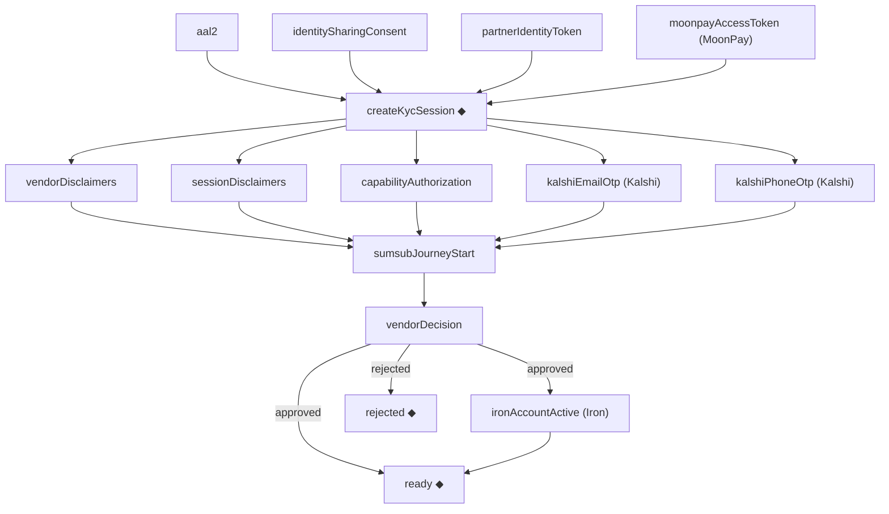
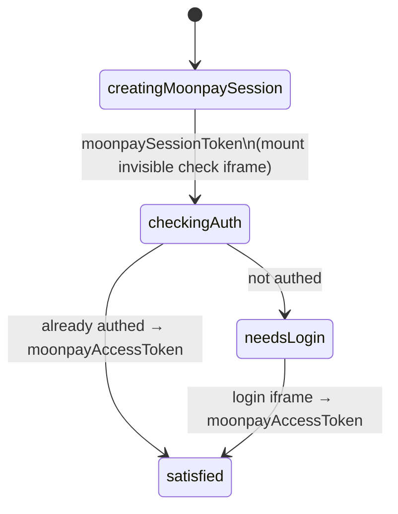
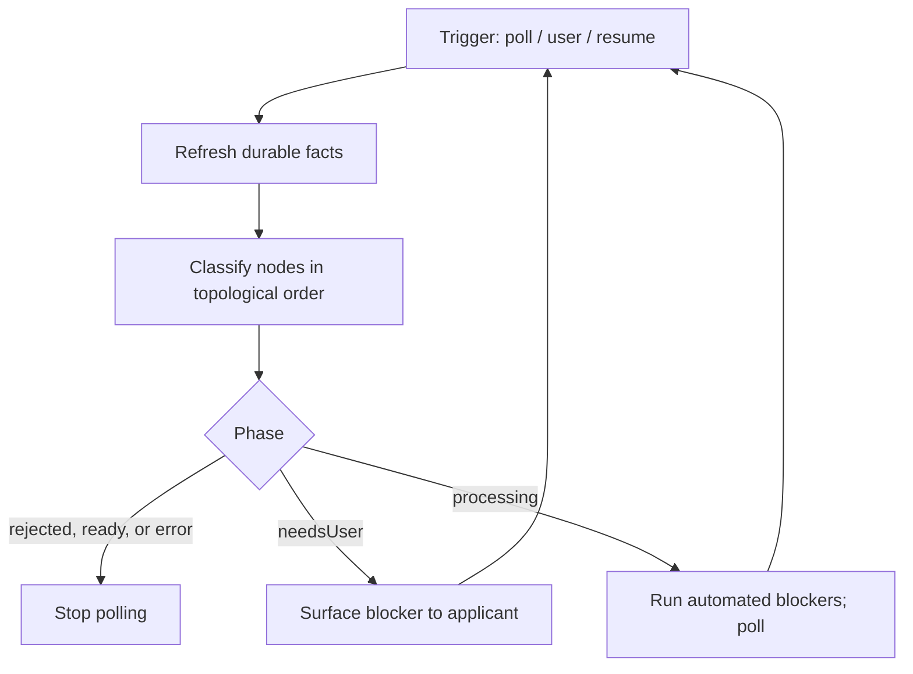

# Multi-vendor KYC flow architecture

Target architecture for generalizing `@metamask/kyc-controller` across multiple
identity vendors (Iron, MoonPay, Kalshi, and future vendors) without growing a
single shared phase enum per vendor quirk.

This document describes the **intended** model. The current package still
centers on a linear `KycPhase` machine plus vendor-specific branches; see
[`ARCHITECTURE.md`](../ARCHITECTURE.md) for the as-shipped MoonPay / Iron
implementation.

---

## 1. Goals

| Goal                                    | Meaning                                                                                                                                                                                                                                             |
| --------------------------------------- | --------------------------------------------------------------------------------------------------------------------------------------------------------------------------------------------------------------------------------------------------- |
| Vendor-neutral consumer surface         | Clients drive initialize / resume / SumSub presentation without vendor-branded public APIs.                                                                                                                                                         |
| Cheap vendor deltas                     | A new vendor is the shared requirement graph plus a few vendor-only nodes, plus any truly nested UX (e.g. MoonPay iframes).                                                                                                                         |
| Dependencies as data                    | Requirements and their dependencies form a directed acyclic graph (DAG). When a requirement starts and stops mattering is derived from the graph, not configured per requirement.                                                                   |
| Backend-authoritative resume            | After backgrounding, process death, or clean reinstall, the client rediscovers truth from kyc-api and remints local secrets.                                                                                                                        |
| Rewind without a rewind graph           | Requirements that become unsatisfied again are handled by recomputing satisfaction — not by encoding “jump back to gate X.”                                                                                                                         |
| Requirements retire at durable outcomes | Once a lasting backend outcome exists below a requirement in the graph, the requirement’s inputs may expire or change without forcing a rewind (e.g. aal2 after session creation; capability authorization once the flow is `ready` or `rejected`). |
| Independent post-session work           | Vendor disclaimers, session disclaimers, and capability authorization have no edges between them, so they are independently checkable and may become unsatisfied again until the flow is `ready` or `rejected`.                                     |
| Vendor work after approval              | A vendor may need more than an approved KYC session before the customer can use it (Iron: the account must be `Active`). Consumers key off a derived `ready` phase, not `finalStatus: approved`.                                                    |

---

## 2. Why not one flat state machine per stage

A shared enum of every vendor stage (`check`, `auth`, Kalshi email OTP, phone
OTP, Iron account activation, …) forces every client to special-case states it
will never see and makes illegal transitions / resume / expiry hard to test.

| Approach                                        | Fits when                                                                                                          | Fails when                                                                           |
| ----------------------------------------------- | ------------------------------------------------------------------------------------------------------------------ | ------------------------------------------------------------------------------------ |
| Flat shared `KycPhase`                          | One mostly linear vendor                                                                                           | Multiple vendors with different optional stages                                      |
| Per-vendor state machines                       | Vendors share little structure                                                                                     | Iron / MoonPay / Kalshi are “same spine + small deltas”                              |
| Ordered gate pipeline only                      | Strict once-through order                                                                                          | Disclaimers / capability are independent and can flip false again                    |
| Requirement set with hand-written scope windows | Few requirements, stable boundaries                                                                                | Windows and guards drift out of sync with the real dependencies as vendors are added |
| **Requirement DAG + recompute** (this doc)      | Shared spine, optional requirements, resume, rewind, requirements that stop or start mattering at backend outcomes | Nested client UX still needs a small private sub-flow (MoonPay)                      |

A coarse **derived** UI phase (`idle` / `needsUser` / `processing` / `ready` /
`rejected`) is still useful. Vendor-specific stages live inside requirements
(or nested sub-flows), not on the public phase type.

When only one requirement is false, “jump to X then walk forward” and
“recompute; do whatever is false” look the same to the user. They diverge when
multiple requirements fail, when fixing one must not replay still-valid work,
or when another requirement flips while the user is fixing the first. Resume
after restart is the strongest reason to prefer recompute: the backend may have
moved without any local cursor update.

The graph does not replace recompute. It is the dependency data the evaluate
loop reads on every evaluation, not a path the client walks with a saved
position.

---

## 3. Core model

### 3.1 Requirements, edges, and durable nodes

Each unit of work is a **requirement**, a node in the graph.

- An **edge** from parent to child means “the parent must be satisfied before
  the child can run.” It does **not** mean “the parent must stay satisfied
  while the child stays valid.” How long a parent keeps mattering comes only
  from the durable-node rule below.
- A **durable** node is one whose satisfaction is a lasting backend fact. Its
  satisfaction retires every node above it. There are three:
  `createKycSession` (a UKYC session exists), `ready` (the session is
  `approved` and every post-approval requirement holds), and `rejected` (the
  session is `rejected`).
- `vendorDecision` (the session is `approved` or `rejected`) is **not**
  durable. Being decided retires nothing on its own; retirement waits for
  `ready` or `rejected`.
- An edge out of `vendorDecision` may carry an **outcome label**
  (`approved` or `rejected`). The child only comes into play when the
  decision’s outcome matches. The evaluator reads the outcome directly from
  the session’s `finalStatus`; it is not a field on `Requirement`.

```typescript
type RequirementId = string;

type DecisionOutcome = 'approved' | 'rejected';

type Edge = RequirementId | { id: RequirementId; outcome: DecisionOutcome };

type RequirementResult = 'satisfied' | 'needsUser' | 'processing' | 'failed';

type Requirement = {
  id: RequirementId;
  /** Parents. Each must be satisfied (or retired) before this node can run. */
  dependsOn?: Edge[];
  /**
   * Children this node gates. Lets a vendor-only node attach itself to shared
   * nodes without the shared nodes listing every vendor’s extras.
   */
  requiredBy?: RequirementId[];
  /** Satisfaction is a durable backend fact that retires every ancestor. */
  durable?: boolean;
  /** True iff this work is currently done. */
  isSatisfied: (ctx: VendorFlowContext) => boolean;
  /**
   * True iff no `satisfy` attempt can succeed in the current backend state,
   * e.g. capability authorization is `wiped`. Only consulted when
   * `isSatisfied` is false. Omitted: never unsatisfiable.
   */
  isUnsatisfiable?: (ctx: VendorFlowContext) => boolean;
  /** Advance toward satisfaction when this node is a blocker. */
  satisfy: (ctx: VendorFlowContext) => Promise<RequirementResult>;
};
```

### 3.2 The graph

Union of all three vendors. ◆ marks a durable node.



`ready` and `rejected` are the graph’s two sinks; every other node is an
ancestor of at least one of them.

`vendorDecision` is a requirement the client cannot satisfy itself. It has two
outcomes, `approved` and `rejected`, and is satisfied by either:

| `finalStatus` | `vendorDecision`              | Effect                                                                                                                                                             |
| ------------- | ----------------------------- | ------------------------------------------------------------------------------------------------------------------------------------------------------------------ |
| `approved`    | satisfied, outcome `approved` | `rejected` is excluded. MoonPay / Kalshi: `ready` is satisfied at once and retires every node above it. Iron: `ironAccountActive` comes into play; `ready` follows |
| `rejected`    | satisfied, outcome `rejected` | `rejected` is satisfied and retires every node above it. `ready` and `ironAccountActive` are excluded                                                              |
| anything else | blocker                       | `satisfy` returns `processing` and lets the evaluate loop poll                                                                                                     |

Because `vendorDecision` is not durable, an approved Iron session keeps its
post-session nodes in play until the account is `Active` and `ready` is
satisfied. MoonPay and Kalshi see no difference: their `ready` is satisfied
in the same evaluation as the approval.

MoonPay’s own “moonpay session” (session token → check/login iframes → access
token) is **not** a UKYC session and is not a node. It is a nested sub-flow
inside the `moonpayAccessToken` requirement.

### 3.3 Evaluation rules

On every evaluation, after refreshing backend facts, each node in the vendor’s
graph is in exactly one state, checked in this order:

1. **Retired** — some durable node below it is satisfied. Never blocks; its
   inputs are irrelevant.
2. **Excluded** — the session is decided and an outcome-labeled edge into it
   carries the other outcome (e.g. `ready` and `ironAccountActive` after a
   rejection; `rejected` after an approval). Never matters.
3. **Waiting** — some parent is waiting, unsatisfiable, or a blocker. Not
   acted on yet, and nothing is fetched for it.
4. **Satisfied** — `isSatisfied` is true.
5. **Unsatisfiable** — `isUnsatisfiable` is true. A dead end: `satisfy` is
   not called, and every node below it stays waiting.
6. **Blocker** — run `satisfy` or surface it to the UI.

```text
for each node, in topological order:
  if any durable descendant is satisfied:              retired
  else if an outcome edge in does not match:            excluded
  else if any parent is waiting, unsatisfiable,
          or blocker:                                   waiting
  else if isSatisfied(ctx):                             satisfied
  else if isUnsatisfiable?.(ctx):                       unsatisfiable
  else:                                                 blocker
```

An unsatisfiable node means the flow cannot reach `ready` from the current
backend state, so the derived phase is `error` (see
[§7.2](#72-persistence-rules)). Like every other state, it is recomputed from
fresh facts on each evaluation, not stored: if the backend changes, the node
can become a blocker or satisfied again. Retirement still wins: if a durable
node below it becomes satisfied anyway, the unsatisfiable node is retired and
no longer matters.

`isUnsatisfiable` is different from `satisfy` returning `failed`. `failed`
describes one attempt; product policy may retry it. `isUnsatisfiable`
describes the current state: no attempt can succeed, so none is made.

Durable nodes are special in one way: their `isSatisfied`, and the decision
outcome, are always evaluated from fresh backend facts, even when they would
otherwise be waiting, because every retirement depends on them. So
`isSatisfied` on a durable node reads backend facts directly and never
depends on its parents’ classification (see
[§3.7](#37-durable-sinks-ready-and-rejected)).

While a node is not retired, it is **always re-checked**. It can be satisfied,
flip false (expired token, stale disclaimer, vendor account no longer active),
and be satisfied again.

Retirement is **not** “remember this was once true.” It is “a lasting
outcome that made this requirement pointless exists.” Because durable nodes
read backend facts, retirement survives restart and reinstall without any
local bookkeeping.

### 3.4 Milestones are durable nodes

The milestones used throughout this doc are names for durable-node facts:

| Milestone        | Holds when                                                                     | Source                                                                                    |
| ---------------- | ------------------------------------------------------------------------------ | ----------------------------------------------------------------------------------------- |
| `sessionCreated` | `createKycSession` is satisfied: a UKYC session resolves for the active vendor | persisted `sessionStatus.id` confirmed by kyc-api, or vendor session lookup               |
| `ready`          | `ready` is satisfied: `finalStatus` is `approved` and post-approval work holds | `GET /sessions/{id}/status`, plus the vendor’s post-approval facts (Iron: account status) |
| `rejected`       | `rejected` is satisfied: `finalStatus` is `rejected`                           | `GET /sessions/{id}/status`                                                               |

`finalStatus: approved` on its own is not a milestone: it satisfies
`vendorDecision`, which retires nothing.

**The backend is always the source of truth.** By kyc-api contract, a
session’s `approved` / `rejected` status is final. The client does **not**
enforce that contract: durable nodes are always evaluated from the latest
backend response. If kyc-api later reports a non-final status for the same
session, or Iron reports the account is no longer `Active`, the durable node
is unsatisfied again and every node it had retired comes back into play.

`vendorDecision` uses the same set as `FINAL_STATUSES_TO_SKIP_AUTH_REFRESH`
today (`approved`, `rejected`). It deliberately **excludes** `retry`, which is
in `TERMINAL_SESSION_STATUSES` (polling stops) but does not end the
applicant’s work. Under the rules above, `retry` needs no special case: the
decision is unsatisfied, neither sink is satisfied, nothing retires, and
SumSub can run again. See
[§11](#11-open-questions).

### 3.5 Derived groups

Applying the rules to the graph produces three groups. They are **derived**,
not configured; the names are shorthand used in the rest of this doc.

| Group         | Nodes                                                                                                                                            | Can run when                                                                                                     | Retires when                       |
| ------------- | ------------------------------------------------------------------------------------------------------------------------------------------------ | ---------------------------------------------------------------------------------------------------------------- | ---------------------------------- |
| Pre-session   | `aal2`, `identitySharingConsent`, `partnerIdentityToken`, `moonpayAccessToken`, `createKycSession`                                               | from the start (`createKycSession` once its parents are satisfied)                                               | `createKycSession` is satisfied    |
| Post-session  | `vendorDisclaimers`, `sessionDisclaimers`, `capabilityAuthorization`, `kalshiEmailOtp`, `kalshiPhoneOtp`, `sumsubJourneyStart`, `vendorDecision` | `createKycSession` is satisfied (`sumsubJourneyStart` and `vendorDecision` once all their parents are satisfied) | `ready` or `rejected` is satisfied |
| Post-approval | `ironAccountActive`                                                                                                                              | `vendorDecision` is satisfied with outcome `approved`                                                            | `ready` is satisfied               |

Neither `sumsubJourneyStart` nor `vendorDecision` is durable. That is why the
disclaimers and capability authorization stay in play after SumSub launches,
and for Iron after approval: the next durable nodes below them are `ready`
and `rejected`. The old “SumSub is a guarded advance” special case is just
rule 3: it is waiting until every parent is satisfied.

**Pre-session nodes** exist only to create the UKYC session.

| Requirement                         | Why it can disappear later without a rewind             |
| ----------------------------------- | ------------------------------------------------------- |
| `aal2`                              | aal2Token may expire with no user action                |
| `identitySharingConsent`            | consent artifacts / tokens may become unavailable       |
| `partnerIdentityToken`              | short-lived mint; only consumed by session create       |
| `moonpayAccessToken` (MoonPay only) | MoonPay session secret; only consumed by session create |

**Post-session nodes** exist only to reach `ready` or `rejected`.

| Requirement                         | Can flip false while in play                                                                                     | After `ready` or `rejected` is satisfied                                |
| ----------------------------------- | ---------------------------------------------------------------------------------------------------------------- | ----------------------------------------------------------------------- |
| `vendorDisclaimers`                 | Catalog version moves; accepted ids no longer current                                                            | The catalog is not re-checked                                           |
| `sessionDisclaimers`                | Session catalog / consent flags change                                                                           | Same                                                                    |
| `capabilityAuthorization`           | Status moves to `expired` (refresh it). `wiped` is unsatisfiable: it must not be resubmitted by this client flow | Expiry is ignored                                                       |
| `kalshiEmailOtp` / `kalshiPhoneOtp` | Backend `currentStep` demands OTP (again)                                                                        | OTP is never requested                                                  |
| `sumsubJourneyStart`                | Documents still required; journey token must be refetched after restart                                          | SumSub is never launched                                                |
| `vendorDecision`                    | kyc-api reports a non-final status again                                                                         | Not re-checked as a requirement; `ready` / `rejected` read the decision |

For an approved Iron session that is not yet `ready`, the post-session nodes
are still in play: a new disclaimer version or an expired capability
authorization becomes a blocker, and `ironAccountActive` waits until it is
fixed. Today’s `needsCapabilityAuthorizationRefresh` skips the refresh as soon
as the session is `approved`; this model does not (see
[§11](#11-open-questions)).

A rejected session excludes `ready` and every post-approval node. Every other
node is retired by `rejected`, so nothing is left to satisfy.

### 3.6 Iron account status

`ironAccountActive` (Iron only) is driven by the Iron account status. `Active`
is the target status; the requirement is satisfied exactly when the account is
`Active`.

| Iron account status | State     | `satisfy`                                                                                                                                                                                                              |
| ------------------- | --------- | ---------------------------------------------------------------------------------------------------------------------------------------------------------------------------------------------------------------------- |
| `Active`            | satisfied | —                                                                                                                                                                                                                      |
| `SigningsRequired`  | blocker   | `needsUser`: fetch the current Iron vendor disclaimers, have the applicant accept them, and submit them again (`POST /vendors/iron/disclaimers`, the same submission `vendorDisclaimers` uses). Then wait for `Active` |
| any other status    | blocker   | `processing`: wait and poll                                                                                                                                                                                            |

It retires once `ready` is satisfied. `ready` reads the account status itself
(see [§3.7](#37-durable-sinks-ready-and-rejected)), and the backend is the
source of truth: if the account later leaves `Active`, `ready` is unsatisfied
again, `ironAccountActive` and the post-session nodes come back into play,
and the applicant is asked to re-sign (`SigningsRequired`) or the phase goes
back to `processing` (any other status).

Re-signing lives inside `ironAccountActive` because the graph cannot express
it as an edge: `SigningsRequired` → `vendorDisclaimers` would point back up to
an ancestor and create a cycle. The two use different signals:
`vendorDisclaimers` reads the disclaimer catalog, and `ironAccountActive`
reads the Iron account status. Between approval and `ready` both are in play,
and either can ask the applicant to sign. Sharing the submission code keeps
the UX identical without giving one requirement two sources of truth.

### 3.7 Durable sinks: `ready` and `rejected`

`ready` and `rejected` are durable requirements with no children. The client
never does work for them: once their parents are satisfied, they are
satisfied, so `satisfy` is a no-op.

| Node       | Parents                                                                | `isSatisfied` (from fresh backend facts)                                                                  |
| ---------- | ---------------------------------------------------------------------- | --------------------------------------------------------------------------------------------------------- |
| `ready`    | `vendorDecision` via an `approved` edge, plus every post-approval node | `finalStatus` is `approved` and every post-approval node’s `isSatisfied` is true (Iron: account `Active`) |
| `rejected` | `vendorDecision` via a `rejected` edge                                 | `finalStatus` is `rejected`                                                                               |

`ready` calls its post-approval parents’ `isSatisfied` directly instead of
reading their classification, because a satisfied `ready` retires those
parents. That is the general rule for durable nodes in
[§3.3](#33-evaluation-rules).

- MoonPay and Kalshi have no post-approval nodes, so `ready` is satisfied in
  the same evaluation as `approved`.
- Iron is `approved` but not `ready` until the account is `Active`.

Consumers that gate product access (ramps, card, money) must key off `ready`,
not `finalStatus: approved`. That keeps the Iron-specific wait out of every
consumer.

### 3.8 Graph constraints

- **No cycles.** Anything that would need a back edge (like Iron re-signing)
  is modeled inside a node’s `satisfy`.
- **Outcome labels only on edges out of `vendorDecision`.** Live statuses, like
  the Iron account status, belong inside a node’s `isSatisfied` / `satisfy`.
  Otherwise the graph’s shape would change between polls.
- **Shared nodes only reference shared nodes.** Vendor-only nodes attach
  themselves with `requiredBy` (e.g. `moonpayAccessToken` is required by
  `createKycSession`), so a shared node never lists a vendor’s extras.
- **Every path ends at a durable sink.** Every node is an ancestor of `ready`
  or `rejected`, so everything retires once the flow finishes.
- **New durable nodes need a lasting backend fact.** A node is durable only if
  its satisfaction is something the backend reports on every resume.

---

## 4. Vendor definitions

### 4.1 Definition type

Vendors are data: a subset of the shared requirement library. Edges come from
the requirements themselves, so a vendor only lists which nodes apply.

```typescript
type VendorFlowDefinition = {
  vendor: 'iron' | 'moonpay' | 'kalshi';
  /** Claims required on the partner identity token. */
  partnerIdentityClaims: ReadonlyArray<'email' | 'phoneNumber'>;
  requirements: RequirementId[];
};
```

Iron is the base case. MoonPay and Kalshi differ by small deltas.

### 4.2 Requirement library (illustrative)

`isSatisfied` / `satisfy` omitted; only the graph shape is shown.

```typescript
const REQUIREMENTS = {
  aal2: {},
  identitySharingConsent: {},
  partnerIdentityToken: {},
  moonpayAccessToken: { requiredBy: ['createKycSession'] },
  createKycSession: {
    dependsOn: ['aal2', 'identitySharingConsent', 'partnerIdentityToken'],
    durable: true,
  },
  vendorDisclaimers: { dependsOn: ['createKycSession'] },
  sessionDisclaimers: { dependsOn: ['createKycSession'] },
  capabilityAuthorization: { dependsOn: ['createKycSession'] },
  kalshiEmailOtp: {
    dependsOn: ['createKycSession'],
    requiredBy: ['sumsubJourneyStart'],
  },
  kalshiPhoneOtp: {
    dependsOn: ['createKycSession'],
    requiredBy: ['sumsubJourneyStart'],
  },
  sumsubJourneyStart: {
    dependsOn: [
      'vendorDisclaimers',
      'sessionDisclaimers',
      'capabilityAuthorization',
    ],
  },
  vendorDecision: { dependsOn: ['sumsubJourneyStart'] },
  ironAccountActive: {
    dependsOn: [{ id: 'vendorDecision', outcome: 'approved' }],
    requiredBy: ['ready'],
  },
  ready: {
    dependsOn: [{ id: 'vendorDecision', outcome: 'approved' }],
    durable: true,
  },
  rejected: {
    dependsOn: [{ id: 'vendorDecision', outcome: 'rejected' }],
    durable: true,
  },
};

const SHARED = [
  'aal2',
  'identitySharingConsent',
  'partnerIdentityToken',
  'createKycSession',
  'vendorDisclaimers',
  'sessionDisclaimers',
  'capabilityAuthorization',
  'sumsubJourneyStart',
  'vendorDecision',
  'ready',
  'rejected',
] as const;

const IRON: VendorFlowDefinition = {
  vendor: 'iron',
  partnerIdentityClaims: ['email'],
  requirements: [...SHARED, 'ironAccountActive'],
};

const MOONPAY: VendorFlowDefinition = {
  vendor: 'moonpay',
  partnerIdentityClaims: ['email'],
  requirements: [...SHARED, 'moonpayAccessToken'],
};

const KALSHI: VendorFlowDefinition = {
  vendor: 'kalshi',
  partnerIdentityClaims: ['email', 'phoneNumber'],
  requirements: [...SHARED, 'kalshiEmailOtp', 'kalshiPhoneOtp'],
};
```

List order is a UI priority hint only. Progress comes from evaluating the
graph, not from a position in the list.

### 4.3 Vendor matrix

| Requirement                                              | Group         | Iron | MoonPay | Kalshi |
| -------------------------------------------------------- | ------------- | ---- | ------- | ------ |
| `aal2` (aal2Token)                                       | pre-session   | ✓    | ✓       | ✓      |
| `identitySharingConsent` (`granted: true` for vendor)    | pre-session   | ✓    | ✓       | ✓      |
| `partnerIdentityToken` with `email`                      | pre-session   | ✓    | ✓       | ✓      |
| `partnerIdentityToken` with `phoneNumber`                | pre-session   |      |         | ✓      |
| `moonpayAccessToken` (via MoonPay session + check/login) | pre-session   |      | ✓       |        |
| `createKycSession` ◆                                     | pre-session   | ✓    | ✓       | ✓      |
| `vendorDisclaimers`                                      | post-session  | ✓    | ✓       | ✓      |
| `sessionDisclaimers`                                     | post-session  | ✓    | ✓       | ✓      |
| `capabilityAuthorization`                                | post-session  | ✓    | ✓       | ✓      |
| `kalshiEmailOtp` (vendor OTP, not MetaMask aal2 OTP)     | post-session  |      |         | ✓      |
| `kalshiPhoneOtp`                                         | post-session  |      |         | ✓      |
| `sumsubJourneyStart` (fetch journey token → launch SDK)  | post-session  | ✓    | ✓       | ✓      |
| `vendorDecision`                                         | post-session  | ✓    | ✓       | ✓      |
| `ironAccountActive`                                      | post-approval | ✓    |         |        |
| `ready` ◆                                                | —             | ✓    | ✓       | ✓      |
| `rejected` ◆                                             | —             | ✓    | ✓       | ✓      |

### 4.4 Definition-time validation

Each vendor definition is checked once, in tests, so mistakes surface before
any user hits them:

- Every id in `requirements`, `dependsOn`, and `requiredBy` exists in the
  library, and every edge’s endpoints are both in the vendor’s set.
- The vendor’s graph has no cycles.
- It contains exactly one each of `createKycSession`, `vendorDecision`,
  `ready`, and `rejected`.
- `ready` and `rejected` are the only nodes with no children, and every other
  node is an ancestor of at least one of them; no node floats unattached.
- Outcome labels only appear on edges out of `vendorDecision`.

The same definitions can generate a per-vendor diagram like the one in
[§3.2](#32-the-graph).

---

## 5. Nested sub-flows (keep private)

### 5.1 MoonPay access token

Only MoonPay needs this. It must **not** leak into the shared public phase
enum. Implement it entirely inside `moonpayAccessToken.satisfy`:



Notes:

- A MoonPay session is with MoonPay directly; it is distinct from the UKYC
  session created afterward.
- Retired once `createKycSession` is satisfied, same as aal2. After create
  succeeds, an expired or missing `moonpayAccessToken` does not rewind the
  flow.
- Before create, after app restart: if no UKYC session exists and the access
  token is missing, re-run this sub-flow. Do not resume mid-iframe from a
  persisted phase.

### 5.2 Kalshi OTP

Model Kalshi email/phone OTP as first-class post-session nodes driven by
kyc-api `currentStep` (or equivalent), not as a second public state machine.
Use a nested machine only if the client UX is as stateful as MoonPay frames.

The two OTP nodes are siblings of each other and of the disclaimers and
capability authorization. kyc-api does not require email OTP before phone OTP,
so there is no edge between them; either can be completed first.

Both retire once `ready` or `rejected` is satisfied. For Kalshi that happens
as soon as the session is decided, so a decided session never prompts for
Kalshi OTP, even if `currentStep` is stale.

### 5.3 Iron account activation

`ironAccountActive` is a status dispatch, not a nested machine (see
[§3.6](#36-iron-account-status)). Account statuses do not appear on the public
phase type: the applicant sees `needsUser` while re-signing is needed,
`processing` while waiting, and `ready` once the account is `Active`.

---

## 6. Engine: recompute, don’t walk a cursor

### 6.1 Evaluate loop

On every trigger (user action, status poll tick, disclaimer refresh, app
foreground, cold start, reinstall discovery):

1. Refresh the durable facts: does a UKYC session exist for the vendor, what
   is its `finalStatus`, and, once it is `approved`, what are the vendor’s
   post-approval facts (Iron: account status)?
2. Classify every node with the rules in [§3.3](#33-evaluation-rules), in
   topological order. Fetch signals only for nodes that reach the
   `isSatisfied` check; retired, excluded, and waiting nodes need no fetch
   (no aal2 refresh after create; no disclaimer or capability refresh once
   `ready` or `rejected` is satisfied; no Iron account fetch before approval).
3. Derive the phase ([§7.2](#72-persistence-rules)).
4. Run `satisfy` for blockers: surface `needsUser` blockers by list priority,
   and run automated ones in parallel where safe.
5. Poll while any blocker is `processing` and no node is unsatisfiable. Stop
   otherwise.



Polling stops at `ready` or `rejected`, not at `approved`: for Iron, the
`ironAccountActive` blocker keeps polling after approval until the account is
`Active`. While the account is `SigningsRequired`, the only blocker needs the
applicant, so nothing polls until the disclaimers are submitted.

Waiting for the vendor’s decision is not a special state: `vendorDecision` is
a `processing` blocker once SumSub is done.

If a post-session node flips false while SumSub is in flight, SumSub becomes
waiting again. Product rules decide whether to block or unwind the open SDK.

### 6.2 Fast-forward

Fast-forward is automatic: after fixing one blocker, the next evaluation
classifies every still-valid node as satisfied or retired. Do not store a
“current gate index” and replay subsequent steps as a pipeline.

### 6.3 Events and engine behavior

| Event                                                                                                                             | Engine behavior                                                                                                                     |
| --------------------------------------------------------------------------------------------------------------------------------- | ----------------------------------------------------------------------------------------------------------------------------------- |
| A node flips false while not retired (stale disclaimer, expired capability)                                                       | It becomes a blocker again; nodes below it go back to waiting. The user may see a rewind                                            |
| Pre-session input expires after create (aal2, partner identity, MoonPay token)                                                    | Ignore; the node is retired                                                                                                         |
| Post-session input expires or changes after `ready` or `rejected` (capability expired, new disclaimer version, OTP step reported) | Ignore; the node is retired                                                                                                         |
| Iron session is approved but not `ready`, and a post-session input expires or changes                                             | The node is a blocker again; `ironAccountActive` waits until it is fixed                                                            |
| The flow becomes `ready` or `rejected` while the user is mid-requirement (e.g. disclaimer screen open)                            | The node retires; discard its in-flight `satisfy` result (generation guard); drop the blocker and show the outcome                  |
| Iron session is approved and the account is neither `Active` nor `SigningsRequired`                                               | `processing`; keep polling                                                                                                          |
| Iron account reports `SigningsRequired` (before or after `ready`)                                                                 | `needsUser`: re-sign the current Iron vendor disclaimers, then poll for `Active`                                                    |
| Iron account leaves `Active` after `ready`                                                                                        | Follow the backend: `ready` is unsatisfied, `ironAccountActive` and the post-session nodes come back into play, and polling resumes |
| kyc-api reports a non-final status for a session the client already observed as `approved` / `rejected`                           | Follow kyc-api: `ready` / `rejected` is unsatisfied, the nodes it retired come back into play, and polling resumes                  |
| `createKycSession` fails                                                                                                          | No session exists; keep evaluating pre-session nodes (including reminting expired aal2)                                             |
| A node reports `isUnsatisfiable` (e.g. capability authorization `wiped`)                                                          | Dead end: do not call `satisfy`; nodes below it stay waiting; phase is `error`; stop polling. Re-evaluated on the next trigger      |
| `satisfy` returns `failed`                                                                                                        | Product policy: retry, reset, or wait for the session decision                                                                      |

Avoid encoding “SumSub failed ⇒ always return to terms” as a global phase edge
if the accurate model is “recompute the graph.”

---

## 7. Resume after restart, background, and reinstall

### 7.1 Contract

Local progress is at best a hint. On cold start, foreground, or first KYC
entry after reinstall:

1. Resolve whether a UKYC session exists for the active vendor (persisted
   `sessionStatus.id` if present; otherwise vendor session lookup via kyc-api).
2. **No session:** pre-session nodes are in play. Remint ephemeral secrets
   (aal2 if needed, partner identity token, MoonPay tokens, frame keypairs).
3. **Session exists:** fetch a **fresh** session status. A persisted status
   may be shown while the fetch is in flight, but the fresh response decides
   which nodes are retired.
   - `rejected`: `rejected` is satisfied; every node is retired or excluded;
     surface the decision.
   - `approved`: fetch the post-approval facts (Iron: account status). If
     `ready` is satisfied (MoonPay and Kalshi always; Iron when `Active`),
     every node is retired or excluded. Otherwise (Iron) pre-session nodes are
     retired; evaluate post-session and post-approval nodes: `needsUser` if a
     disclaimer, capability authorization, or `SigningsRequired` needs the
     applicant, otherwise `processing`.
   - otherwise: pre-session nodes are retired; evaluate post-session nodes.

   In every case, do **not** demand aal2, identity-sharing consent, or
   partner/MoonPay tokens because they are missing locally.

4. Launch SumSub only if the evaluation makes it a blocker.

| Scenario                                                     | Durable facts                     | Behavior                                                                                                  |
| ------------------------------------------------------------ | --------------------------------- | --------------------------------------------------------------------------------------------------------- |
| Background → foreground, session undecided                   | session exists                    | Refresh session; evaluate post-session nodes                                                              |
| Background → foreground, session rejected while backgrounded | `rejected`                        | Show rejection; nothing to satisfy                                                                        |
| Background → foreground, session approved while backgrounded | `ready`, or session exists (Iron) | `ready`; or (Iron, not `Active`) evaluate post-session and post-approval nodes                            |
| Process kill / restart, session id still valid               | any                               | Same as above; ignore expired local aal2 / MoonPay tokens                                                 |
| Clean reinstall, backend has an undecided session            | session exists                    | Remint nothing for create; evaluate post-session nodes                                                    |
| Clean reinstall, backend has an approved session             | `ready`, or session exists (Iron) | No aal2 or consent needed. `ready`; or (Iron, not `Active`) evaluate post-session and post-approval nodes |
| Clean reinstall, backend has a rejected session              | `rejected`                        | Show rejection                                                                                            |
| Clean reinstall, no backend session                          | none                              | Full pre-session path                                                                                     |

### 7.2 Persistence rules

**Persist (recovery keys / UX cache, not sole authority):**

- Active `vendor`
- UKYC `sessionStatus.id` (last-known status only as a display cache). It is
  the local hint for every durable node; confirm with kyc-api when possible
- Optional product / analytics hints
- Disclaimer acceptance records as **optimistic caches** keyed by document
  identity/version. Re-compare to the current catalog / `consented` flags
  before treating a disclaimer node as satisfied
- Last-known Iron account status, as a display cache only

**Do not treat as durable progress across resume:**

- Linear `phase` / current gate index
- A local “retired” or “ready” flag. Retirement and readiness come from the
  graph and from backend facts. This includes a persisted `approved` /
  `rejected` status or a persisted `Active` account status: they are display
  caches, not facts the client holds onto against a newer backend response
- aal2 / partner identity / MoonPay tokens as proof that create may be skipped
  (only a resolvable UKYC session skips create)
- X25519 frame keypairs, SumSub applicant tokens
- Session-scoped consents that the API requires per UKYC session (e.g.
  credential reusability), unless the backend confirms they survive

**Derived UI phase** (not the source of truth):

| Phase        | Rule                                                                                                                                                               |
| ------------ | ------------------------------------------------------------------------------------------------------------------------------------------------------------------ |
| `idle`       | No active vendor flow / after `reset`                                                                                                                              |
| `needsUser`  | At least one blocker whose `satisfy` needs the applicant                                                                                                           |
| `processing` | Blockers exist but none needs the applicant (automated work, the vendor decision, or post-approval activation)                                                     |
| `ready`      | The `ready` node is satisfied                                                                                                                                      |
| `rejected`   | The `rejected` node is satisfied                                                                                                                                   |
| `error`      | Some node is unsatisfiable, or a hard failure that product policy does not retry. Takes precedence over `needsUser` and `processing`, since the flow cannot finish |

`ready` and `rejected` are named to avoid confusion with
`TERMINAL_SESSION_STATUSES`, which also contains `retry`, and with
`finalStatus: approved`, which is not enough for Iron.

When multiple blockers need the user, pick one by list priority for a single
screen, or expose all of them for a checklist UI.

---

## 8. Authority split

| Concern                                                                              | Authority                                                                                     |
| ------------------------------------------------------------------------------------ | --------------------------------------------------------------------------------------------- |
| Pre-session tokens, MoonPay iframes, partner identity mint                           | Client, until `createKycSession` is satisfied                                                 |
| Durable nodes (`createKycSession`, `ready`, `rejected`)                              | kyc-api session existence and `finalStatus`; for Iron’s `ready`, also the Iron account status |
| Graph shape                                                                          | Vendor definitions and the requirement library (static, validated in tests)                   |
| `currentStep`                                                                        | kyc-api                                                                                       |
| Disclaimer catalog currency and consent flags                                        | kyc-api disclaimer endpoints, until `ready` or `rejected` is satisfied                        |
| Capability authorization status (`new` / `pending` / `stored` / `expired` / `wiped`) | kyc-api session status, until `ready` or `rejected` is satisfied                              |
| Iron account status (`Active`, `SigningsRequired`, …)                                | Backend (endpoint TBD), once approved                                                         |
| SumSub SDK presentation                                                              | Injected client launcher; journey token from kyc-api                                          |
| Coarse UI phase                                                                      | Derived from node classification                                                              |

Open `currentStep` values (unknown strings passed through) must be tolerated:
an unrecognized step is a signal to refresh and recompute rather than assume a
fixed enum. Once `ready` or `rejected` is satisfied, `currentStep` does not
create blockers.

---

## 9. Mapping onto package responsibilities

| Component               | Role in this architecture                                                                                                                             |
| ----------------------- | ----------------------------------------------------------------------------------------------------------------------------------------------------- |
| `KycController`         | Owns vendor selection, evaluate loop triggers, persistence of recovery keys, generation/cancellation for in-flight work, SumSub launch orchestration. |
| Graph evaluator         | Pure function: (vendor definition, fresh facts) → classification of every node and the derived phase. Easy to unit test without HTTP.                 |
| `KycService`            | Stateless HTTP + validation; session status, disclaimers, authorizations, journey creation, and vendor account status.                                |
| Vendor flow definitions | Declarative lists of requirement ids + partner identity claims.                                                                                       |
| Requirement library     | Shared nodes with `dependsOn` / `requiredBy` / `durable` / `isSatisfied` / `isUnsatisfiable` / `satisfy`, reused across vendors.                      |
| MoonPay nested flow     | Private implementation of `moonpayAccessToken`.                                                                                                       |
| Client UI               | Renders derived phase / active blockers; mounts iframes / SumSub SDK; forwards frame messages.                                                        |

`reset()` remains callable at any time and must invalidate in-flight async work
so stale responses cannot write over a recomputed or idle state (same
generation-token idea as today). Clearing the local session without a backend
delete re-opens the pre-session path only if discovery no longer finds a
session. Product policy must define whether `reset` abandons the UKYC session
or only clears local UI state.

A new UKYC session (e.g. after `rejected`, if product allows re-application)
starts with no durable node satisfied, so every node is back in play.
Retirement never carries across sessions.

---

## 10. Adding a fourth vendor

Checklist:

1. Add a `VendorFlowDefinition` (claims + requirement ids).
2. Reuse shared nodes where possible.
3. For each new vendor-only node, declare its edges:
   - a create-only input: `requiredBy: ['createKycSession']`
   - work needed to reach a decision: `dependsOn: ['createKycSession']` and
     `requiredBy: ['sumsubJourneyStart']` (or another post-session node)
   - work needed after approval before the customer can use the vendor:
     `dependsOn: [{ id: 'vendorDecision', outcome: 'approved' }]` and
     `requiredBy: ['ready']`. `ready.isSatisfied` then includes its
     `isSatisfied`
4. Add a new durable node only if the backend reports a new lasting fact that
   should retire the nodes above it.
5. Anything that would need a back edge goes inside a node’s `satisfy`.
6. If some backend state means no `satisfy` attempt can succeed, report it
   with `isUnsatisfiable` instead of returning `processing` forever.
7. If the vendor needs interactive nested UX (frames, deep links), keep that
   state machine inside that node’s `satisfy`.
8. Extend resume discovery (`getSessionStatusForVendor` / equivalent) and
   persistence keys if the vendor needs a recovery id.
9. Make sure the definition passes the checks in
   [§4.4](#44-definition-time-validation).
10. Do **not** add vendor-only stages to the public coarse phase enum unless
    every client must render them for every vendor.

---

## 11. Open questions

- **`retry`.** This doc treats `retry` as undecided: post-session nodes stay in
  play, so a stale disclaimer or expired capability authorization is asked for
  again before SumSub relaunches. Confirm with kyc-api whether a `retry`
  session reuses existing disclaimers and capability authorization, or whether
  `retry` should become a durable outcome that retires some of them.
- **Other Iron account statuses.** `Active` is the target and
  `SigningsRequired` means re-sign vendor disclaimers. This doc treats every
  other status as “keep waiting.” Confirm whether any are final failures
  (`ironAccountActive` would report them with `isUnsatisfiable`, so the phase
  becomes `error` instead of polling forever) or need some other applicant
  action.
- **Post-session nodes between approval and `ready` (Iron).** Because
  `vendorDecision` is not durable, an approved Iron session that is waiting
  for `Active` still re-checks disclaimers and capability authorization, and
  asks the applicant to fix them if they go stale. Today’s
  `needsCapabilityAuthorizationRefresh` stops refreshing at `approved`.
  Confirm that Iron activation really needs current disclaimers and capability
  authorization.
- **Watching after `ready`.** `ready` reads the Iron account status on every
  evaluation, so if Iron later reports `SigningsRequired` (e.g. new terms) or
  another status, `ready` is unsatisfied and the post-session nodes come back
  into play, including capability authorization. Confirm whether an `Active`
  account can move to `SigningsRequired`, and whether the KYC flow or the
  consuming product owns re-signing once the customer is `ready`.
- **Alternative ways to satisfy a requirement.** Every `dependsOn` edge is an
  AND: a node runs only once all of its parents are satisfied. Confirm whether
  a requirement can ever be satisfied by two or more non-overlapping sets of
  parents, e.g. `createKycSession` accepting either a partner identity token
  or some other proof of identity. Alternatives that only differ in UX, like
  MoonPay’s check iframe versus login iframe, already fit inside one node’s
  `satisfy`. Alternatives with different parents would need OR edges (or
  “any of” groups). That changes the waiting rule (one satisfied alternative
  is enough), needs a new state for the unused alternatives so they are not
  surfaced as blockers, needs a rule for which alternative the UI offers
  first, and extends definition-time validation.
