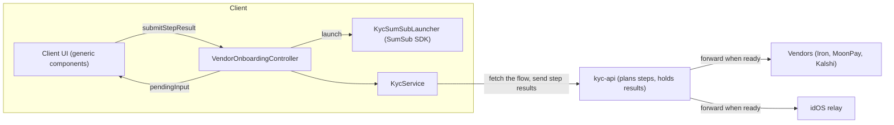
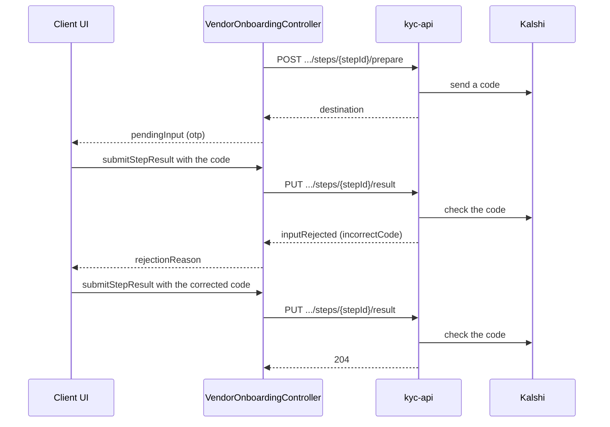
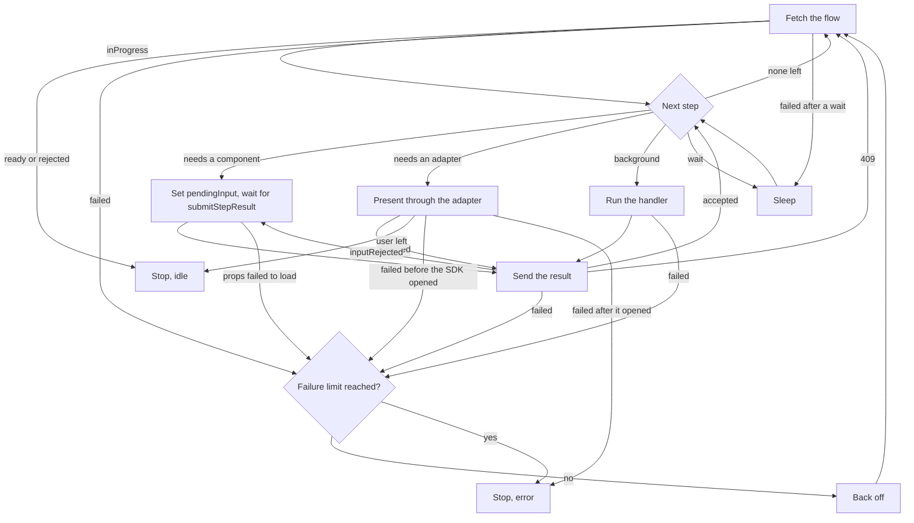
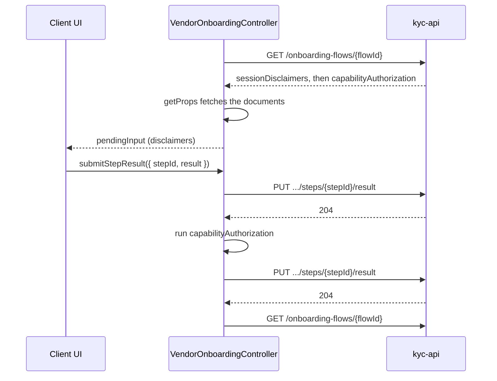
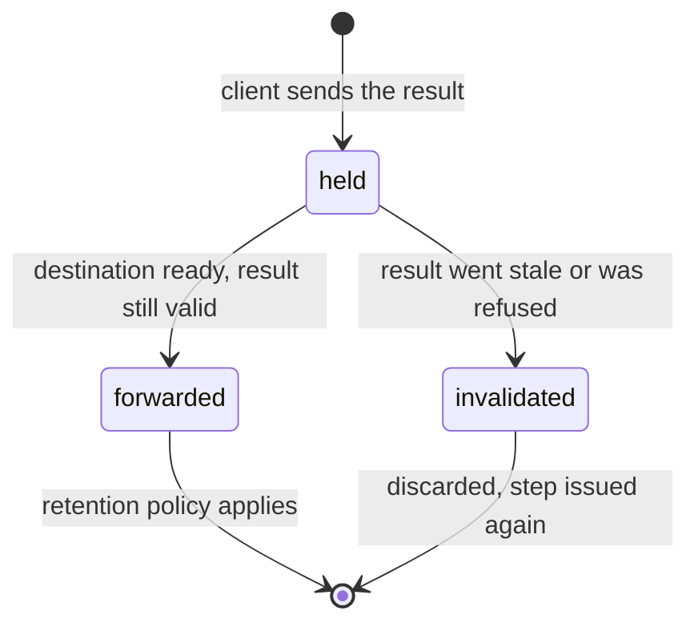

# Server-driven vendor onboarding

Target design for onboarding a customer with an identity vendor (Iron, MoonPay,
Kalshi, and later vendors). kyc-api decides what the customer has to do next
and returns it as an ordered list of steps. A new client controller,
`VendorOnboardingController`, runs those steps: it asks the client to show a
component when a step needs the user, does the work itself when it doesn't, and
sends every result to kyc-api.

---

## 1. Overview

|                                     | Client-side graph (previous design)                  | Server-driven steps (this design)                                                                      |
| ----------------------------------- | ---------------------------------------------------- | ------------------------------------------------------------------------------------------------------ |
| Decides what happens next           | `KycController`/ Client side orchestration           | kyc-api                                                                                                |
| What the client knows about vendors | Each vendor's requirements and their dependencies    | Only step types, a few of which belong to one vendor (Kalshi's OTP)                                    |
| Adding a vendor or reordering work  | Client release                                       | kyc-api change, if the client already supports the step types                                          |
| Where user results go               | The vendor- or session-specific endpoint, right away | The flow; kyc-api decides when to forward them                                                         |
| Resume after restart or reinstall   | Client recomputes from backend facts                 | Client fetches the flow again. Server keeps persisted state / refreshes from external sources of truth |

Three ideas carry the design:

- **kyc-api plans, the client interprets.** The client knows step types, not
  which vendor needs which steps. For each type it knows whether the user is
  involved, which component to request, and what result to send back. A step
  is always something kyc-api can tell is done ([§4](#4-step-types)).
- **Components are generic.** The client implements a small set of components
  that any step type can request. The controller turns a step into component
  props, and the component's result back into a step result. UI that doesn't
  fit a component, like the SumSub SDK, goes through an injected adapter
  instead.
- **Collecting a result is separate from using it.** kyc-api can ask for
  something whenever it suits the user, hold the answer, and forward it when
  the vendor or the idOS relay is ready for it.

---

## 2. Roles

| Party                         | Responsibilities                                                                                                                                                                                                                                                                                                                                                                                                                                             |
| ----------------------------- | ------------------------------------------------------------------------------------------------------------------------------------------------------------------------------------------------------------------------------------------------------------------------------------------------------------------------------------------------------------------------------------------------------------------------------------------------------------ |
| kyc-api                       | Owns the flow. Decides which steps are outstanding and in what order. Records step results, forwards them when their destination is ready, and decides what to keep afterward. Reports what it's waiting on, and when and why the flow ended.                                                                                                                                                                                                                |
| `VendorOnboardingController`  | Fetches the flow and runs its steps in order. Maps each step type to a handler that requests a component, presents UI through an injected adapter, or runs in the background. Holds the local secrets background steps need. Sends every result to kyc-api, and refetches the flow again after the last step or after an unexpected/unhandled failure. Understands how to wait/poll. Is able to eventually communicate success to the feature that needs it. |
| Client UI (mobile, extension) | Implements the generic components and the SumSub launcher. Renders the component the controller requests and hands the user's result back.                                                                                                                                                                                                                                                                                                                   |
| `KycService`                  | Stateless HTTP for the flow endpoints and for the endpoints step handlers still call ([§4](#4-step-types)).                                                                                                                                                                                                                                                                                                                                                  |
| Vendors, idOS relay           | Receive results from kyc-api. The client never sends them step results directly.                                                                                                                                                                                                                                                                                                                                                                             |



---

## 3. API contract

### 3.1 Types

```typescript
type OnboardingStepType =
  | 'vendorDisclaimers'
  | 'sessionDisclaimers'
  | 'capabilityAuthorization'
  | 'kalshiEmailOtp'
  | 'kalshiPhoneOtp'
  | 'sumsubJourney'
  | 'wait';

type OnboardingStep =
  | {
      /** Opaque and unique within the flow. See §3.3 for when it changes. */
      id: string;
      type: Exclude<OnboardingStepType, 'wait'>;
      /** Inputs from kyc-api. Empty for these step types so far. */
      args: [];
    }
  | {
      id: string;
      type: 'wait';
      args: [WaitArgs];
    };

type WaitArgs = {
  /** What kyc-api is waiting on (§4.6). Any string, so a new reason needs no client release. */
  reason: string;
  /** Seconds until checking again is worthwhile. */
  retryAfter?: number;
};

type OnboardingFlowStatus = 'inProgress' | 'ready' | 'rejected';

type OnboardingFlow = {
  id: string;
  /** Vendor id, e.g. `iron`. A plain string, so a new vendor needs no client change. */
  vendor: string;
  /** Proposed addition; see below. */
  status: OnboardingFlowStatus;
  /** Why the flow ended, when `status` is `rejected`; otherwise `null`. Proposed addition. */
  statusReason: string | null;
  /** Outstanding steps, in the order the client runs them. */
  steps: OnboardingStep[];
};
```

`status` is an addition to the minimal contract of `id`, `vendor`, and `steps`.
Without it, an empty step list can't tell a customer who is ready from one who
was rejected, and the client would need vendor-specific facts to work it out
(for Iron, an approved session isn't enough; the account must also be
`Active`). `ready` keeps its meaning from the previous design: the customer can
use the vendor. Consumers such as ramps, card, and money gate access on it.

`statusReason` is also an addition. It says why a flow ended without the
customer being able to use the vendor, such as `identityNotVerified`,
`vendorDeclined`, or `regionNotSupported`, and kyc-api decides how specific it
can be. A flow that can't finish for a lasting reason, unlike capability
authorization that was `wiped`, ends the same way instead of failing requests
([§3.4](#34-errors)). Like every code and reason in this design, it's a value
the client maps to its own copy, which is why it isn't free text like session
status's `statusMessage`.

`wait` is the first step type with inputs, so `OnboardingStep` is a union
discriminated on `type`, and each step type that needs inputs gets its own
`args` tuple. Response validation accepts any string for `type`, so a type the
client doesn't know reaches the controller ([§4.7](#47-unknown-step-types))
instead of failing validation of the whole flow.

### 3.2 Endpoints

All requests carry the wallet bearer token, like the other kyc-api calls.
`supportedStepTypes` is a comma-separated list of the step types the client can
run ([§5.4](#54-step-handlers)).

| Method | Path                                                | Body                        | Response             | Purpose                                                                                                                                                                         |
| ------ | --------------------------------------------------- | --------------------------- | -------------------- | ------------------------------------------------------------------------------------------------------------------------------------------------------------------------------- |
| `POST` | `/onboarding-flows?supportedStepTypes=…`            | `{ vendor }`                | `OnboardingFlow`     | Returns the customer's current flow for the vendor, creating one if there is none. Used to start and to resume                                                                  |
| `GET`  | `/onboarding-flows/{flowId}?supportedStepTypes=…`   | —                           | `OnboardingFlow`     | Returns the flow with steps computed from kyc-api's current state                                                                                                               |
| `POST` | `/onboarding-flows/{flowId}/steps/{stepId}/prepare` | Step-specific; empty so far | Step-specific inputs | Produces inputs that can't come with the flow (rule 8), such as sending an OTP code or minting a SumSub applicant token. Calling it again sends a new code or mints a new token |
| `PUT`  | `/onboarding-flows/{flowId}/steps/{stepId}/result`  | `{ result }`                | `204`                | Records the result of an outstanding step                                                                                                                                       |

### 3.3 Rules kyc-api follows

The controller relies on these.

1. **Order.** The client runs `steps` one at a time, in order.
2. **Stable ids.** A step keeps its id across fetches while the same work is
   outstanding, so a component can stay on screen across a refresh. New work
   gets a new id: a new disclaimer version, or a capability authorization that
   expired again. Once a result is recorded for a step id, that id is never
   issued again.
3. **Never empty while in progress.** If `status` is `inProgress`, `steps` has
   at least one step; when there's nothing for the client to do, it's `wait`.
   If `status` is `ready` or `rejected`, `steps` is empty.
4. **Supported types only.** kyc-api only returns step types in
   `supportedStepTypes`. If the flow can't continue without another type, it
   responds with error code `clientUpdateRequired`.
5. **`wait` comes last.** Any step after a `wait` would run from a list that is
   already one delay old.
6. **Idempotent results.** Sending the same result for a step again succeeds.
   A result for a step that isn't outstanding (replaced by a newer step,
   already recorded with a different result, or no longer needed) gets `409`.
7. **Server timestamps.** kyc-api records when it received each result. The
   client doesn't send timestamps, unlike today's client-side `termsAcceptedAt`
   for MoonPay.
8. **No side effects on fetch.** Fetching the flow never sends a code or mints a
   token, since the client fetches on every refresh. Those happen in `prepare`,
   when the client starts the step.

### 3.4 Errors

Request errors are only for problems a retry or an app update can fix, and for
input the user can correct. When the flow can't continue for a lasting reason,
such as a region the vendor doesn't serve, kyc-api ends the flow with a
`statusReason` ([§3.1](#31-types)). When the problem is temporary, such as a
vendor outage, it returns a `wait` with a reason ([§4.6](#46-wait)). Either
way the client learns why from the flow, instead of retrying something that
can't succeed.

| Response                                    | Meaning                                                                                                 | Controller                                                                      |
| ------------------------------------------- | ------------------------------------------------------------------------------------------------------- | ------------------------------------------------------------------------------- |
| `404` from a flow route                     | The flow id is unknown or expired                                                                       | Calls `POST /onboarding-flows`, which returns the current flow or a new one     |
| `409` from `prepare` or a result `PUT`      | The step isn't outstanding anymore                                                                      | Fetches the flow right away; not a failure                                      |
| Error code `inputRejected`, with a `reason` | kyc-api refused something the user can correct: a wrong or expired code, or a resend asked for too soon | Keeps the step on screen and sets `pendingInput.rejectionReason`; not a failure |
| Any other `422` from a result `PUT`         | The result failed validation, e.g. it accepts documents that are no longer current                      | Fetches the flow; counts as a failure                                           |
| Error code `clientUpdateRequired`           | The flow needs a step type this client doesn't support                                                  | Stops with `error.code` `clientUpdateRequired`; doesn't retry                   |
| `5xx`, network errors                       | Transient                                                                                               | The service policy retries; if the request still fails, it counts as a failure  |

`KycService` keeps only an error's status and message today, so it needs to
surface `code` and `reason` from the error body as well.

---

## 4. Step types

A step is something kyc-api can tell is done. kyc-api holds the result, as
with disclaimers; checks it while the `PUT` waits, as with an OTP code; or sees
the outcome where the result went, as with capability authorization on the
session. Work that only the client can observe doesn't get a step of its own.
It goes inside the handler of the step that needs it:

- **User decisions kyc-api needs a record of** are step results, such as
  accepting a vendor's terms.
- **Short-lived credentials only the client can mint**, such as the partner
  identity token and the aal2 token that session creation needs, are minted by
  the step that consumes them and sent with its result
  ([§10](#10-migration-from-kyccontroller)). kyc-api uses them right away and
  doesn't hold them.
- **Device secrets**, such as `local_user_secret`, stay inside the handler that
  uses them, here `capabilityAuthorization`. kyc-api never learns of them.

Giving client-only work a step of its own doesn't work. kyc-api can't tell
when such a step is done, so it would keep returning it until something it can
see changes, and the client would decide by itself whether the step is already
satisfied, such as when it already holds a valid aal2 token. That's the same
work as one combined step, with more round trips. It also breaks rule 2: once
kyc-api accepts a result, that step can't come back, and the controller counts
a repeat as a failure ([§5.3](#53-run-loop)). Recording each part instead
would leave kyc-api holding short-lived credentials between steps, where they
can expire while the user is on a later screen. To see where users drop off,
the handler can report its own progress through the analytics trackers.

| Type                      | Needs the user | Component                                         | Inputs                                                          | Result sent to kyc-api                                     |
| ------------------------- | -------------- | ------------------------------------------------- | --------------------------------------------------------------- | ---------------------------------------------------------- |
| `vendorDisclaimers`       | Yes            | `disclaimers`                                     | Vendor documents (`GET /vendors/{vendor}/disclaimers?country=`) | `{ disclaimerIds }`                                        |
| `sessionDisclaimers`      | Yes            | `disclaimers`                                     | idOS and KYC-provider documents (`GET /disclaimers?country=`)   | `{ idOS, kycProvider, credentialReusabilityConsentGiven }` |
| `capabilityAuthorization` | No             | —                                                 | Session id, wrapping keys, idOS JWKS, `local_user_secret`       | `{ wrappedEncryptionDataKey, wrappedUkycCapabilityToken }` |
| `kalshiEmailOtp`          | Yes            | `otp`                                             | A code Kalshi sends by email (`prepare`)                        | `{ code }`                                                 |
| `kalshiPhoneOtp`          | Yes            | `otp`                                             | A code Kalshi sends by SMS (`prepare`)                          | `{ code }`                                                 |
| `sumsubJourney`           | Yes            | None; the SumSub SDK, through `KycSumSubLauncher` | Applicant access token (`prepare`)                              | `{ outcome: 'submitted' }`                                 |
| `wait`                    | No             | —                                                 | `reason` and `retryAfter`, in `args`                            | Nothing                                                    |

Inputs come from three places. `args` carries what kyc-api knows when it
returns the flow; only `wait` uses it so far. The other handlers fetch
documents and session details from existing endpoints, and those could move
into `args` later. Inputs produced on demand, like a code Kalshi has to send
or an applicant token that expires, come from `prepare` when the step starts
(rule 8), so they wouldn't move into `args`. The country comes from
`KycService:getGeoCountry`, as it does today.

### 4.1 `vendorDisclaimers`

The vendor's own terms. The handler fetches the vendor's documents and requests
the `disclaimers` component. The result is the ids the user accepted. kyc-api
turns it into what the vendor needs (Iron signings, MoonPay terms acceptance)
whenever the vendor is ready to take it.

The client stops persisting acceptance in `vendorDisclaimersAccepted`. kyc-api
holds the record and issues the step again when the vendor's terms change,
which covers Iron's `SigningsRequired`.

### 4.2 `sessionDisclaimers`

The idOS and KYC-provider (SumSub) documents, plus the optional consent to
reuse existing idOS credentials. The handler requests the same `disclaimers`
component with a `credentialReusability` consent. It uses the country catalog,
which doesn't need a UKYC session, so kyc-api can ask for these before the
session exists and apply them once it does. kyc-api skips documents the session
has already consented to, which the client does today in
`consentRecordsFromAcceptedList`.

The result has the shape `POST /sessions/{id}/disclaimers` takes today, without
the session id. The client stops persisting `providerDisclaimersAccepted`,
`idosDisclaimersAccepted`, and `credentialReusabilityConsentGiven`.

### 4.3 `capabilityAuthorization`

Runs without the user, and only the client can run it: the data encryption key
and the capability-token signing key derive from `local_user_secret`, which
never leaves the device. The handler does what
`KycController.#refreshAuthorizations` does today:

1. Look up the vendor's UKYC session (`GET /sessions/latest/status/{vendor}`)
   to get its id.
2. Generate a fresh X25519 key pair and register its public key
   (`POST /sessions/{id}/wrapping-keys`), which returns the two encryption
   schemas.
3. Verify each schema's `jwtChain` against the idOS enclave and idOS relay
   JWKS.
4. Derive the data encryption key, sign a capability token, and wrap both.
5. Return the two wrapped values as the result. The private key is discarded
   when the step ends.

The wrapped values are sealed to keys attested by the idOS enclave and relay,
so kyc-api can hold and forward them without being able to read them. kyc-api
decides when the step is needed; on the client today, that rule is
`needsCapabilityAuthorizationRefresh`.

Registering a public key is a side effect, so the wrapping keys are an
on-demand input, like an OTP code. Rather than moving into `args`, they could
come from `prepare`, with the public key in the request body, which would also
replace the session lookup.

### 4.4 `kalshiEmailOtp` and `kalshiPhoneOtp`

Kalshi's own one-time codes, by email and by SMS. They're separate from
MetaMask's aal2 OTP. Kalshi needs both after the UKYC session exists and before
SumSub, and doesn't care which comes first, so kyc-api picks the order. In the
previous design kyc-api's `currentStep` drove these; the flow's steps take its
place. Once the flow ends kyc-api stops issuing them, so a decided session
never asks for a code.

Both step types share one handler, parameterized by channel, and the `otp`
component:

1. `getProps` calls `prepare`, which has Kalshi send a code, and gets back
   where it went: a masked email address or phone number.
2. The user enters the code, and the result is `{ code }`.
3. kyc-api checks the code with Kalshi while the `PUT` waits. A code expires in
   minutes and the user needs to know right away if it was wrong, so these
   results are never held.
4. A wrong or expired code gets `inputRejected`, with a reason such as
   `incorrectCode` or `codeExpired`. The screen stays up with
   `pendingInput.rejectionReason` set, and the user tries again. It isn't a
   failure.
5. The component's resend button calls `restartStep`, which calls `prepare`
   again. kyc-api can refuse a resend that comes too soon with `inputRejected`
   and `resendTooSoon`.
6. After too many wrong codes, kyc-api can end the step: it answers `409`, and
   the next fetch returns a new step with a new code, or `wait`.



Props load once per step id, so returning to the app after reading the code
doesn't send a new one ([§5.3](#53-run-loop)).

### 4.5 `sumsubJourney`

SumSub's identity verification (`sumsubJourneyStart` in the previous design).
It needs the user, but its UI is the SumSub SDK rather than a generic
component. Clients already provide the SDK as `KycSumSubLauncher`, so this is
an adapter step ([§5.4](#54-step-handlers)): the handler launches the SDK
instead of setting `pendingInput`, and `status` is `presenting` while the SDK
is open. It does what `launchProviderFlow` does today:

1. Call `prepare` for an applicant access token. Today that's
   `POST /sessions/{id}/journey`, which the handler can call until `prepare`
   exists.
2. Launch the SDK. Its `onTokenExpiration` callback calls `prepare` again for
   a fresh token.
3. Check the statuses the SDK reports through `onStatusChange`, and the one it
   closes with, using `isSumSubFlowCompleted` and `isSumSubFlowFailed`. Some
   native SDKs close without reporting their last status first. When the SDK
   closes:
   - If the applicant submitted, the result is `{ outcome: 'submitted' }`.
   - If the user closed it before submitting, nothing is sent, and the run
     stops in `idle` so the SDK doesn't reopen by itself. `refresh` or `start`
     resumes.
   - If the SDK failed, the run stops in `error` without retrying, for the
     same reason.

The documents go from the SDK to SumSub, not through kyc-api. The result only
tells kyc-api that the applicant submitted, and kyc-api holds it until SumSub
reports, so the next fetch returns `wait` instead of the same journey again. If
SumSub then asks for more, kyc-api issues a new `sumsubJourney` step.

kyc-api issues this step only once what the journey depends on is in place: the
disclaimers, capability authorization, and for Kalshi both codes. If something
else becomes outstanding while the SDK is open, kyc-api returns it on the fetch
after the SDK closes; the controller doesn't interrupt an open SDK.

A few more details:

- The applicant token is never persisted. After a restart, the handler asks
  `prepare` for a new one.
- After `stop` or `reset`, the token callback refuses to mint a new token, so
  an SDK left open can't keep going on its own.
- If the launcher's `isAvailable()` is false, the controller leaves
  `sumsubJourney` out of `supportedStepTypes`.
- `launchProviderFlow` takes the SDK's locale and debug flag as parameters.
  The run launches the SDK itself, so the controller takes them as a
  constructor option instead: a callback, so the locale follows the app's.

### 4.6 `wait`

kyc-api is waiting on something other than this client: SumSub's review, the
vendor's decision, account activation, a forward in progress, or a vendor
that's down. `reason` says which, so the client knows what to tell the user and
how to show it. A short wait is a spinner in place; a long one is a status
screen the user can leave.

| `reason`            | kyc-api is waiting for                                       | Wait  |
| ------------------- | ------------------------------------------------------------ | ----- |
| `processing`        | Its own work, such as forwarding held results                | Short |
| `identityReview`    | SumSub's review of the applicant                             | Long  |
| `vendorReview`      | The vendor's decision                                        | Long  |
| `accountActivation` | The vendor account to become active, such as Iron's `Active` | Long  |
| `vendorUnavailable` | The vendor to recover from an outage                         | Long  |

`reason` is any string, so kyc-api can add reasons without a client release. A
reason the client doesn't know gets generic copy and the long presentation,
since the user shouldn't be held on a spinner for a wait of unknown length.

The handler sleeps, and then the step is complete. When kyc-api sends
`retryAfter`, the handler sleeps that many seconds, with a floor such as 2
seconds so a bad value can't cause a hot loop. Otherwise, like today's
session-status polling, the delay starts at 10 seconds and grows by 10 seconds
with each consecutive `wait`, up to a cap such as 60 seconds. Any other step
resets it. `refresh()` cuts a wait short, for example when the app returns to
the foreground.

Temporary problems on kyc-api's side, like a vendor outage, are waits rather
than errors: the flow is still in progress, and the client has nothing to
retry. The client reads the reason from the `wait` step in `flow`, which is
persisted, so it can show the reason right after a restart, before `refresh()`
returns ([§6.1](#61-contract)).

### 4.7 Unknown step types

kyc-api shouldn't return a type the client didn't list (rule 4). If it does,
the controller stops with `error.code` `unsupportedStep` and doesn't fetch
again: the next fetch would return the same step, and the retries would never
end.

---

## 5. `VendorOnboardingController`

A new controller in `@metamask/kyc-controller`, next to `KycController`.

### 5.1 State

```typescript
type VendorOnboardingControllerState = {
  /**
   * Latest flow from kyc-api. Persisted as a display cache and a resume
   * hint; its steps never run without fetching the flow again.
   */
  flow: OnboardingFlow | null;
  /** What the current run is doing. */
  status: VendorOnboardingStatus;
  /** Step being run, or `null` between steps. After a step fails, the step that failed. */
  currentStepId: string | null;
  /** Component the client should show, while a step needs one. */
  pendingInput: PendingInput | null;
  /** Why the run stopped, or the latest failure while it retries. Cleared when a step completes. */
  error: VendorOnboardingError | null;
};

type VendorOnboardingError = {
  code: VendorOnboardingErrorCode;
  /** A more specific cause from a handler or kyc-api, e.g. `verifiedEmailRequired`. */
  reason: string | null;
  /** For logs. The client shows its own copy for `code` and `reason`. */
  message: string;
};
```

Only `flow` is persisted. The other fields describe a live run, start out at
their defaults on launch, and are rebuilt by `start` or `refresh`.

| `status`       | Meaning                                                                                                                                   |
| -------------- | ----------------------------------------------------------------------------------------------------------------------------------------- |
| `idle`         | Not running: before `start`, after `stop` or `reset`, after the user closes an adapter's UI without finishing, or once the flow has ended |
| `loading`      | Fetching the flow, including between retries                                                                                              |
| `awaitingUser` | Waiting for `submitStepResult`                                                                                                            |
| `submitting`   | Sending the user's result                                                                                                                 |
| `presenting`   | An adapter's UI, such as the SumSub SDK, is on screen                                                                                     |
| `running`      | Running a background step and sending its result                                                                                          |
| `waiting`      | Running a `wait` step, including the fetch that follows it                                                                                |
| `error`        | Stopped; `refresh()` resumes                                                                                                              |

| `error.code`           | Cause                                                                                             | What the client offers                                                                                |
| ---------------------- | ------------------------------------------------------------------------------------------------- | ----------------------------------------------------------------------------------------------------- |
| `requestFailed`        | A kyc-api request kept failing                                                                    | A retry that calls `refresh()`                                                                        |
| `stepFailed`           | A step handler kept failing, an adapter failed after opening, or a handler failed with a `reason` | A retry, unless `reason` says the user has to fix something first, such as verifying an email address |
| `unsupportedStep`      | kyc-api returned a step type this client didn't list                                              | A prompt to update the app                                                                            |
| `clientUpdateRequired` | The flow needs a step type this client doesn't support                                            | A prompt to update the app                                                                            |

While the controller backs off between retries, `status` is `loading` and
`error` holds the latest failure, so the client can show that it's still
trying.

Whether the flow ended, and how, is only in `flow.status` and
`flow.statusReason`, so the last known outcome survives a restart that resets
`status` to `idle`. Consumers that gate access (ramps, card, money) read
`flow.status === 'ready'`. Like `sessionStatus` today, it's a cache, so they
should refresh when they can.

Nothing in state is secret. The capability-authorization key pair, the keys
derived from `local_user_secret`, and the SumSub applicant token exist only in
memory while their step runs.

### 5.2 Messenger actions

Besides `getState` and the `stateChange` event:

| Action                                 | Behavior                                                                                                                                                                                                                                                                                                                                |
| -------------------------------------- | --------------------------------------------------------------------------------------------------------------------------------------------------------------------------------------------------------------------------------------------------------------------------------------------------------------------------------------- |
| `start({ vendor })`                    | Ends any current run once an open adapter has closed, calls `POST /onboarding-flows`, and runs the flow. Resolves after that first request, whether or not it succeeded; everything after it is reported through state. Starting a different vendor replaces the run, and the other vendor's flow stays on kyc-api                      |
| `refresh()`                            | Lets a request in flight settle, or an open adapter close and send its result, then fetches the flow and runs it from its first step. Cuts a `wait` short, and resumes after `error` or after the user closed an adapter. Uses `flow.id` from state, so it works after a restart; throws if there's no flow, in which case call `start` |
| `submitStepResult({ stepId, result })` | Takes the user's result for the step awaiting input, converts it into the step result, and sends it to kyc-api. Resolves once the `PUT` settles, whatever the outcome; what happens next shows up in state. Rejects only if `stepId` isn't awaiting input or `result` doesn't match the component, both client bugs                     |
| `restartStep({ stepId })`              | Prepares the step awaiting input again and replaces `pendingInput.props`; for an OTP step, that sends a new code. If kyc-api refuses with `inputRejected`, the props stay and `rejectionReason` says why. Rejects if `stepId` isn't awaiting input                                                                                      |
| `stop()`                               | Ends the run and clears its timers. Keeps `flow`                                                                                                                                                                                                                                                                                        |
| `reset()`                              | `stop()`, then restores the default state. Doesn't abandon the flow on kyc-api; the next `start` resumes it                                                                                                                                                                                                                             |

### 5.3 Run loop

The controller fetches the flow, runs its steps in order, and fetches again
when it runs out of steps or something fails:



- **Generations.** Each run has a generation number. `start`, `refresh`,
  `stop`, and `reset` end the current run by bumping it. The run checks it
  after every await and exits without writing state once it's stale. This is
  the same idea as the session-status poll token in `KycController`.
- **Failures.** A failed fetch, a failed handler or `prepare`, a failed result
  `PUT`, and a `422` that isn't `inputRejected` each count as a failure. The
  controller backs off (2, 4, then 8 seconds, say) and fetches the flow again.
  After three consecutive failures it stops in `error`, and `refresh()` starts
  over. A completed step resets the count. Without the backoff and the limit, a
  step that fails every time would be retried as fast as the network allows.
- **Failures while waiting.** A failed fetch after a `wait` doesn't count. The
  controller stays in `waiting` and tries again after the same delay, the way
  today's session-status polling keeps going after a failed poll. The delay is
  already long, so there's no hot loop to prevent, and a long review doesn't
  end in an error screen because the network dropped for a while.
- **Failures with a reason.** A handler that fails with a `reason`, such as
  `verifiedEmailRequired`, stops the run in `error` right away, since backing
  off can't fix it.
- **`409`** isn't a failure. The controller fetches right away.
- **Rejected input.** `inputRejected` keeps the step on screen with
  `rejectionReason` set, and isn't a failure. The user tries again.
- **Adapters.** Once an adapter's UI has opened, a failure stops the run in
  `error` instead of backing off and retrying, and the user closing it stops
  the run in `idle`. Either way the UI never reopens on its own. A failure
  before the UI opens, such as a failed `prepare`, is handled like any other.
  `start` and `refresh` wait for an open adapter to close and send its result
  before starting a new run, so the SumSub SDK never opens twice and a
  submission isn't dropped.
- **Repeated steps.** If a step whose result kyc-api accepted in this run shows
  up again, the controller counts a failure. Under rule 2 it means kyc-api
  didn't record the result, and counting it keeps a server bug from becoming a
  hot loop.
- **The user's screen across a refresh.** `refresh` keeps `pendingInput` while
  it fetches. If the same step comes back first, it keeps its `stepId` and
  props without loading them again, so the screen keeps what the user entered
  and an OTP step doesn't send a new code. Otherwise it's replaced or cleared.

### 5.4 Step handlers

Each step type has one handler, of one of three kinds. Handlers produce
results; the controller sends them, so every step gets the same submission,
failure, and generation handling.

```typescript
type StepContext = {
  flow: OnboardingFlow;
  /** Aborted when the run ends. */
  signal: AbortSignal;
};

type UserStepHandler<Component extends OnboardingComponent> = {
  kind: 'user';
  component: Component;
  /** Loads what the component renders. Runs once per step id, and again on `restartStep`. */
  getProps(
    step: OnboardingStep,
    context: StepContext,
  ): Promise<OnboardingComponentProps[Component]>;
  /** Converts the component's result into the result kyc-api expects. */
  toStepResult(
    result: OnboardingComponentResults[Component],
    props: OnboardingComponentProps[Component],
  ): Json;
};

type AdapterStepHandler = {
  kind: 'adapter';
  /** False when the adapter can't run here, which leaves the type out of `supportedStepTypes`. */
  isAvailable(): boolean;
  /**
   * Presents the step through the adapter and resolves when it closes: with
   * the result to send, or `left` if the user closed it before finishing.
   */
  present(
    step: OnboardingStep,
    context: StepContext,
  ): Promise<{ result: Json } | 'left'>;
};

type BackgroundStepHandler = {
  kind: 'background';
  /** Does the work. Returns the result to send, or `null` to send nothing. */
  run(step: OnboardingStep, context: StepContext): Promise<Json | null>;
};

type StepHandler =
  | UserStepHandler<OnboardingComponent>
  | AdapterStepHandler
  | BackgroundStepHandler;

const STEP_HANDLERS: Record<OnboardingStepType, StepHandler> = {
  vendorDisclaimers: vendorDisclaimersHandler,
  sessionDisclaimers: sessionDisclaimersHandler,
  capabilityAuthorization: capabilityAuthorizationHandler,
  kalshiEmailOtp: createOtpHandler('email'),
  kalshiPhoneOtp: createOtpHandler('phone'),
  sumsubJourney: sumsubJourneyHandler,
  wait: waitHandler,
};
```

`supportedStepTypes` is the keys of `STEP_HANDLERS`, minus adapter steps whose
`isAvailable()` is false, so what the client tells kyc-api always matches what
it can run.

The controller reports analytics through injected trackers, the same pattern
as `KycAnalyticsTrackers`: when a step starts, completes, or fails, with the
flow id, vendor, and step type.

---

## 6. Client components

### 6.1 Contract

The package defines each component's props and result types; each client
implements the components. A client supports a step type only if it implements
that type's component, and new components ship with new package versions.

```typescript
type OnboardingComponent = 'disclaimers' | 'otp';

type OnboardingComponentProps = {
  disclaimers: DisclaimersProps;
  otp: OtpProps;
};

type OnboardingComponentResults = {
  disclaimers: DisclaimersResult;
  otp: OtpResult;
};

type PendingInput = {
  stepId: string;
  stepType: OnboardingStepType;
  /** Why kyc-api refused the last submission or restart. Cleared on the next one. */
  rejectionReason: string | null;
} & (
  | { component: 'disclaimers'; props: DisclaimersProps }
  | { component: 'otp'; props: OtpProps }
);
```

What the client does:

- Renders `pendingInput.component` with `pendingInput.props` whenever
  `pendingInput` is set, and keys the screen by `stepId`. A refresh that keeps
  the step then keeps what the user entered, and a new step starts fresh.
- Calls `submitStepResult({ stepId, result })` when the user is done, and shows
  progress while `status` is `submitting`.
- Shows `rejectionReason` on the component when it's set, mapped to copy such
  as "That code didn't work."
- Chooses titles and copy from `stepType` and `flow.vendor`. Props carry data,
  not copy.
- Treats back or dismiss as the user leaving. The step stays outstanding on
  kyc-api and comes back on the next `start` or `refresh`. The client can call
  `stop()` to end the run.

When `pendingInput` is null, the first row that applies says what to show:

| State                                           | What the client shows                                                                                                             |
| ----------------------------------------------- | --------------------------------------------------------------------------------------------------------------------------------- |
| `status` is `presenting`                        | Nothing; the SumSub SDK is on screen                                                                                              |
| `status` is `error`                             | Copy for `error.code` and `error.reason`, with a retry or a prompt to update the app ([§5.1](#51-state))                          |
| The flow ended                                  | The outcome in `flow.status`, with copy for `statusReason`                                                                        |
| `selectWaitReason(state)` returns a reason      | Copy for the reason: a spinner in place for a short wait, or a status screen the user can leave for a long one ([§4.6](#46-wait)) |
| `status` is `idle`, and the flow is in progress | A way to continue that calls `refresh()`, for example after the user closed SumSub                                                |
| `status` is `loading` or `running`              | A spinner                                                                                                                         |

`selectWaitReason(state)` is a selector the package exports, so clients don't
parse steps. While `status` is `waiting`, it returns the current wait's reason.
When no run is active, it returns the reason of the flow's first step if that's
a `wait`. Because `flow` is persisted, a client that opens onboarding after a
restart can show "Your documents are being reviewed" right away, while it calls
`refresh()`. And because `status` stays `waiting` through the fetch after each
wait, the screen doesn't flash a spinner on every check.

Every code and reason in this design is a value the client maps to its own
copy: `rejectionReason`, `error.code` and `error.reason`, `statusReason`, and a
wait's `reason`. kyc-api can add values before clients know them, so an unknown
value gets generic copy. `error.message` is for logs, not for display.



### 6.2 `disclaimers`

Used by `vendorDisclaimers` and `sessionDisclaimers`.

```typescript
type DisclaimersProps = {
  /** Documents to accept, in display order. */
  documents: { id: string; title: string; url: string }[];
  /** Optional consents shown with the documents. The client maps each id to copy. */
  consents: { id: 'credentialReusability'; required: boolean }[];
};

type DisclaimersResult = {
  /** Every id in `props.documents`: there's no partial acceptance. */
  acceptedDocumentIds: string[];
  /** One answer per consent in `props.consents`, keyed by id. */
  consents: Record<string, boolean>;
};
```

The handler assigns the document ids, and its `toStepResult` maps them back to
vendor disclaimer ids or `{ key, version }` records.

### 6.3 `otp`

Used by `kalshiEmailOtp` and `kalshiPhoneOtp`.

```typescript
type OtpProps = {
  channel: 'email' | 'phone';
  /** Where the code went, masked by kyc-api, e.g. `j•••@example.com` or `•••• 1234`. */
  destination: string;
};

type OtpResult = {
  code: string;
};
```

`channel` lets the component pick its icon and copy without knowing the step
types. The resend button calls `restartStep({ stepId })`, and a refused code or
resend comes back as `rejectionReason`.

### 6.4 Adapters

Not every UI fits a component. The SumSub SDK is imperative: the controller
launches it, the SDK asks for fresh tokens through a callback, and the launch
resolves when the SDK closes. Clients already implement it as
`KycSumSubLauncher`, and `sumsubJourney` uses that adapter instead of
`pendingInput` ([§4.5](#45-sumsubjourney)).

---

## 7. kyc-api: collect now, forward later

Because results go to the flow and not to their destination, asking the user
and using the answer are separate. kyc-api can ask for something whenever it
fits the experience best and apply it when the vendor or the idOS relay is
ready. For example, it can show Iron's terms on the first screen, before the
Iron customer exists, hold the acceptance, and send the signings to Iron once
the customer is created. Not every result can wait, though: an OTP code
expires in minutes, so kyc-api checks it while the `PUT` waits.

### 7.1 Collected results

```typescript
type CollectedResult = {
  flowId: string;
  stepId: string;
  stepType: OnboardingStepType;
  /** What the client sent. Wrapped secrets are opaque to kyc-api. */
  result: Json;
  receivedAt: string;
  state: 'held' | 'forwarded' | 'invalidated';
};
```



- **Planning.** A step is outstanding when kyc-api needs a result it doesn't
  have: there's no valid held result, and the destination doesn't already
  reflect one. A held result counts as done, so the user isn't asked twice
  while kyc-api waits to forward it. Once a result is forwarded, the
  destination is the source of truth.
- **Forwarding** is always kyc-api's job, never a client step. kyc-api forwards
  once the destination exists (the Iron customer, the UKYC session), checks
  first that the result is still valid, and retries transient failures itself.
- **Staleness.** A held result can go stale before it's used: a document gets a
  new version, the capability token passes its expiry, or the session's
  wrapping keys are reset after the result was wrapped. A result the
  destination refuses for good is in the same position. kyc-api invalidates
  it, and the planner issues the step again with a new id.

### 7.2 Retention

Each step type has its own policy for what happens to a result once it has
been used. The values below are suggestions:

| Result                             | Destination                                          | Held until                                                                                        | Afterward                                                                                                |
| ---------------------------------- | ---------------------------------------------------- | ------------------------------------------------------------------------------------------------- | -------------------------------------------------------------------------------------------------------- |
| `vendorDisclaimers`                | The vendor (Iron signings, MoonPay terms acceptance) | The vendor customer exists                                                                        | Keep an acceptance record (document ids, versions, time) if compliance needs one. It contains no secrets |
| `sessionDisclaimers`               | The UKYC session's consents                          | The UKYC session exists                                                                           | Same as `vendorDisclaimers`                                                                              |
| `capabilityAuthorization`          | The UKYC session's authorizations                    | Not held: kyc-api only issues the step once the session exists, and applies the result right away | Delete. kyc-api can't read it, it expires, and nothing needs it again                                    |
| `kalshiEmailOtp`, `kalshiPhoneOtp` | Kalshi's code check                                  | Not held: checked while the `PUT` waits                                                           | Delete the code; keep only that the channel was verified                                                 |
| `sumsubJourney`                    | None; it tells the planner the applicant submitted   | SumSub reports on the submission                                                                  | Delete; SumSub's status is the source of truth from then on                                              |

### 7.3 Planning steps

How kyc-api chooses steps is internal to it, but it faces the problems the
previous design solved on the client: requirements that depend on each other,
requirements that stop mattering after a lasting outcome, and requirements that
become unsatisfied again. The requirement graph in
[`vendor-flow-architecture.md`](./vendor-flow-architecture.md) still fits,
recomputed on every flow request from facts kyc-api has directly, with one
addition: a held result satisfies its requirement.

| Case                                                                                    | Handling                                                                                                |
| --------------------------------------------------------------------------------------- | ------------------------------------------------------------------------------------------------------- |
| A disclaimer catalog moves to a new version                                             | kyc-api issues a new `vendorDisclaimers` or `sessionDisclaimers` step                                   |
| Capability authorization is `new` or `expired`                                          | kyc-api issues `capabilityAuthorization`                                                                |
| Capability authorization is `wiped`                                                     | kyc-api never issues it. The flow can't finish, so it ends as `rejected` with a `statusReason`          |
| Kalshi needs its email and phone codes                                                  | kyc-api issues both before `sumsubJourney`, in whichever order it prefers                               |
| The applicant submitted in the SDK, but SumSub hasn't reported yet                      | The held result keeps kyc-api returning `wait` with `identityReview` instead of the journey again       |
| SumSub asks the applicant to resubmit (`retry`)                                         | kyc-api issues a new `sumsubJourney` step                                                               |
| Iron reports `SigningsRequired`                                                         | kyc-api issues a new `vendorDisclaimers` step and forwards the result right away                        |
| Waiting for the vendor's decision, or for Iron's account to become `Active`             | `wait` with `vendorReview` or `accountActivation`                                                       |
| The vendor is down                                                                      | `wait` with `vendorUnavailable`, not an error                                                           |
| The customer can't onboard with the vendor at all, such as in a region it doesn't serve | The flow ends as `rejected`, with a `statusReason` such as `regionNotSupported`                         |
| Pre-session inputs (aal2 token, partner identity token) expire after the session exists | Nothing; kyc-api doesn't need them anymore                                                              |
| The flow ends while the user is on a step                                               | The next fetch has no steps. If the user submits first, the `PUT` gets `409` and the controller fetches |
| Restart, reinstall, or a second device                                                  | `POST /onboarding-flows` returns the same flow, without the steps already answered                      |

---

## 8. Examples

### 8.1 Iron

|     | kyc-api returns                                                                             | Client                                                                                                             | kyc-api, with the result                                                |
| --- | ------------------------------------------------------------------------------------------- | ------------------------------------------------------------------------------------------------------------------ | ----------------------------------------------------------------------- |
| 1   | `vendorDisclaimers`, `sessionDisclaimers`                                                   | Shows Iron's terms, then the idOS and SumSub terms                                                                 | Holds both: neither the Iron customer nor the UKYC session exists yet   |
| 2   | —                                                                                           | Outside the flow for now ([§10](#10-migration-from-kyccontroller)): creates the Iron customer and the UKYC session | Forwards the held signings to Iron and the held consents to the session |
| 3   | `sumsubJourney`                                                                             | Launches SumSub, and the applicant submits                                                                         | Holds the outcome until SumSub reports                                  |
| 4   | `wait` with `identityReview`                                                                | Shows that the documents are under review, and fetches again after the delay                                       | —                                                                       |
| 5   | `capabilityAuthorization`, because the capability token expired before Iron decided         | Wraps and sends new authorizations in the background                                                               | Applies them to the session                                             |
| 6   | `wait` with `vendorReview`                                                                  | Shows that Iron is reviewing, and fetches again after the delay                                                    | —                                                                       |
| 7   | `vendorDisclaimers` with a new id, because Iron reported `SigningsRequired` after approving | Shows Iron's new terms                                                                                             | Forwards them to Iron right away, since the customer exists             |
| 8   | `wait` with `accountActivation`                                                             | Shows that the account is being activated, and fetches again after the delay                                       | —                                                                       |
| 9   | `status: 'ready'`, no steps                                                                 | Stops; consumers can use Iron                                                                                      | —                                                                       |

### 8.2 Kalshi

|     | kyc-api returns                           | Client                                                                                                                            | kyc-api, with the result                           |
| --- | ----------------------------------------- | --------------------------------------------------------------------------------------------------------------------------------- | -------------------------------------------------- |
| 1   | `vendorDisclaimers`, `sessionDisclaimers` | Shows Kalshi's terms, then the idOS and SumSub terms                                                                              | Holds both until their destinations exist          |
| 2   | —                                         | Outside the flow for now: creates the UKYC session, with a partner identity token that carries the email address and phone number | Forwards the held results                          |
| 3   | `kalshiEmailOtp`, `kalshiPhoneOtp`        | For each, `prepare` has Kalshi send a code and the user enters it. A mistyped code is rejected and entered again                  | Checks each code with Kalshi while the `PUT` waits |
| 4   | `sumsubJourney`                           | Launches SumSub, and the applicant submits                                                                                        | Holds the outcome until SumSub reports             |
| 5   | `wait` with `identityReview`              | Shows that the documents are under review, and fetches again after the delay                                                      | —                                                  |
| 6   | `status: 'ready'`, no steps               | Stops. Kalshi has nothing to wait for after approval, so it's ready as soon as the session is approved                            | —                                                  |

---

## 9. Resume

kyc-api owns the flow, so resuming means fetching it again:

- The controller never runs persisted steps. `start` and `refresh` always fetch
  first.
- On launch the controller is `idle`, and `flow` shows the last known state,
  including what kyc-api was waiting on.
  The client calls `start` or `refresh` when the user enters onboarding, and
  `refresh` when the app returns to the foreground.
- After a clean reinstall there's no local state, and `start({ vendor })`
  returns the existing flow. `local_user_secret` comes back from Encrypted User
  Storage, so `capabilityAuthorization` works the same way.
- Short-lived inputs aren't persisted either. After a restart, an OTP step
  sends a new code and `sumsubJourney` gets a new applicant token, both through
  `prepare`.
- If the flow is gone (`404`), the controller calls `POST /onboarding-flows`
  and continues with whatever it returns.

---

## 10. Migration from `KycController`

These step types cover what the three vendors need once the UKYC session
exists. The pre-session work doesn't have step types yet (see the candidates
below), so it stays on `KycController`, and the client still calls
`startSession` before it starts the flow.

| `KycController` today                                                                                                                                         | Moves to                                                                                                                                                                                                     |
| ------------------------------------------------------------------------------------------------------------------------------------------------------------- | ------------------------------------------------------------------------------------------------------------------------------------------------------------------------------------------------------------ |
| Deciding what comes next: `startSession`'s branches, `needsCapabilityAuthorizationRefresh`, `hasCompletedVendorDisclaimers`, `hasCompletedSessionDisclaimers` | kyc-api's planner                                                                                                                                                                                            |
| `fetchVendorDisclaimers`, `recordVendorDisclaimers`, `vendorDisclaimersAccepted`                                                                              | The `vendorDisclaimers` handler and kyc-api's held results                                                                                                                                                   |
| `fetchSessionDisclaimers`, `recordSessionDisclaimers`, `providerDisclaimersAccepted`, `idosDisclaimersAccepted`, `credentialReusabilityConsentGiven`          | The `sessionDisclaimers` handler and kyc-api's held results                                                                                                                                                  |
| `#refreshAuthorizations`, `#setAuthorizations`, `#verifyWrappingKeys`, `#generateWrappedAuthorizations`                                                       | The `capabilityAuthorization` handler. Extract them into a module both controllers can use while `KycController` still creates sessions                                                                      |
| `launchProviderFlow`, `providerFlowStatus`                                                                                                                    | The `sumsubJourney` handler. kyc-api's held result replaces `providerFlowStatus`, and the SDK-outcome analytics move to the handler                                                                          |
| Session-status polling                                                                                                                                        | `wait`                                                                                                                                                                                                       |
| `startSession`: identity-sharing consent, partner identity token, aal2 token, vendor customer, UKYC session                                                   | Stays for now; the `createKycSession` candidate below would replace it                                                                                                                                       |
| `ensureLocalUserSecret`                                                                                                                                       | The `capabilityAuthorization` handler, which gets or creates the secret, as `#generateWrappedAuthorizations` does today. `start` can create it early, which is what clients call `ensureLocalUserSecret` for |
| `getDataShares`                                                                                                                                               | Stays; it isn't part of the flow                                                                                                                                                                             |

Kalshi's codes are new: nothing in `KycController` handles them today. During
the migration, each piece of work should go through one controller only. For
example, a client that runs `vendorDisclaimers` steps stops calling
`recordVendorDisclaimers`.

`KycService` gains `createOnboardingFlow`, `getOnboardingFlow`,
`prepareOnboardingStep`, and `submitOnboardingStepResult`, and surfaces error
codes ([§3.4](#34-errors)). The new controller's messenger allows those, the
`KycService` actions its handlers call, and the User Storage actions that read
`local_user_secret`. Like `KycController`, it takes the SumSub launcher as a
constructor option.

Candidate step types for the pre-session work:

| Candidate               | Needs the user                  | Component                                                 | Replaces                                                                                                                                                       |
| ----------------------- | ------------------------------- | --------------------------------------------------------- | -------------------------------------------------------------------------------------------------------------------------------------------------------------- |
| `createKycSession`      | Only without a valid aal2 token | None; MetaMask's OTP screen, through an injected callback | `startSession`'s pre-session work: identity-sharing consent, the partner identity token, the aal2 token, and creating the vendor customer and the UKYC session |
| `moonpayAuthentication` | For the login frame only        | `vendorFrame`                                             | MoonPay's check frame (mounted invisibly) and login frame                                                                                                      |

`createKycSession` is one step rather than one per part, because what kyc-api
can tell is that the session exists ([§4](#4-step-types)). Its handler:

1. Records the identity-sharing consent. This is automatic and never asks the
   user, as in `startSession` today.
2. Mints the partner identity token for the audience and claims in `args`:
   `email` for Iron, `email` and `phoneNumber` for Kalshi. The client then
   doesn't need them per vendor.
3. Gets an aal2 token, showing MetaMask's OTP screen only if it has no valid
   one.
4. Sends the partner identity token and the residence country as the result,
   with the aal2 token as the request's bearer, as `POST /sessions` takes it
   today.

kyc-api creates the vendor customer and the UKYC session while the `PUT` waits,
and keeps neither token. If the profile has no verified email address, or no
verified phone number for Kalshi, minting fails. The run stops with
`stepFailed` and a `reason` such as `verifiedEmailRequired`, so the client can
send the user to verify it and then call `refresh()`.

Both candidates need the user only some of the time. `createKycSession` can get
its aal2 token through an injected callback that returns a still-valid token or
shows the OTP screen, which makes it an adapter step like `sumsubJourney`.
MoonPay's check frame is UI the client mounts but the user never touches, so
`moonpayAuthentication` may need one more handler kind: a background step that
can fall back to a component.

---

## 11. Open questions

- **Flow `status` and `statusReason`.** Both are additions
  ([§3.1](#31-types)). Confirm their values. A flow that can't finish, such as
  when capability authorization is `wiped`, ends as `rejected` with a reason.
  If `rejected` reads wrong for cases like an unsupported region, a neutral
  name such as `closed` would fit better.
- **Wait reasons.** Confirm the reasons in [§4.6](#46-wait) and which are long.
  A long wait lets the user leave, so the product may want to tell them when it
  ends, for example with a notification.
- **Inputs in `args`.** While `args` is empty, handlers fetch documents, the
  country, and the session id from vendor- and session-specific endpoints, and
  show the whole catalog even when only one document changed. Passing those
  inputs in `args` would make the client fully vendor-unaware, limit the screen
  to the documents that still need consent, and guarantee it shows exactly what
  kyc-api will accept. Capability authorization's wrapping keys are an
  exception that fits `prepare` better ([§4.3](#43-capabilityauthorization)).
- **Vendor-named OTP steps.** `kalshiEmailOtp` and `kalshiPhoneOtp` are named
  for Kalshi, though their handler and component are generic. If another vendor
  needs email or phone codes, generic `emailOtp` and `phoneOtp` step types
  would avoid adding a pair per vendor.
- **Retention.** Which results kyc-api keeps after using them, such as an
  acceptance record for compliance, and which it deletes
  ([§7.2](#72-retention)).
- **Next step types.** Which of the candidates in
  [§10](#10-migration-from-kyccontroller) come first. Today `POST /sessions`
  takes the client's public key, but `capabilityAuthorization` registers a
  fresh one anyway, so session creation may not need it.
- **One flow or one per vendor.** The controller runs one flow at a time, like
  `KycController`. If a customer can onboard with Iron for money and MoonPay
  for ramps, state may need a cached flow per vendor.
- **Abandoning a flow.** `reset` only clears the client. Does the product need
  a way to start over on kyc-api?
- **Planner questions.** The open questions in
  [`vendor-flow-architecture.md` §11](./vendor-flow-architecture.md#11-open-questions)
  (`retry`, other Iron account statuses, what Iron activation needs) still
  apply, now to kyc-api's planner.
