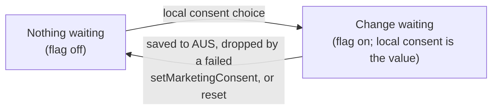
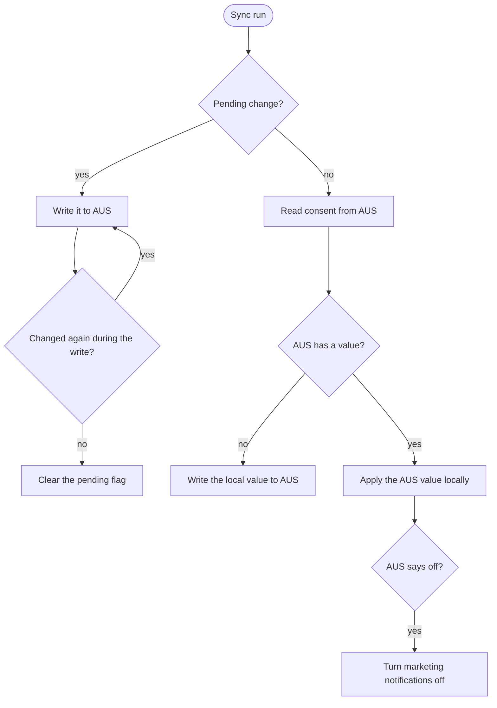

# Architecture

The `MarketingConsentSyncService` keeps a user's marketing consent in sync between this device and their Authenticated User Storage (AUS) profile, and keeps the AUS marketing notification channels consistent with it.

For setup and usage, see the [README](./README.md).

## Local and remote consent

Marketing consent lives in two places:

- **Local**: `optedInToMarketing` and `marketingConsentDecisionMade` in `AnalyticsController`. Analytics on this device reads it.
- **Remote**: the marketing consent record in AUS. Every device and client signed in to the same profile reads it, and marketing notifications depend on it.

AUS is the source of truth. When the two disagree and there is no unsaved local change, the AUS value is applied locally. AUS is read even when nothing changed on this device, because another device or client signed in to the same profile may have changed it.

## Readiness and sessions

The service only calls AUS when it is **ready**: the wallet is unlocked, the user is signed in (`AuthenticationController.isSignedIn`), and a consent decision has been made. Sign-in happens after unlock, so the wallet can be unlocked but not signed in yet (for example during onboarding). Whether locking signs the user out depends on the client: the extension signs out on lock, mobile stays signed in, so the service tracks the lock state itself.

A **session** is one signed-in period. A new session starts whenever the signed-in status changes. Each sync run belongs to the session it started in. If the session changes or the service stops being ready while it reads AUS, the result of the read is dropped. Before each AUS write the run checks again and stops if either changed, so a multi-step write never finishes on a profile that signed in since; an unsaved change stays pending for the new session. A write request already sent is not cancelled.

## Pending change

The service holds no state. Whether a local change is waiting to be saved to AUS is the `marketingConsentSyncPending` flag of `AnalyticsController`; the value waiting is local consent (`optedInToMarketing`). The flag is persisted with consent, in the same state update, so the two cannot disagree after a restart.

| `AnalyticsController` method                   | Consent   | `marketingConsentSyncPending`     |
| ---------------------------------------------- | --------- | --------------------------------- |
| `optInToMarketing` / `optOutOfMarketing`       | set       | `true`                            |
| `applyRemoteMarketingConsent` (value from AUS) | set       | unchanged; does nothing if `true` |
| `clearPendingMarketingConsent(value)`          | unchanged | `false` if consent equals `value` |
| `resetMarketingConsentDecision`                | undecided | `false`                           |

Every local choice is marked pending, whether it comes from `setMarketingConsent` or from other code calling `AnalyticsController` directly, even when it matches local consent, so an explicit choice wins over a different value in AUS. Values the service applies from AUS are not marked pending, so they are never written back. A reset drops the pending change: an undecided client has nothing to write and reads AUS instead.

The service subscribes to `AnalyticsController:stateChanged` with a selector that only picks the pending value, so the many other updates `AnalyticsController` makes (for example to its event queue on every tracked event) don't start a sync.

A pending change isn't tied to a profile: it is written to whichever profile signs in next.

While a change is waiting:

- A newer choice replaces it. Only one value is ever waiting: local consent.
- It stays put while the service is not ready, or after a failed write. A failed write is retried on the next unlock, sign-in, consent change or `refresh()`, not straight away, so a run can't loop while AUS is down. There is no retry timer; individual AUS requests already retry with backoff through the service policy.

## Sync run

Only one sync run is in flight at a time; asking for a sync while one runs returns the same run. A run is started by `initialize()`, on sign-in, on unlock (through `refresh()`), on a consent change and on `refresh()`.

If a change is made while the AUS read is in progress, the read result is ignored and the change is written instead.

After a write, the service calls `clearPendingMarketingConsent` with the value it wrote. The flag is only cleared if local consent still equals that value, so a change made during the write stays pending and is written next.

A write that has started is never cancelled; a newer change is written after it. Only the latest value is ever written next, so values the user moved past are skipped: if the user changes consent several times during a write, at most one more write follows, and none if they end up back on the value being written. Before sign-in, or while another run is still reading AUS, intermediate values are never sent at all.

When a run ends, another starts if the session changed, a `refresh()` was requested during the run, or the run succeeded and a change was made after its last write.

See [MarketingConsentSyncService.ts](/packages/marketing-consent-sync-service/src/MarketingConsentSyncService.ts) (`#sync`, `#run`, `#reconcileWithAus`, `#flushPendingConsent`).

## Saving a consent change

`setMarketingConsent(enabled)`:

1. Applies the choice locally through `AnalyticsController:optInToMarketing` or `optOutOfMarketing`, which mark it pending before awaiting anything, so an older call that resumes later cannot overwrite a newer one.
2. Starts a sync.
3. Resolves immediately if the service is not ready. The change is saved once the wallet is unlocked and signed in.
4. Otherwise waits until AUS confirms this exact value in the same session.

On failure:

- If a newer choice was made while it waited (a newer `setMarketingConsent` call, or other code changing consent in `AnalyticsController`), it resolves; the newer choice is saved on its own.
- If the wallet locked or the user was signed out during the save, the change stays pending and the call rejects.
- Otherwise the change is dropped (`clearPendingMarketingConsent`), consent is re-read from AUS and applied locally, and the call rejects.

## Marketing notifications

Marketing notifications rely on marketing consent, so whenever consent is off the AUS marketing push and in-app channels must be off too.

When saving an opt-out, the service:

1. Reads notification preferences from AUS.
2. If a marketing channel is on, writes the preferences with both marketing channels off.
3. Re-reads the preferences, so UIs bound to the AUS cache through `@metamask/react-data-query` see the change.
4. Writes consent off to AUS.

The channels go off before consent is written, so AUS never has consent off while a marketing channel is on. If step 2 or 4 fails, or the session changes before either, the sequence stops and both are retried together. Steps 1 to 3 also run when a sync reads "off" from AUS, because another client may have revoked consent without turning the channels off.

Turning a marketing channel on is the reverse rule, and it is enforced by `NotificationServicesController:updateNotificationPreferences`, which rejects updates that turn a marketing channel on without consent. When notification preferences are created for the first time, `NotificationServicesController` sets both marketing channels (push, and in-app feature announcements) from marketing consent.
