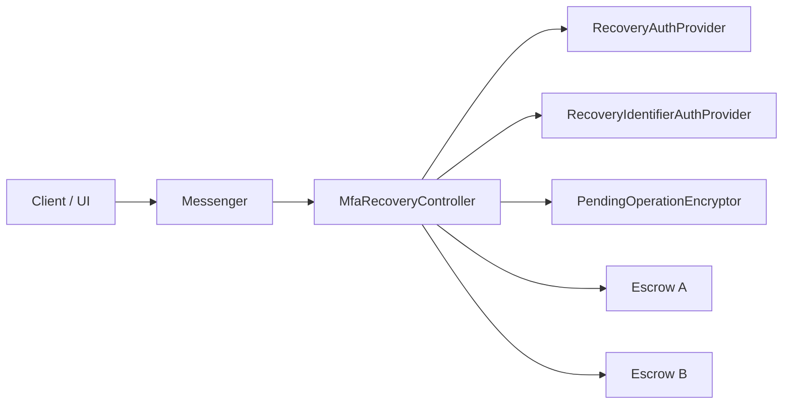
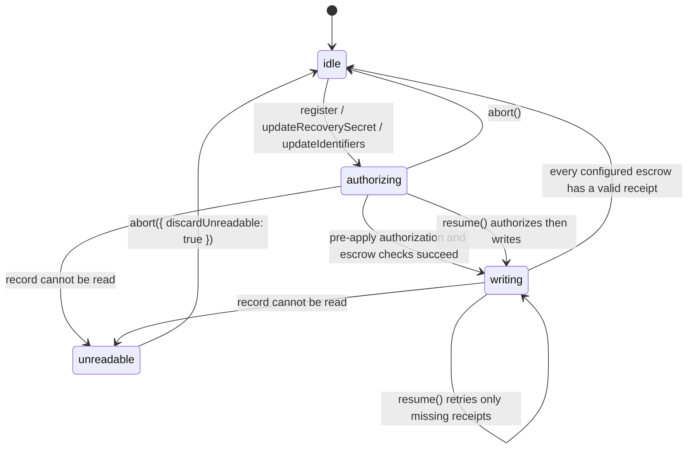
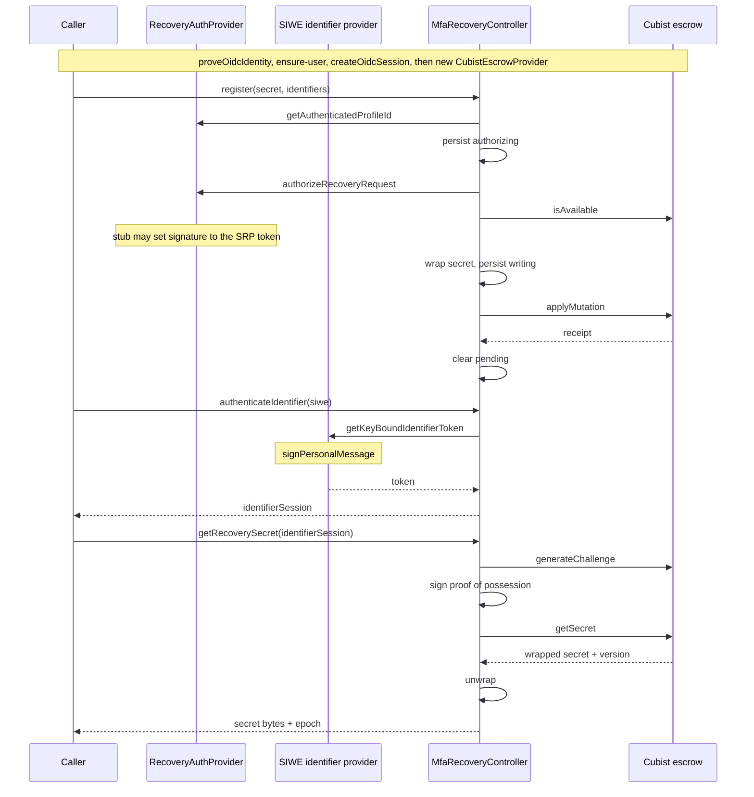
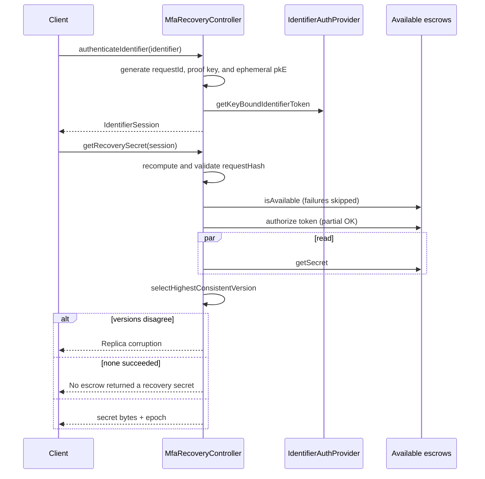
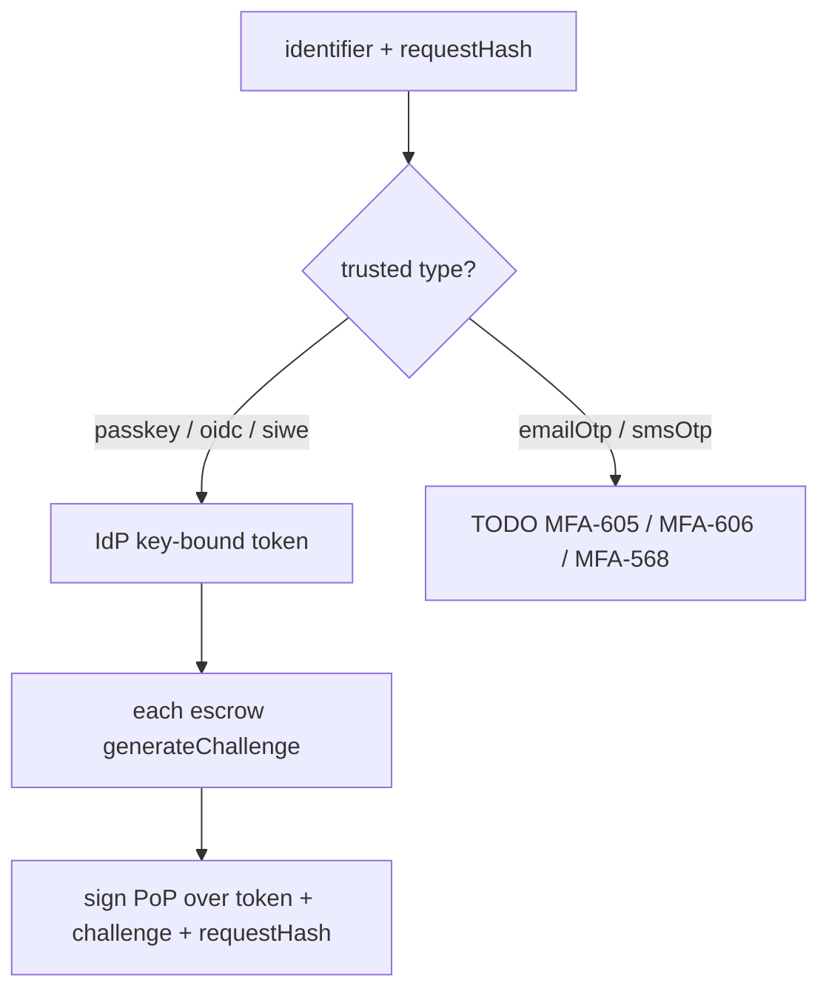
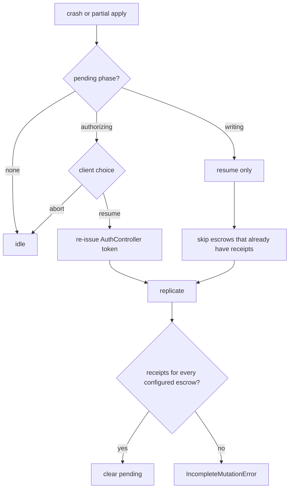

# `@metamask/mfa-recovery-controller`

Orchestration layer for MFA recovery. The controller never stores the recovery
secret in controller state. It replicates a full copy of that secret to every
configured escrow, and persists only an **encrypted** pending mutation so a
crash can finish the same write.

## Architecture

The controller is a coordinator. Auth, identifier proofs, escrow I/O, and
encryption are injected. OTP collection is not wired yet.



| Piece                    | Role                                                                                            |
| ------------------------ | ----------------------------------------------------------------------------------------------- |
| `pendingOperation`       | Only persisted field: encrypted `authorizing` / `writing` blob, or `null`                       |
| `escrows[]`              | Build-time replica set; mutations require **all** of them                                       |
| `authProvider`           | Profile id + request-bound AuthController token                                                 |
| `identifierAuthProvider` | Key-bound IdP assertion (passkey / OIDC / SIWE)                                                 |
| `#withLock`              | Serializes mutations, resume, and abort cleanup; `getPhase` / `getRecoverySecret` are lock-free |

Identifier types pick the auth mode from a trusted table, not a client flag:
`passkey` / `oidc` / `siwe` → key-bound. `emailOtp` / `smsOtp` escrow-challenge
is not wired yet (MFA-605 / MFA-606 / MFA-568).

`register` and `updateIdentifiers` require at least two identifiers.

Recovery secrets are wrapped in transit with escrow-wrap-v1 (P-256 ECDH, HKDF,
ChaCha20-Poly1305). Pending state stores the secret as 0x-hex; `payloadHash`
is the hash of that pending payload. At apply, each escrow gets
`{ pkE, ciphertext }` wrapped to its own wrap key. Reads bind the client's
ephemeral `pkE` into the `getSecret` request hash.

Public surface: `register`, `updateRecoverySecret`, `updateIdentifiers`,
`authenticateIdentifier`, `getRecoverySecret`, `resume`, `abort`, `getPhase`.

## State machine

Persisted phase is derived from decrypted pending state: no pending → `idle`.
If the persisted record cannot be decrypted or validated, `getPhase` reports
`unreadable` instead.



Rules:

- **`abort()`** drops `authorizing` only. It aborts the in-flight
  `AbortController`, clears persisted pending when allowed, and bumps an
  **abort generation** so mutations or `resume()` queued behind the lock fail
  with `operation_aborted` before any new external work. Once
  `inFlight.applying` is true (writing persisted and escrow apply may have
  started), `abort()` rejects immediately with `abort_not_allowed`; the
  `writing` mutation must `resume()`. When `resume()` is processing an already
  persisted `writing` mutation before its next apply, `abort()` may cancel that
  pre-apply work but still rejects with `abort_not_allowed` after the persisted
  phase check; the `writing` mutation remains unchanged.
- Every persisted phase change goes through the event table in
  `src/state-machine.ts` (`start`, `write`, `complete`, `reject`, `abort`,
  `discardUnreadable`). A transition the table does not allow throws before
  anything is stored.
- **`abort({ discardUnreadable: true })`** also clears a record that cannot be
  read. The record is cleared without decrypting it, so this works after a lost
  encryption key or an escrow reorder. A readable `writing` record is still
  refused. Transient timeouts and aborts while reading keep the record.
  Escrows may then hold different versions; `getRecoverySecret` returns the
  highest consistent one.
- `writing` is persisted before the **first escrow apply** after identifier
  authorization succeeds, so an ambiguous apply failure remains resumable while
  pre-write authorization failures stay abortable.
- `register` / `updateRecoverySecret` / `updateIdentifiers` require idle
  pending state. `resume()` finishes a persisted mutation.

## Mutation sequence (`register` / updates)

Mutations are all-or-nothing across the configured escrow set. Reads are not.

```mermaid
sequenceDiagram
  participant C as Client
  participant M as MfaRecoveryController
  participant A as AuthProvider
  participant E as Escrows

  C->>M: register / updateRecoverySecret / updateIdentifiers
  M->>M: lock; reject if a mutation is already pending
  M->>A: getAuthenticatedProfileId
  M->>M: expectedVersion from caller epoch (register uses 0)
  M->>M: persist pending = authorizing
  M->>A: authorizeRecoveryRequest (AuthController token)
  M->>E: require every escrow available
  alt not register
    M->>E: identifier auth per escrow
  end
  M->>M: persist writing before apply
  par write every replica
    M->>E: applyMutation
  end
  M->>M: persist receipts
  alt all receipts valid
    M->>M: clear pending → idle
  else every escrow proves it did not apply and none has a receipt
    M->>M: clear pending → idle
    M-->>C: MutationRejectedError (start a new mutation)
  else some replicas missing
    M-->>C: IncompleteMutationError (call resume)
  end
```

Versioning:

- Version lives on the mutation (`expectedVersion` / `newVersion`), which is
  what escrows apply. `epoch` is only the client-facing name for the current
  replica version returned by `getRecoverySecret`.
- `register` uses expectedVersion `0` → version `0 → 1`
- updates take the caller-supplied `epoch` as `expectedVersion`, then
  `n → n+1`. Escrows reject a mismatch.
- Mutation `audiences` is the full configured replica-id list, in that order.
  Each replica should require an exact match to its configured set (a
  cubist-only deploy is `["cubist"]`; adding another escrow means every replica
  is rebuilt with the expanded list).

`resume()` is the same write path without creating a new mutation: authorizing
pending gets a fresh token then replicates; writing pending retries only
escrows that do not already have a stored receipt.

## Rejections on retry

An escrow refusal (`MutationRejectedError`) does not always mean "not applied".
An escrow can commit a mutation and lose the response, so a retry of the same
mutation can be refused even though the state already changed. The controller
therefore persists `dispatchedEscrowIds` (the escrows sent `applyMutation`)
before each apply, and classifies every refusal:

- **First send** to that escrow: not applied.
- **Retry**: the optional `getMutationStatus` call decides. `applied: false`
  means not applied. A returned receipt is verified and stored. An error, a
  timeout, or a missing status call is ambiguous.

The pending mutation is cleared only when every escrow is not applied and no
receipt exists. Otherwise it stays in `writing`, `resume()` finishes it, and
`abort()` is refused. A `writing` record without `dispatchedEscrowIds` loads as
sent to every escrow.

## Cubist store sequence

The controller does not call CubeSigner, the registration API, or
`KeyringController`. A Cubist deploy injects one `RecoveryEscrowProvider`
(`id: "cubist"`). The caller proves OIDC, calls `ensure-user`, opens the
session, and constructs `CubistEscrowProvider` before `register`.

`register(recoverySecret, identifiers)` takes an identifier **array** of at
least two distinct key-bound identifiers. One `siwe` identifier is rejected.
`applyMutation` is the store: the controller wraps the secret to the escrow
wrap key, and the Cubist provider persists that payload. `AuthControllerToken`
is opaque; a stub may put an SRP token in `signature`.

`authenticateIdentifier` asks the injected identifier provider for a key-bound
token. A SIWE provider signs with `KeyringController.signPersonalMessage`.
The controller does not. `getRecoverySecret` then challenges the escrow, signs
the proof of possession locally, calls `getSecret`, and unwraps. `epoch` is
the replica `version`.



## Read sequence (`getRecoverySecret`)

Reads tolerate down replicas. They do **not** repair pending writes. The
selected replica version is returned as `epoch` so a later
`updateRecoverySecret` / `updateIdentifiers` can be formed without a locally
stored version.



`IdentifierSession` contains the key-bound token, request identifiers, and
ephemeral private keys needed for the read. The controller does not persist or
store the session; callers must keep it in memory and must not log it.

`getPhase` and `getRecoverySecret` do not wait for the mutation lock. During
`writing`, replicas may hold different versions; the read takes the highest
one. The next mutation still requires `resume()` first.

## Timeouts and cancellation

The controller bounds every injected authorization, identifier, escrow, and
pending-state encrypt/decrypt call.

| Option             | Default (ms) | Applies to                                                            |
| ------------------ | ------------ | --------------------------------------------------------------------- |
| `promptTimeoutMs`  | `300000`     | AuthController authorization and identifier IdP prompts (prompt kind) |
| `requestTimeoutMs` | `30000`      | Profile lookup, escrow I/O, pending-state encryption (request kind)   |

Both constructor options must be **positive integers**; otherwise construction
throws `invalid_timeout`.

Provider calls receive a child `AbortSignal` where supported. Cancellation is
**cooperative**: injected providers should honor `signal.aborted` promptly.
`CubistEscrowProvider` checks the signal before `policyInvoke` but cannot
cancel an SDK request that is already in flight; controller-side
`requestTimeoutMs` still bounds how long the caller waits.

**`abort()`** (see state-machine rules) aborts the in-flight controller while
phase is `authorizing` or pre-apply work is running. **`getPhase`** and
**`getRecoverySecret`** never take the mutation lock; they may run while
authorization or replication is pending elsewhere.

### Controller error codes (timeouts and cancellation)

| Code                 | Typical cause                                                                                                           | Pending phase / recovery                                                                                                                                              |
| -------------------- | ----------------------------------------------------------------------------------------------------------------------- | --------------------------------------------------------------------------------------------------------------------------------------------------------------------- |
| `invalid_timeout`    | Non-integer or non-positive `*TimeoutMs` option                                                                         | Controller not constructed; fix options and retry                                                                                                                     |
| `prompt_timeout`     | User-facing prompt exceeded `promptTimeoutMs`                                                                           | Often `authorizing` with pending stored; `abort()` or `resume()`                                                                                                      |
| `request_timeout`    | Network/storage call exceeded `requestTimeoutMs`                                                                        | Depends on step: pre-write may leave `authorizing`; after writing is persisted, may leave `writing` (treat like ambiguous apply — `resume()`)                         |
| `operation_aborted`  | `abort()`, parent signal aborted, or stale queue after abort generation                                                 | Allowed `abort()` clears pending → `idle`; otherwise same as the step that was cancelled                                                                              |
| `pending_unreadable` | Pending record cannot be decrypted or validated (lost key, reordered escrows, retired identifier type, malformed token) | `getPhase` returns `unreadable`; mutations, `resume`, and `abort()` reject with the original error as `cause`; `abort({ discardUnreadable: true })` clears the record |
| `invalid_transition` | An internal phase change the transition table does not allow                                                            | Controller bug; nothing is stored                                                                                                                                     |
| `abort_not_allowed`  | `abort()` while `applying` or pending is `writing`                                                                      | Pending unchanged; call `resume()`                                                                                                                                    |

An apply `request_timeout` is ambiguous (the escrow may or may not have applied).
The pending mutation stays in `writing` with any verified receipts; `resume()`
retries missing escrows only.

## Identifier auth (inside writes and reads)



On **mutation**, every target escrow must authorize or the write does not
start. On **read**, failed authorizations are skipped.

## Crash / repair


