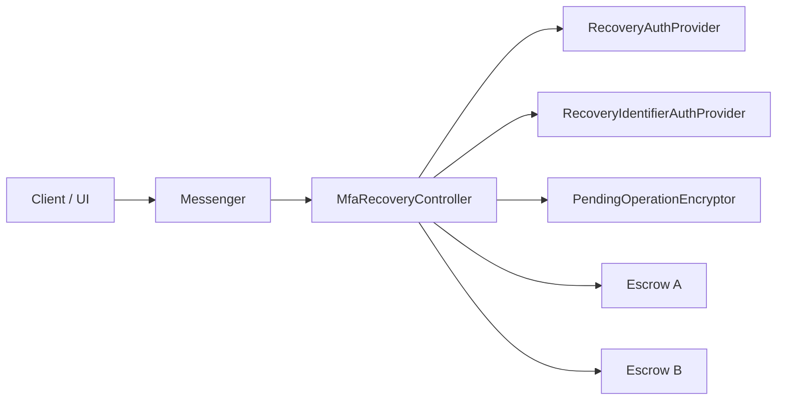
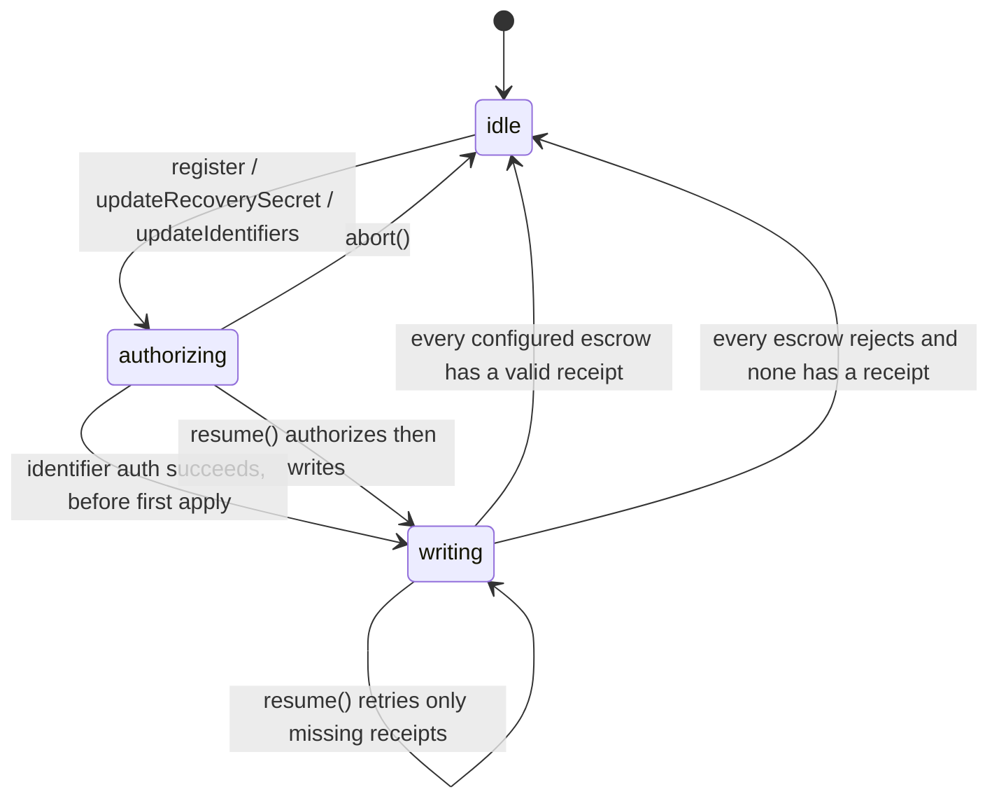
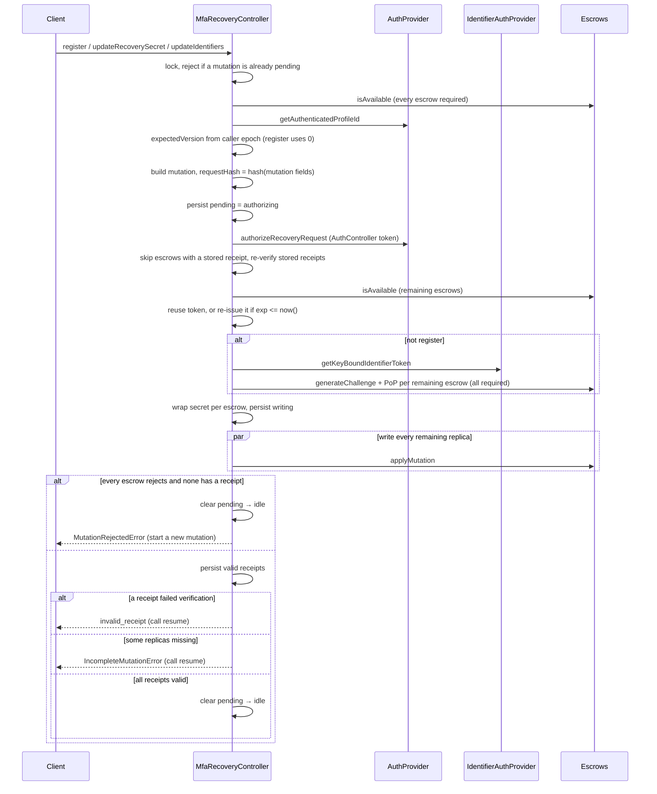
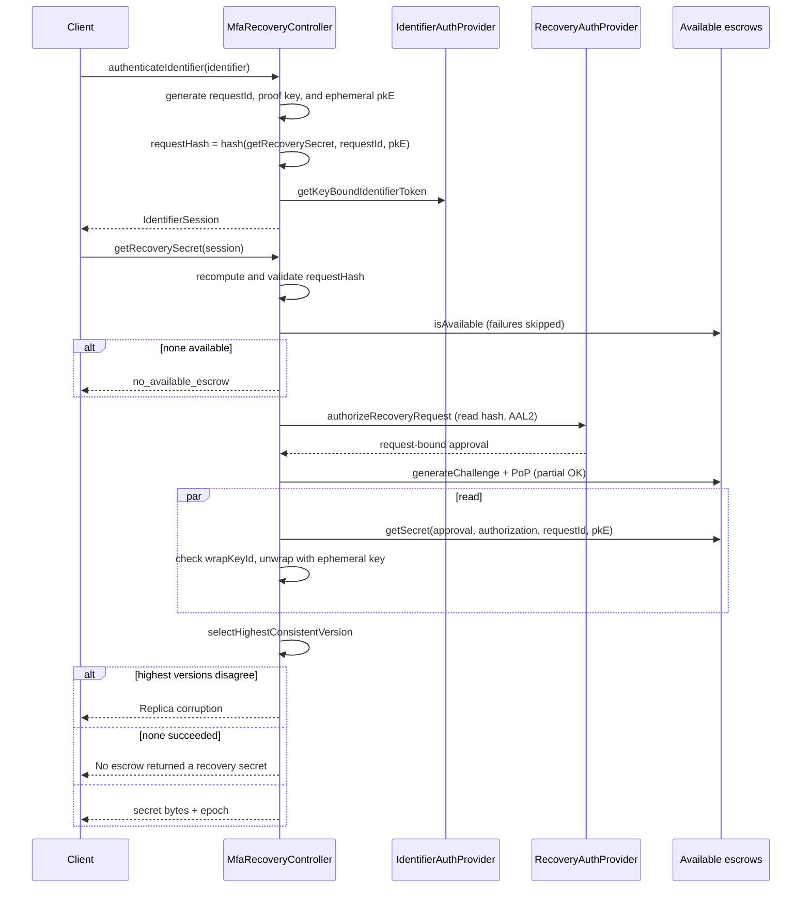
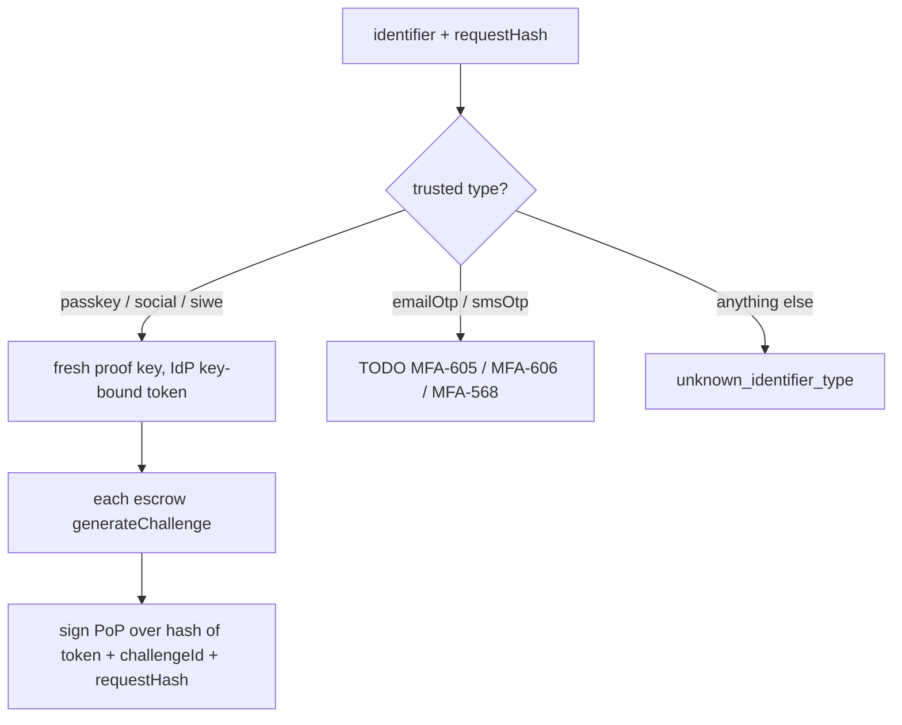

# `@metamask/mfa-recovery-controller`

Orchestration layer for MFA recovery. The controller never stores the recovery
secret in controller state. It replicates a full copy of that secret to every
configured escrow, and persists only an **encrypted** pending mutation so a
crash can finish the same write.

## Architecture

The controller is a coordinator. Auth, identifier proofs, escrow I/O, and
encryption are injected. OTP collection is not wired yet.

| Piece                       | Role                                                                        |
| --------------------------- | --------------------------------------------------------------------------- |
| `pendingOperation`          | Only persisted field: encrypted `authorizing` / `writing` blob, or `null`   |
| `escrows[]`                 | Build-time replica set; non-empty, unique `id`s; mutations require **all**  |
| `authProvider`              | Profile id + request-bound Auth API approval                                |
| `identifierAuthProvider`    | Key-bound IdP assertion (passkey / OIDC / SIWE)                             |
| `pendingOperationEncryptor` | Encrypts / decrypts the pending blob with wallet secure storage             |
| `now`                       | Clock (Unix seconds) for AuthController token expiry; defaults to `unixNow` |
| `#withLock`                 | Serializes every public method except `authenticateIdentifier`              |

`id` identifies the replica in mutations and receipts; `authAudience` identifies
the approval audience. Cubist uses `id: "cubist"` and an `authAudience` matching
`AUTH_CONTROLLER_AUDIENCE`.

Identifier types pick the auth mode from a trusted table, not a client flag:
`passkey` / `social` / `siwe` → key-bound. Any other type is rejected with
`unknown_identifier_type`. `emailOtp` / `smsOtp` escrow-challenge is not wired
yet (MFA-605 / MFA-606 / MFA-568).

`register` and `updateIdentifiers` require at least two **distinct**
identifiers (by `type` + `namespace` + `value`).

Recovery secrets are wrapped in transit with X25519 ECDH, HKDF-SHA256 (empty
salt, info `escrow-wrap-v1`), and AES-256-GCM. The ciphertext is the raw bytes
`iv || ciphertext+tag`. Wrap keys and `pkE` are raw 32-byte X25519 public keys,
and `wrapKeyId` is the SHA-256 of the raw 32-byte public key. Proof keys and
receipt keys are raw 32-byte Ed25519 public keys, and `receiptKeyId` is the
SHA-256 of the raw 32-byte Ed25519 public key. Pending state stores the secret
as 0x-hex; `payloadHash` is the hash of that pending payload. At apply, each
escrow gets `{ pkE, ciphertext }` wrapped to its own `wrapPublicKey` with a
fresh ephemeral key. Reads bind the client's ephemeral `pkE` into the
`getSecret` request hash, and the escrow wraps its response to `pkE`. On the
Cubist wire, byte fields are 0x-prefixed hex, and the hash of a request
matches the hash computed over its hex-encoded form.

Public surface (all exposed as messenger actions): `register`,
`updateRecoverySecret`, `updateIdentifiers`, `authenticateIdentifier`,
`getRecoverySecret`, `resume`, `abort`, `getPhase`.

## State machine

Persisted phase is derived from decrypted pending state: no pending → `idle`.

Rules:

- **`abort()`** drops `authorizing` only. `writing` must `resume()`
  (`abort_not_allowed`).
- `writing` is persisted before the **first escrow apply**, after the
  AuthController token is issued, every target escrow has accepted identifier
  authorization, and the per-escrow payloads are wrapped. An ambiguous apply
  failure remains resumable, while pre-write failures stay abortable.
- `register` / `updateRecoverySecret` / `updateIdentifiers` require idle
  pending state (`pending_mutation`). `resume()` finishes a persisted
  mutation and is a no-op when idle.

### Pending state validation

The decrypted blob is validated on every load and before every persist.
Anything that fails is rejected rather than acted on:

- Shape: phase, mutation fields, `newVersion = expectedVersion + 1`, payload
  keys for the operation, hex secret, at least two distinct identifiers, known
  identifier types.
- `audiences` must equal the configured escrow ids, in order
  (`audience_mismatch`).
- `payloadHash` must match the payload (`payload_mismatch`) and `requestHash`
  must match the mutation fields.
- `register` has `expectedVersion` `0` and `identifier: null`; updates carry
  an identifier.
- `writing` only: the approval binds `sub` to `profileId` and `ext.request_hash`
  to `requestHash`, with `aal >= 2`. `register` / `updateIdentifiers` also need
  `identifiers_hash` to match `approvedIdentifiers`; receipts must be
  well-formed with at most one per escrow.

## Mutation sequence (`register` / updates)

Mutations are all-or-nothing across the configured escrow set. Reads are not.

Auth approvals:

- The provider receives the operation's `requestHash` and each target escrow's
  `authAudience`. All writes and reads set `requireTwoFactor` for AAL2.
- The issuer controls approval lifetime. AAL2 requires recent MFA.
- The approval's `identifiers` are persisted with its token as
  `approvedIdentifiers` and refreshed with it. `register` and
  `updateIdentifiers` send them to every escrow, which checks them against
  `identifiers_hash` and rejects payload identifiers outside them. Hashing
  sorts object keys, not arrays.
- A 403 from Auth means MFA is missing or stale (`authentication_required`).
- Escrows verify signatures. The controller decodes claims only for pending-state
  validation and expiry-based refresh.

Receipts:

- A receipt counts only if it is well-formed, its `escrowId` matches the
  target, and `escrow.verifyReceipt` accepts it (pinned receipt key).
- Stored receipts are re-verified before every retry. A receipt for an
  escrow that is no longer configured fails with `unknown_receipt_escrow`.
- `MutationRejectedError` is only surfaced when **every** remaining escrow
  threw `MutationRejectedError` and no receipt exists yet; anything else may
  have been applied and stays `writing`.

Versioning:

- Version lives on the mutation (`expectedVersion` / `newVersion`), which is
  what escrows apply. `epoch` is only the client-facing name for the current
  replica version returned by `getRecoverySecret`.
- `register` uses expectedVersion `0` → version `0 → 1`
- updates take the caller-supplied `epoch` (a non-negative integer, else
  `invalid_epoch`) as `expectedVersion`, then `n → n+1`. Escrows reject a
  mismatch.
- Mutation `audiences` is the full configured replica-id list, in that order.
  Each replica should require an exact match to its configured set (a
  cubist-only deploy is `["cubist"]`; adding another escrow means every replica
  is rebuilt with the expanded list).

`resume()` is the same write path without creating a new mutation:
authorizing pending gets a fresh token then replicates; writing pending
retries only escrows that do not already have a stored receipt. Updates
re-run identifier auth (a new key-bound token and PoP) for those escrows on
every attempt, so the identifier provider must be able to authenticate again.

## Cubist integration

The controller does not call CubeSigner, the registration API, or
`KeyringController`. A Cubist deploy injects one `CubistEscrowProvider`.
The caller proves OIDC, calls
`ensure-user`, opens the session, and constructs the provider with the
authenticated `CubeSignerClient` and the pinned wrap and receipt public keys
before `register`.

`CubistEscrowProvider` sends every command with `policyInvoke` on the C2F
(default `cubist_secret_escrow`, version `latest`) as `{ cmd, ...fields }`:
`ping` (`isAvailable`), `generateChallenge`, `getSecret`, and
`applyMutation`. Escrow JSON is parsed from C2F stdout. A policy `Deny` on
`applyMutation` becomes `MutationRejectedError`; any other failure is
`escrow_request_failed` / `escrow_response_invalid`. `verifyReceipt` checks
the mutation id, request hash, escrow id, `version === newVersion`,
`receiptKeyId` (SHA-256 of the pinned receipt key), and the Ed25519 signature
locally.

For a single-escrow walkthrough, see [Cubist test sequence](CUBIST_TEST_SEQUENCE.md).

## Read sequence (`getRecoverySecret`)

Reads tolerate down replicas. They do **not** repair pending writes. The
selected replica version is returned as `epoch` so a later
`updateRecoverySecret` / `updateIdentifiers` can be formed without a locally
stored version.

`IdentifierSession` contains the key-bound token, its proof private key, the
`requestId`, and the ephemeral `pkE` key pair needed for the read. The
controller does not persist or store the session; callers must keep it in
memory and must not log it.

A replica whose `wrapKeyId` does not match its configured `wrapPublicKey`, or
whose ciphertext fails to unwrap, counts as a failed read. Among successful
reads, the highest `version` wins; every replica at that version must agree
on `lastMutationId` and the secret bytes.

`getRecoverySecret` runs under the controller lock but does not check pending
state. During `writing`, replicas may hold different versions; the read takes
the highest one. The next mutation still requires `resume()` first.

## Identifier auth (inside writes and reads)

On **mutation**, every remaining target escrow must authorize or the write
does not start (`identifier_auth_failed`). On **read**, escrows whose
challenge fails are skipped. `register` sends no identifier authorization
(`null`).
