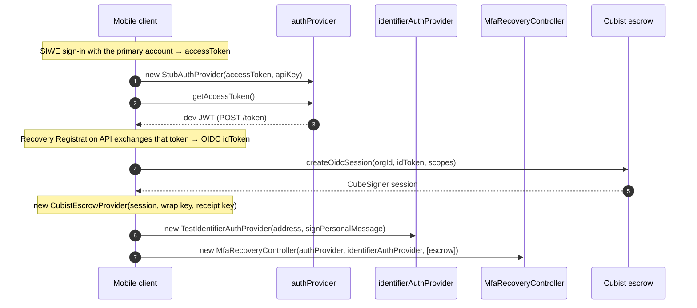
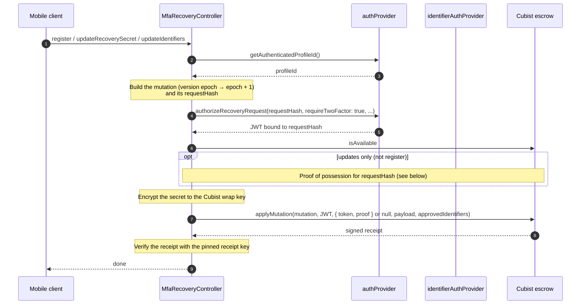
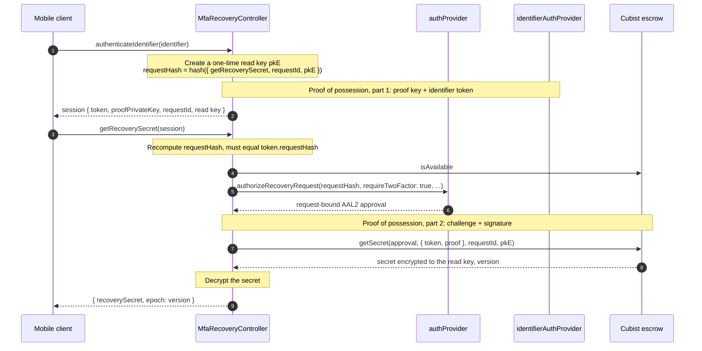

# Cubist MFA recovery sequence

How the mobile developer test (`runMfaRecoveryCubistTest` in
`metamask-mobile`) drives one `MfaRecoveryController` against a single Cubist
escrow (`id: cubist`). It runs three mutations and reads the secret back after
each one. Error branches, pending-state repair, and multi-escrow behavior are
in [ARCHITECTURE.md](./ARCHITECTURE.md); treat the TypeScript in `src/` as the
source of truth if a diagram drifts.

| Step | Client call                                                  | Read with            | Version |
| ---- | ------------------------------------------------------------ | -------------------- | ------- |
| 1    | `register(secret, [siwe, passkey])`                          | `siwe`               | `0 → 1` |
| 2    | `updateRecoverySecret(passkey, newSecret, epoch)`            | `passkey`            | `1 → 2` |
| 3    | `updateIdentifiers(siwe, [siwe, replacementPasskey], epoch)` | `replacementPasskey` | `2 → 3` |

Each update passes the `epoch` returned by the previous read.

## Setup

The mobile client does this before it creates the controller. The controller
never calls these services itself.

- `authProvider` (`StubAuthProvider` in mobile) takes the profile ID from the
  access token and mints request-bound JWTs from the MPC service's
  development-only `POST /token` endpoint. That route is not mounted in
  production builds.
- `identifierAuthProvider` (`TestIdentifierAuthProvider` in mobile) signs SIWE
  proofs with the primary account and passkey proofs with a software passkey.

## Write: `register`, `updateRecoverySecret`, `updateIdentifiers`

All mutations require a request-bound AAL2 approval. `register` and
`updateIdentifiers` also send the approval's identifiers as
`approvedIdentifiers`, bound by `identifiers_hash`.

| Operation              | Identifier proof        | Payload              |
| ---------------------- | ----------------------- | -------------------- |
| `register`             | none                    | identifiers + secret |
| `updateRecoverySecret` | the identifier argument | secret               |
| `updateIdentifiers`    | the identifier argument | identifiers          |

If an escrow refuses the mutation (`MutationRejectedError`) and every replica
does the same, the controller clears the pending mutation. A transport failure
or a partial receipt keeps it and throws `incomplete_mutation`; call `resume()`
to finish that write.

## Proof of possession

Updates and reads prove control of a registered identifier:

1. The controller generates an Ed25519 proof key and requests an identifier token
   binding `hash([proofPublicKey, requestHash])`: the SIWE nonce or WebAuthn challenge.
2. The proof key signs `hash([token, challenge.id, requestHash])` for each escrow.
   The controller sends the approval and `{ kind: 'key-bound', token, proof }`
   with `applyMutation` or `getSecret`.
3. The escrow C2F verifies the provider assertion, registered identifier, request
   binding, challenge, and proof signature.

The proof private key never leaves the controller/caller; read sessions keep it
in memory. `register` sends `null` instead of an identifier proof. Implementation:
`requestKeyBoundIdentifierToken` and `authorizeEscrowsWithToken` in `src/identifier-auth.ts`.

## Read: `authenticateIdentifier`, `getRecoverySecret`

With one escrow, any failure during the read (challenge, `getSecret`, wrong
wrap key, or decrypt) surfaces as `read_failed`.
