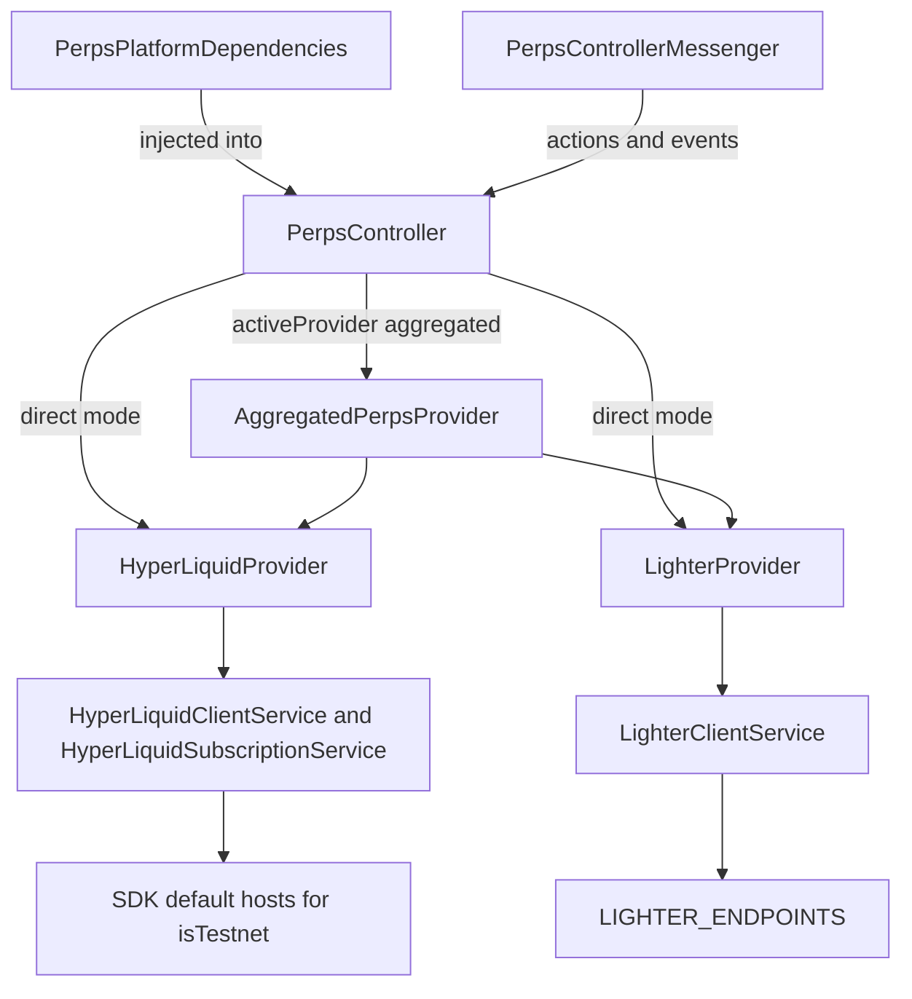

# Perps controller architecture

`@metamask/perps-controller` (24.0.0) is the perpetual futures trading controller. It is published from Core and consumed by the MetaMask clients. Client UI, hooks, stream channels and connection timing stay in each client.

## Layers

| Layer            | What it owns                                                                                                                                                                                     |
| ---------------- | ------------------------------------------------------------------------------------------------------------------------------------------------------------------------------------------------ |
| Venue            | HyperLiquid and Lighter REST and WebSocket APIs. Lighter REST and WebSocket endpoints are Core constants; HyperLiquid REST and WebSocket hosts come from the SDK defaults for `isTestnet`.       |
| Provider adapter | Exchange-specific implementation of the `PerpsProvider` interface, one per venue. Owns venue clients, subscriptions, signing, request formatting, response normalisation and its session caches. |
| Aggregation      | `AggregatedPerpsProvider` wraps the registered providers behind the same `PerpsProvider` interface.                                                                                              |
| Controller       | `PerpsController` extends `BaseController`. Owns the provider registry, active-provider choice, provider lifecycle, state, preload caches, services and the messenger actions.                   |
| Client           | Implements `PerpsPlatformDependencies`, calls messenger actions, decides when to connect and disconnect.                                                                                         |

Code: `src/PerpsController.ts` `PerpsController`; `src/types/index.ts` `PerpsProvider`, `PerpsPlatformDependencies`; `src/providers/`; `src/services/HyperLiquidClientService.ts` `#createTransports`; `src/constants/lighterConfig.ts` `LIGHTER_ENDPOINTS`.

## What the controller owns

| Concern                              | Where it lives                                                                                                                                                                                                                                  |
| ------------------------------------ | ----------------------------------------------------------------------------------------------------------------------------------------------------------------------------------------------------------------------------------------------- |
| Order, TP/SL, close and margin math  | `src/utils/orderCalculations.ts`, `tpslCalculations.ts`, `closeCalculations.ts`, `marginAdjustment.ts`, `positionProtection.ts`; actions `calculateFees`, `calculateLiquidationPrice`, `calculateMaintenanceMargin`                             |
| Fee resolution                       | `src/services/RewardsIntegrationService.ts`, `src/utils/subscriptionFeeWaiver.ts`                                                                                                                                                               |
| Advanced orders (TWAP, chase, scale) | `src/utils/advancedOrders.ts` (rules from `getOrderCapabilities().strategyRules`, validation, previews, ladder sizing, price warnings), `advancedOrderLists.ts` (live lists); actions `subscribeToLiveTwapOrders`, `subscribeToChaseOrderLists` |
| Display formatting                   | `src/utils/perpsFormatters.ts`; locale number formatting injected as `marketDataFormatters`                                                                                                                                                     |
| Venue adapters and validation        | `src/utils/hyperLiquidAdapter.ts`, `hyperLiquidOrderBookProcessor.ts`, `hyperLiquidValidation.ts`, `marketDataTransform.ts`, `marketUtils.ts`, `sortMarkets.ts`, `idUtils.ts`, `standaloneInfoClient.ts`                                        |
| Request reliability                  | `src/utils/providerHealth.ts`, `coalescePerpsRestRequest.ts`, `guardedHyperLiquidClient.ts`                                                                                                                                                     |
| Constants                            | `src/constants/` (`perpsConfig.ts` `PERPS_CONSTANTS`, `hyperLiquidConfig.ts`, `lighterConfig.ts` and others)                                                                                                                                    |
| Connection primitives                | `PerpsController` `init`, `disconnect`, `reconnect`, `toggleTestnet`, `switchProvider`                                                                                                                                                          |
| State                                | `PerpsControllerState`, `getDefaultPerpsControllerState`; selectors in `src/selectors.ts`                                                                                                                                                       |
| Messenger events                     | `PerpsControllerEvents`                                                                                                                                                                                                                         |
| Analytics properties                 | `src/constants/eventNames.ts` `PERPS_EVENT_PROPERTY`, `PERPS_EVENT_VALUE`; sent through the injected `metrics`                                                                                                                                  |
| Errors                               | `src/perpsErrorCodes.ts`, `src/errors.ts`                                                                                                                                                                                                       |

Code: `src/utils/`, `src/constants/`, `src/selectors.ts`, `src/PerpsController.ts` `PerpsControllerState`.

## Providers

| Provider                  | Registered as                                | What it does                                                                                                                                                                                                                                                                                                                                                                                                                                                                                                                                                                                          |
| ------------------------- | -------------------------------------------- | ----------------------------------------------------------------------------------------------------------------------------------------------------------------------------------------------------------------------------------------------------------------------------------------------------------------------------------------------------------------------------------------------------------------------------------------------------------------------------------------------------------------------------------------------------------------------------------------------------- |
| `HyperLiquidProvider`     | `hyperliquid`, always                        | HyperLiquid REST and WebSocket through `HyperLiquidClientService`, `HyperLiquidSubscriptionService`, `HyperLiquidWalletService` and `DexDiscoveryCacheManager`. Lifecycle methods are `initialize()`, `disconnect()`, `ping()` (default timeout `WebsocketPingTimeoutMs`, 5 s) and `reconnect()`; there is no `connect()`.                                                                                                                                                                                                                                                                            |
| `LighterProvider`         | `lighter`, when the gate below passes        | zkLighter venue (POC). REST reads plus WebSocket market, account, position, order, fill, order-book and candle streams. Writes are signed by the client's `LighterSignerBridge` (Go/WASM signer). Shipped as the `./providers/lighter` subpath export.                                                                                                                                                                                                                                                                                                                                                |
| `AggregatedPerpsProvider` | not registered; built as the active instance | List reads (positions, markets, orders, fills, funding and others) aggregate from every provider with `Promise.allSettled`; `getAccountState` and some other reads use the default provider. Writes route through `ProviderRouter` to `params.providerId` or the default provider. Price, position, order and fill subscriptions go through `SubscriptionMultiplexer` (prices with `merge`); account, OI cap, candle, order-book and TWAP subscriptions follow the default provider. `disconnect()` and `prepareTradingWallet()` visit every registered provider. Returned data carries `providerId`. |

### Registration and active-provider choice

1. `#performInitialization` disconnects every registered provider, clears the map, retires the standalone provider and calls `#createProviders`.
2. `#createProviders` creates `HyperLiquidProvider`. When Lighter is enabled it loads `LighterProvider` through `providerCredentials.lighter.loadProvider` or a dynamic import, then `registerLighterProvider` adds it.
3. Initialization waits for the Lighter registration and `ReconnectionCleanupDelayMs` (500 ms) together, re-runs `#migrateActiveProviderForMultiProviderIfNeeded`, then calls `#assignActiveProvider`.
4. `#assignActiveProvider` picks the instance from `state.activeProvider`.

| `activeProvider` | Active instance                                                                                                                          |
| ---------------- | ---------------------------------------------------------------------------------------------------------------------------------------- |
| `aggregated`     | New `AggregatedPerpsProvider`; its default is `state.defaultProvider` when registered, else `hyperliquid` (the saved preference is kept) |
| `hyperliquid`    | `HyperLiquidProvider`                                                                                                                    |
| any other value  | That provider when registered; else `HyperLiquidProvider`, and `activeProvider` is rewritten to `hyperliquid`                            |

`activeProvider` defaults to `hyperliquid`. When the `perpsMultiProviderModeEnabled` remote flag is on, the migration moves a direct venue to `aggregated`, unless the user picked a provider explicitly. On the first migration that venue becomes `defaultProvider` when the user has not saved one. A flag set to disabled restores direct mode. `effectiveProvider` records the venue writes go to and is never restored from a persisted snapshot.

### Routing helpers

| Helper                          | Job                                                                                                                                                                                              |
| ------------------------------- | ------------------------------------------------------------------------------------------------------------------------------------------------------------------------------------------------ |
| `ProviderRouter`                | Phase 1 routing. An explicit `providerId` wins, else the default provider. Only the `default_provider` strategy exists.                                                                          |
| `isPerpsProviderType`           | Accepts only `hyperliquid` and `lighter`.                                                                                                                                                        |
| `resolveTradeConfigProviderKey` | Picks the venue a trade configuration belongs to. Explicit route first, then `effectiveProvider`, then the direct provider or the aggregated default. Invalid state falls back to `hyperliquid`. |

### Lighter enablement gate

`#isLighterProviderEnabled` returns true in two cases.

- The local override `providerCredentials.lighter.enabled` is set.
- The client passed `providerCredentials.lighter.signerBridge` and the remote `perpsLighterProviderEnabled` flag passes `featureFlags.validateVersionGated`.

Without a signer bridge the remote flag cannot register Lighter. A missing Lighter module logs at debug level; any other load failure goes to `logger.error`. `switchProvider('lighter')` returns the load error. `isProviderOnTestnet` keeps Lighter on testnet while `PROVIDER_CONFIG.LIGHTER_TESTNET_ONLY` is set (false at this commit).

Code: `src/PerpsController.ts` `#createProviders`, `registerLighterProvider`, `handleLighterImportError`, `#assignActiveProvider`, `#isLighterProviderEnabled`, `#migrateActiveProviderForMultiProviderIfNeeded`; `src/providers/`; `src/routing/`; `src/aggregation/SubscriptionMultiplexer.ts`; `src/services/providerNetwork.ts` `isProviderOnTestnet`.

## Services

The controller creates `TradingService`, `MarketDataService`, `AccountService`, `EligibilityService`, `DataLakeService`, `DepositService`, `FeatureFlagConfigurationService` and `RewardsIntegrationService` with the platform dependencies (some also get the messenger). Venue services are created by their provider.

| File                              | Job                                                                                                                                                                                                                |
| --------------------------------- | ------------------------------------------------------------------------------------------------------------------------------------------------------------------------------------------------------------------ |
| `AccountService`                  | Withdrawals and withdrawal validation; stateless, delegates to the provider                                                                                                                                        |
| `accountSigner.ts`                | Readiness checks for an injected main-account signer                                                                                                                                                               |
| `agentSigner.ts`                  | HyperLiquid agent bindings kept across provider instances (`AgentBindings`)                                                                                                                                        |
| `AggregatedOrderBookConnection`   | Dedicated HyperLiquid socket for the order-book panel's aggregated `l2Book` stream; opens on first subscriber, closes after the last                                                                               |
| `causeChain.ts`                   | Matches an error anywhere in its `cause` chain                                                                                                                                                                     |
| `DataLakeService`                 | Reports order events to the Data Lake API with exponential backoff and tracing                                                                                                                                     |
| `DepositService`                  | Prepares and validates deposit transaction data; the controller owns the `TransactionController` call and confirmation                                                                                             |
| `DexDiscoveryCacheManager`        | Single HIP-3 DEX discovery cache for every `perpDexs()` derivative                                                                                                                                                 |
| `EligibilityService`              | Eligibility from `GeolocationController` geolocation and blocked regions                                                                                                                                           |
| `environmentTypeProperty.ts`      | Adds the optional UI surface to analytics properties                                                                                                                                                               |
| `FeatureFlagConfigurationService` | HIP-3 and geo-blocking config from remote flags; once remote config loads it never drops back to fallback                                                                                                          |
| `HyperLiquidClientService`        | HyperLiquid SDK client initialization, HTTP and WebSocket transports, client lifecycle                                                                                                                             |
| `HyperLiquidSubscriptionService`  | HyperLiquid WebSocket subscriptions with reference counting; per DEX, `clearinghouseState` carries positions and account and `openOrders` carries orders; one `webData3` subscription carries OI caps for all DEXs |
| `HyperLiquidWalletService`        | Wallet adapter and signing for the HyperLiquid SDK                                                                                                                                                                 |
| `LighterChaseService`             | Bounded Chase order ownership and serial cancel/replace                                                                                                                                                            |
| `LighterClientService`            | zkLighter REST client on the platform `fetch`, no SDK; decodes every response                                                                                                                                      |
| `lighterDispatchIdentity.ts`      | Checks the signed Lighter tx hash and expiry; refuses submission without them                                                                                                                                      |
| `LighterTwapService`              | Durable native Lighter TWAP schedules                                                                                                                                                                              |
| `LighterWalletService`            | Routes the L1 signatures Lighter needs; the venue key stays in the client signer bridge                                                                                                                            |
| `MarketDataService`               | Read-only fetches (markets, positions, orders, account state and more); writes state through `stateManager` when given; tries the Terminal API before the provider                                                 |
| `missingActionHandler.ts`         | Detects the `Messenger.call` error for an unregistered or undelegated action                                                                                                                                       |
| `providerNetwork.ts`              | Whether a provider runs on testnet                                                                                                                                                                                 |
| `RewardsIntegrationService`       | Unified fee resolver; lowest of `default`, `rewards`, `grant` and `subscription`                                                                                                                                   |
| `ServiceContext.ts`               | Per-call context type (tracing, error context, state callbacks)                                                                                                                                                    |
| `TerminalMarketService`           | Market metadata from the MetaMask Terminal API, cached for `TERMINAL_API_CONFIG.CacheTtlMs`, and one schema-v4 global snapshot per provider, cached until `receivedAt` plus the smaller of its `maxAgeMs` and 30 s |
| `TradingReadinessCache.ts`        | Global signing cache (unified account, builder fee, referral) that survives provider recreation so hardware wallets are not prompted again                                                                         |
| `TradingService`                  | Orders, cancels and positions with fee discounts; signals `cacheInvalidator` after changes                                                                                                                         |

Code: `src/services/`; `src/PerpsController.ts` constructor.

## Market lists and saved markets

Aggregated reads return the original venue rows. Clients can call `groupMarketsByMarketKey(rows, defaultProvider)` for display. It groups rows only when the backend supplies a shared key and each row uses the canonical price scale. Each group puts the default venue first when present. Use the selected venue row's `providerId` and `symbol` for charts and trading. Unmapped and scaled rows remain separate, with a venue-local display key based on the HyperLiquid symbol or `lighter:<SYMBOL>`.

`toggleWatchlistMarket`, `isWatchlistMarket` and `recordMarketViewed` take an optional second argument for a grouped market key. Only pass it for a backend-confirmed market at the canonical scale. Symbol-only callers keep the existing stored format. When opening a saved item, pass the watchlist or recently viewed strings and the ungrouped rows to `resolveSavedPerpsMarkets`. This resolves older symbols on the original venue when available, using HyperLiquid by default for legacy entries. Pass the prior venue if the entries were saved on Lighter. New keyed entries resolve to the configured default venue when it lists the market.

## Platform dependencies

`PerpsPlatformDependencies` is passed as `infrastructure` to the constructor. Venue credentials and signer hooks come separately through `clientConfig.providerCredentials`.

| Member                  | Required | Job                                                                                                    |
| ----------------------- | -------- | ------------------------------------------------------------------------------------------------------ |
| `logger`                | yes      | Error reporting (Sentry on Mobile)                                                                     |
| `debugLogger`           | yes      | Development logging                                                                                    |
| `metrics`               | yes      | Analytics events                                                                                       |
| `performance`           | yes      | `now()` and the `onControllerConstructed` hook                                                         |
| `tracer`                | yes      | Trace spans                                                                                            |
| `streamManager`         | yes      | `pauseChannel`, `resumeChannel`, `clearAllChannels` on the client stream layer                         |
| `featureFlags`          | yes      | `validateVersionGated` against the app version                                                         |
| `marketDataFormatters`  | yes      | Volume, fiat and percentage formatting                                                                 |
| `cacheInvalidator`      | yes      | Invalidates client standalone caches (`positions`, `accountState`, `markets`)                          |
| `diskCache`             | yes      | `getItem`, optional `getItemSync`, `setItem`, `removeItem` for cold-start persistence                  |
| `terminalApi`           | no       | `marketDataUrl` and `globalSnapshotUrl`                                                                |
| `terminalApiUrl`        | no       | Deprecated; use `terminalApi.marketDataUrl`                                                            |
| `terminalMarketService` | no       | Custom Terminal market service; the controller builds `TerminalMarketService` when only URLs are given |
| `rewards`               | yes      | `getPerpsDiscountForAccount`, optional `getPerpsTradingFeeGrant`                                       |
| `subscription`          | no       | `getPerpsBenefits`, optional `registerTradingAddress`                                                  |
| `accountSigner`         | no       | Main-account signer for clients without a `KeyringController`                                          |

Code: `src/types/index.ts` `PerpsPlatformDependencies`, `PerpsCacheInvalidator`, `MarketDataFormatters`; `src/PerpsController.ts` `PerpsControllerOptions`.

## Messenger surface

- 139 method actions named `PerpsController:<method>`, generated into `PerpsController-method-action-types.ts` from `MESSENGER_EXPOSED_METHODS`, plus `PerpsController:getState`. Handlers are registered on the first `init()`, not in the constructor.
- 3 own events: `stateChange`, `stateChanged` and `chaseOrderMaxDistanceReached`.
- 16 allowed external actions and 3 allowed external events (`RemoteFeatureFlagController:stateChange`, `AccountsController:selectedAccountChange`, `AccountTreeController:selectedAccountGroupChange`).

Code: `src/PerpsController-method-action-types.ts`; `src/PerpsController.ts` `MESSENGER_EXPOSED_METHODS`, `PerpsControllerEvents`, `PerpsControllerActions`; `src/types/messenger.ts` `PerpsControllerAllowedActions`, `PerpsControllerAllowedEvents`.

## State, caches and persistence

| Cache                                               | Holds                                      | Key                                                              | Lifetime                                                                                                                                                                                             |
| --------------------------------------------------- | ------------------------------------------ | ---------------------------------------------------------------- | ---------------------------------------------------------------------------------------------------------------------------------------------------------------------------------------------------- |
| `cachedMarketDataByProvider` (state, not persisted) | REST market snapshot                       | `providerId:network`                                             | Kept on disconnect. Read TTL 300 s unless `skipTTL`. Terminal global-snapshot entries stay valid until `sourceExpiresAt` with a matching HIP-3 version and DEX list.                                 |
| `cachedUserDataByProvider` (state, not persisted)   | Positions, orders, `accountState`, address | `providerId:network`                                             | Kept on disconnect. Read TTL 60 s unless `skipTTL`. Reads return null when the stored address is not the selected EVM account; HyperLiquid entries also need the current HIP-3 version and DEX list. |
| Standalone `HyperLiquidProvider`                    | Provider for reads before `init()`         | one instance                                                     | Recreated when `isTestnet` or `hip3ConfigVersion` changes; retired on init, `toggleTestnet`, `disconnect` and `stopMarketDataPreload`                                                                |
| `TradingReadinessCache`                             | Signing state and in-flight locks          | `network:userAddress`; locks `operationType:network:userAddress` | Global singleton; clear methods exist but nothing in the package calls them                                                                                                                          |

`HyperLiquidProvider.disconnect()` clears the fee cache, referral and builder-fee checks, `#cachedMetaByDex`, `#cachedSpotMeta` and DEX discovery. It keeps `#maxLeverageCache` (TTL) and `#cachedMarketDataWithPrices` (last known-good markets). `#symbolToAssetId` is rebuilt on init.

### Preload

- `startMarketDataPreload()` runs the market and user preloads in parallel at once, then every 5 minutes (`#preloadRefreshMs`).
- It re-runs both preloads when `isTestnet` or `hip3ConfigVersion` changes, and the user preload on `AccountsController:selectedAccountChange` and `AccountTreeController:selectedAccountGroupChange`.
- `#performMarketDataPreload` skips during reinitialization or when the entry is newer than `#preloadGuardMs` (30 s). It calls `getMarketDataWithPrices({ standalone: true })` and writes `cachedMarketDataByProvider[providerNetworkKey]`; aggregated mode writes one entry per provider plus an empty sentinel.
- `#performUserDataPreload` needs a selected EVM address. It skips when the matching entry is newer than 30 s, or exists while the WebSocket is connected. It writes `cachedUserDataByProvider[providerNetworkKey]`.
- `stopMarketDataPreload()` and `disconnect()` both stop the timer and its subscriptions. After a disconnect, preload restarts only when the client calls `startMarketDataPreload()` again.

### Disk hydration

- The constructor calls `#hydrateCacheFromDiskSync`, which reads `diskCache.getItemSync`; without it hydration is a no-op.
- Keys are `PERPS_DISK_CACHE_MARKETS` and `PERPS_DISK_CACHE_USER_DATA` (value `PERPS_DISK_CACHE_USER_DATA_V2`). Each holds one entry or `{ entries: [...] }`.
- Prices are replaced with `$---`, `--` and `--%`.
- Hydrated timestamps are set older than 300 s, so only `skipTTL` reads return disk data.
- User entries are hydrated without an address check; the read-time address guard applies.
- After each preload the controller writes with `persistMarketEntriesToDisk` and `#persistUserCacheToDisk` (`persistUserEntriesToDisk`). Writes are best effort. `PERPS_DISK_CACHE_THROTTLE_MS` (30 s) is exported for client writers.

### Account and network change

- Account change deletes nothing. The address guard makes the old entry unreadable and the user preload refreshes it under the same key. Registered rewards trading addresses are reset and the new address registers.
- A network toggle does not clear caches; mainnet and testnet use different keys.

Code: `src/PerpsController.ts` `cachedMarketDataByProvider`, `cachedUserDataByProvider`, `getCachedMarketDataForActiveProvider`, `getCachedUserDataForActiveProvider`, `#isUserCacheIdentityCurrent`, `#getOrCreateStandaloneProvider`, `startMarketDataPreload`, `#performMarketDataPreload`, `#performUserDataPreload`, `#hydrateCacheFromDiskSync`; `src/utils/perpsDiskPersistence.ts` `hydrateFromDiskSync`; `src/services/TradingReadinessCache.ts`; `src/providers/HyperLiquidProvider.ts` `disconnect`.

## Connection

The controller provides the connect and disconnect primitives. The client decides when to call them. Mobile's connection manager and React providers are described in [`metamask-mobile/docs/perps/connection-architecture.md`](https://github.com/MetaMask/metamask-mobile/blob/main/docs/perps/connection-architecture.md).

| Event                                                                  | What the controller does                                                                                                                                                                                                                                                                                 |
| ---------------------------------------------------------------------- | -------------------------------------------------------------------------------------------------------------------------------------------------------------------------------------------------------------------------------------------------------------------------------------------------------- |
| `init()`                                                               | Waits for any disconnect or reinitialization in flight, reuses `#initializationPromise`, runs `#performInitialization`. Up to 3 attempts, with a 1 s then a 2 s wait between them. On final failure it sets `initializationState` to `Failed` and `initializationError`, then resolves without throwing. |
| Data call before init                                                  | `getActiveProvider()` throws `CLIENT_REINITIALIZING`, `CLIENT_NOT_INITIALIZED` or `PROVIDER_NOT_AVAILABLE`. `subscribeTo*` returns a no-op unsubscribe when no provider exists.                                                                                                                          |
| `reconnect()`                                                          | Delegates to `provider.reconnect()`. HyperLiquid rebuilds its socket through `HyperLiquidClientService` (up to 10 attempts); the SDK transport also retries 5 times.                                                                                                                                     |
| `disconnect()`                                                         | Serialised. Stops the preload timer and subscriptions, waits for init or reinit in flight, disconnects the active provider, clears it and `effectiveProvider`, retires the standalone provider, resets `isInitialized`. State caches and the feature-flag subscription stay.                             |
| Network change (`toggleTestnet`) or provider change (`switchProvider`) | `#beginReinitialization` sets `isReinitializing`, the state flips, init runs again. Failure rolls back. When preload is running it re-runs for the new key.                                                                                                                                              |
| Account change                                                         | No reinit. User preload refreshes and the rewards address re-registers. Reconnecting the provider for the new account is the client's call.                                                                                                                                                              |
| HIP-3 remote flag change                                               | `FeatureFlagConfigurationService` bumps `hip3ConfigVersion` and the preload watcher re-preloads. Providers get the new HIP-3 config on the next `init()`.                                                                                                                                                |

`PERPS_CONSTANTS` carries the default timings clients use, among them `ConnectionGracePeriodMs` (20 s), `ConnectionAttemptTimeoutMs` (30 s) and `ConnectRetryDelayMs` (200 ms). The controller does not read them; each client's connection owner does.

Code: `src/PerpsController.ts` `init`, `#performInitialization`, `#beginReinitialization`, `getActiveProvider`, `reconnect`, `disconnect`, `#performDisconnect`, `toggleTestnet`, `switchProvider`; `src/services/HyperLiquidClientService.ts` `reconnect`; `src/constants/hyperLiquidConfig.ts` `HYPERLIQUID_TRANSPORT_CONFIG`; `src/constants/perpsConfig.ts` `PERPS_CONSTANTS`.

## What a client must do

Agreed for every client ([TAT-4656](https://consensyssoftware.atlassian.net/browse/TAT-4656)). Perps review checks each line on Mobile, Extension and Terminal. Bracketed values are the current constants.

- One owner per client decides when to call `init` and `disconnect`. Other components read state; they don't connect.
- Read connection timings from one config per client. It defaults to the `PERPS_CONSTANTS` timings (`ConnectionGracePeriodMs` 20 s, `ConnectionAttemptTimeoutMs` 30 s, `ConnectRetryDelayMs` 200 ms), and an override goes in that config, not in a local literal.
- On account change, reconnect the provider if the new account needs live data; the controller refreshes preload but does not reconnect.
- While `initializationState` is not ready, show the loading or failed state; don't call data methods.
- Every `subscribeTo*` call keeps its unsubscribe and calls it on teardown.

## Balance contract on AccountState

Balance display must keep spendable balance, collateral and HyperLiquid account abstraction state apart. `AccountState` balance fields are USD decimal strings; `returnOnEquity` is a percentage. Any of them can be the `--` unavailable sentinel.

| Field                                           | Meaning                                                                                                                                                                             | HyperLiquid value                                                                                                                      |
| ----------------------------------------------- | ----------------------------------------------------------------------------------------------------------------------------------------------------------------------------------- | -------------------------------------------------------------------------------------------------------------------------------------- |
| `totalBalance`                                  | Equity on the venue, collateral plus unrealized PnL                                                                                                                                 | `marginSummary.accountValue` + spot USDC − spot hold                                                                                   |
| `spendableBalance`                              | USD that can collateralize a new position now, with no transfer                                                                                                                     | Unified `withdrawable + freeSpotUSDC`; Standard `withdrawable`                                                                         |
| `withdrawableBalance`                           | USD that can leave the venue to the external wallet                                                                                                                                 | Unified `withdrawable + freeSpotUSDC`; Standard `withdrawable`                                                                         |
| `marginUsed`, `unrealizedPnl`, `returnOnEquity` | Margin and PnL summary                                                                                                                                                              |                                                                                                                                        |
| `crossMarginSummary`                            | Optional `accountValue`, `maintenanceMargin`, `marginUsed`, `notional`                                                                                                              | Summed across DEXs                                                                                                                     |
| `spotCollateral`                                | Optional spot USDC counted as cross collateral; pass it to `calculateAccountSummary`. Absent while spot state or abstraction mode is unknown, or when the USDC balance is malformed | `'0'` for Standard (`disabled`, `default`); free spot USDC, `max(0, total - hold)`, for Unified and portfolio margin; `'0'` on Lighter |
| `subAccountBreakdown`                           | Optional per-sub-account balances                                                                                                                                                   | Main DEX and HIP-3 DEXs                                                                                                                |
| `providerId`                                    | Venue, set by the aggregator                                                                                                                                                        |                                                                                                                                        |

Clients read `withdrawableBalance` without branching on provider; no client-side spot to perps sweep happens. `hyperLiquidModeFoldsSpot` folds spot into collateral for `unifiedAccount` and `portfolioMargin` only. An unknown mode does not fold.

Code: `src/types/index.ts` `AccountState`, `CrossMarginSummary`; `src/utils/hyperLiquidAdapter.ts` `adaptAccountStateFromSDK`; `src/utils/accountUtils.ts` `addSpotBalanceToAccountState`, `aggregateAccountStates`, `getCrossMarginSpotCollateral`; `src/types/hyperliquid-types.ts` `HyperLiquidAbstractionMode`, `hyperLiquidModeFoldsSpot`.

## Errors

- `PERPS_ERROR_CODES` holds 104 stable codes returned to clients for translation. `isPerpsErrorCode` checks a value. Adding a code is a minor change, so clients need a catch-all.
- `PerpsControllerError` carries `errorCode` and optional `errorDetails`. `createPriceMovedError` and `createTpslLegReplaceUnsupportedError` build typed errors. The package entry exports only the detail types from this file.
- The controller and services log through the injected `logger`.

Code: `src/perpsErrorCodes.ts` `PERPS_ERROR_CODES`, `PerpsErrorCode`, `isPerpsErrorCode`; `src/errors.ts` `PerpsControllerError`, `PerpsErrorDetails`.

## Package tests

`tests/public-api.test.ts` and `tests/capabilities-public-api.test.ts` cover the public API. `tests/e2e/` holds Lighter and advanced-order end-to-end tests.

Code: `tests/public-api.test.ts`, `tests/capabilities-public-api.test.ts`, `tests/e2e/`.
