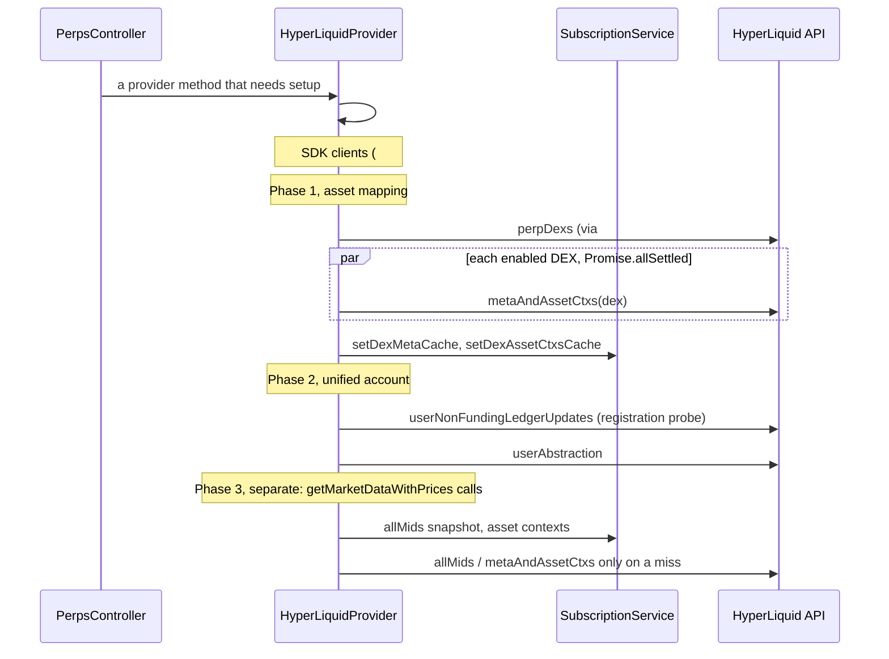

# HyperLiquid init flow

Which client entry point starts the flow, and when, is client code. Controller registration and `PerpsController.init()` are in [architecture.md](../../architecture.md). This page covers what `HyperLiquidProvider` calls on HyperLiquid.

## `initialize()` and `#ensureReady()`

- `PerpsController.init()` does not call `initialize()`. `#ensureReady()` creates the SDK clients through `#ensureClientsInitialized` on first use. `initialize()` does the same and makes no info call.
- Most provider methods run `#ensureReady()` lazily; `getPositions()` only initializes the SDK clients. Concurrent callers share `#ensureReadyPromise`.
- `#ensureReadyPromise` is dropped, so the next caller runs setup again, when setup throws, when DEX discovery was degraded, when the unified-account step needs a retry, or during the transport cooldown.

Code: `src/providers/HyperLiquidProvider.ts` `initialize`, `#ensureClientsInitialized`, `#ensureReady`.

## Phase 1, asset mapping

`#buildAssetMapping` runs when `#symbolToAssetId` is empty or DEX discovery is incomplete.

1. `#getValidatedDexs` returns the main DEX only when `hip3Enabled` is off. Otherwise it reads `perpDexs` once and `DexDiscoveryCacheManager` filters it by the HIP-3 config on testnet and by the DEXes the market allowlist names on mainnet, unless `AutoDiscoverAll` is set. Concurrent callers share one pending request. A failed read returns the main DEX only and is not cached.
2. For each DEX not already in `#cachedMetaByDex`, `metaAndAssetCtxs` (not `meta`), in parallel with `Promise.allSettled`.
3. `#symbolToAssetId` is filled. `#cacheDexMetadata` writes the provider cache and hands meta and asset contexts to the subscription service.

The DEX count depends on `perpDexs`, `hip3Enabled` and the allowlist, so the call count is not fixed.

Code: `src/providers/HyperLiquidProvider.ts` `#buildAssetMapping`, `#getValidatedDexs`, `#fetchValidatedDexsInternal`, `#cacheDexMetadata`; `src/services/DexDiscoveryCacheManager.ts`.

## Phase 2, unified account

`#ensureReady` calls `#ensureUnifiedAccountEnabled` unless the provider is disconnected or in the transport cooldown. Software wallets run it with signing allowed; wallets where `requiresSignatureConfirmation()` is true (hardware, QR) run it without.

- Skipped when `TradingReadinessCache` holds a final outcome for this network and address. Deferred, unregistered and retry outcomes are not final, so the next entry reads again.
- `userNonFundingLedgerUpdates` probes whether the wallet is registered on HyperLiquid. A positive answer is cached. An unregistered wallet is skipped.
- `userAbstraction` reads the mode.

| Mode                                       | Action at init                                                                                                        |
| ------------------------------------------ | --------------------------------------------------------------------------------------------------------------------- |
| `unifiedAccount`, `portfolioMargin`        | No write; success cached                                                                                              |
| `default`, `disabled`, signing allowed     | `userToMultiSigSigners` probe, then silent `agentSetAbstraction`. A multi-sig account is skipped and cached as final. |
| `default`, `disabled`, signing not allowed | Deferred to action time; cache untouched                                                                              |
| Any other mode, including `dexAbstraction` | Log and skip                                                                                                          |

Referral (`referral`) and builder-fee approval (`maxBuilderFee`) do not run at init. `#ensureReadyForTrading` runs them before the first trade or withdrawal.

Code: `src/providers/HyperLiquidProvider.ts` `#ensureUnifiedAccountEnabled`, `#isWalletOnHyperliquid`, `#getAccountSupportForContext`, `#ensureReadyForTrading`, `#ensureReferralSet`, `#ensureBuilderFeeApproval`; `src/utils/hyperLiquidAbstraction.ts` `shouldDeferUnifiedAccountSetup`; `src/services/TradingReadinessCache.ts`.

## Phase 3, `getMarketDataWithPrices`

1. Awaits `#ensureReady`, so the meta cache is filled first.
2. Uses the HTTP info client.
3. Per DEX with cached meta, takes asset contexts from the subscription service cache. When their length differs from the universe length it refetches `metaAndAssetCtxs`.
4. Per DEX without cached meta, `#fetchSingleDexFresh` calls `metaAndAssetCtxs`.
5. Mid prices come from the WebSocket `allMids` snapshot; REST `allMids` runs only when no snapshot exists.

Code: `src/providers/HyperLiquidProvider.ts` `getMarketDataWithPrices`, `#fetchSingleDexFresh`, `#getAllMids`; `src/services/HyperLiquidSubscriptionService.ts` `getLastAllMidsSnapshot`, `getDexAssetCtxsCache`.

## Caches

| Cache                | Owner                      | Key for main DEX | Holds                                                                                               |
| -------------------- | -------------------------- | ---------------- | --------------------------------------------------------------------------------------------------- |
| `#symbolToAssetId`   | Provider                   |                  | Symbol to asset ID                                                                                  |
| `#cachedMetaByDex`   | Provider                   | `null`           | `MetaResponse` per DEX                                                                              |
| `#dexDiscoveryCache` | `DexDiscoveryCacheManager` |                  | Raw and validated `perpDexs`                                                                        |
| `#dexMetaCache`      | Subscription service       | `''`             | Meta, written only when the provider also has asset contexts. On a miss the service fetches `meta`. |
| `#dexAssetCtxsCache` | Subscription service       | `''`             | Asset contexts used by `getMarketDataWithPrices`                                                    |

What `disconnect()` clears is in [architecture.md](../../architecture.md).

Code: `src/providers/HyperLiquidProvider.ts` `#symbolToAssetId`, `#cachedMetaByDex`, `#dexDiscoveryCache`; `src/services/HyperLiquidSubscriptionService.ts` `setDexMetaCache`, `setDexAssetCtxsCache`, `#dexMetaCache`, `#dexAssetCtxsCache`.

## Transports

| Client                                                               | Transport | Use                                                                  |
| -------------------------------------------------------------------- | --------- | -------------------------------------------------------------------- |
| `ExchangeClient`                                                     | HTTP      | Writes (orders, approvals)                                           |
| `InfoClient` (`#infoClient`, default)                                | WebSocket | Reads such as `perpDexs` and `metaAndAssetCtxs` during asset mapping |
| `InfoClient` (`#infoClientHttp`, `getInfoClient({ useHttp: true })`) | HTTP      | Market data, REST position reads, price fallback                     |
| `SubscriptionClient`                                                 | WebSocket | Live channels                                                        |

`getInfoClient` throws when the clients are not initialized. The provider picks the transport per call; the controller never sees it.

Code: `src/services/HyperLiquidClientService.ts` `#createAllClients`, `#createHttpClients`, `getInfoClient`.

## Subscriptions

| Channel              | Scope              | Feeds                              |
| -------------------- | ------------------ | ---------------------------------- |
| `clearinghouseState` | Per DEX            | Positions and account              |
| `openOrders`         | Per DEX            | Orders                             |
| `webData3`           | User               | Open-interest caps only            |
| `allMids`            | Global and per DEX | Mid prices                         |
| `assetCtxs`          | Per DEX            | Funding, open interest, mark price |
| `fastAssetCtxs`      | Global             | Price updates                      |

Code: `src/services/HyperLiquidSubscriptionService.ts` `#ensureClearinghouseStateSubscription`, `#ensureOpenOrdersSubscription`, `#ensureGlobalAllMidsSubscription`, `#createDexAllMidsSubscription`, `#createAssetCtxsSubscription`, `#ensureGlobalFastAssetCtxsSubscription`.
