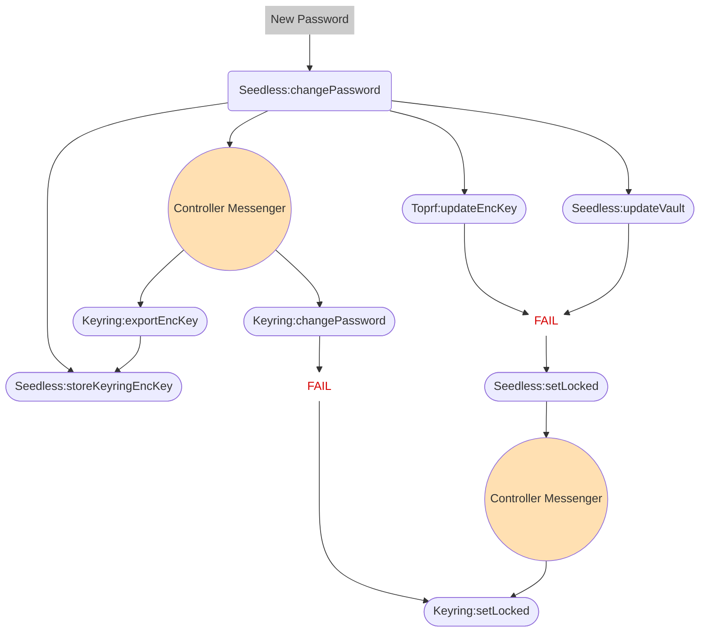

# Controller Owned Password Change/Sync flow

## Background

Social login password change has multiple sub-operations and strictly requires the proper client-side orchestration as mentioned in [here](0002-seedless-password-sync-flow.md).
Currently, the client (metamask extension or mobile) is responsible for orchestrating the password changes in both Seedless/TOPRF and local Keyring areas.

This exposes the high risks of breaking issues;

- Incorrect orchestration from the client
- Different flows in client sides

## Proposed Design

Move the whole orchestration logics into the `seedless-onboarding-controller` package.

`SeedlessOnboardingController` will also be responsible to do the _password change operations_ for the `KeyringController`, via the **controller messenger**.
