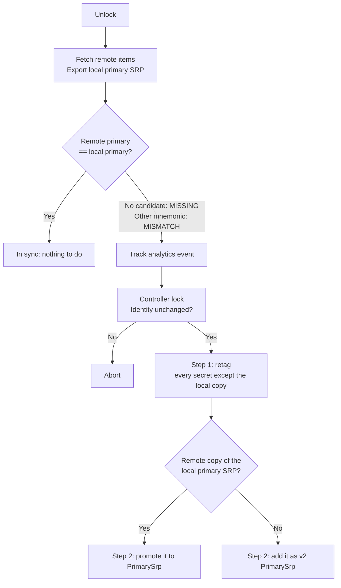
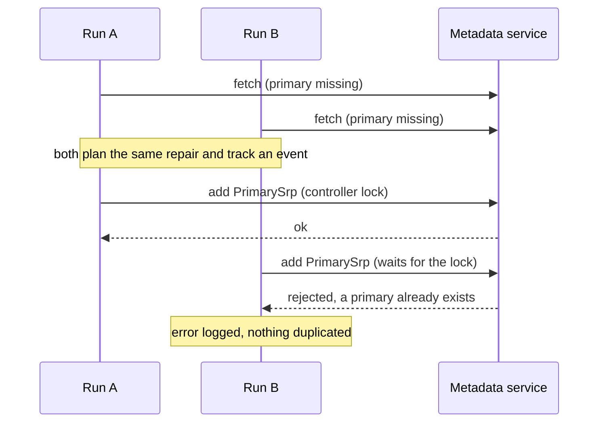

# Repair the primary SRP backup

Follow-up of [identifying the users with an incomplete or incorrect backup](./identify-incomplete-metadata-users.md). It describes what `PrimarySrpBackupRepairService` does to the remote backup.

## Goal

Make the **local primary SRP** the single remote `PrimarySrp` item, without deleting or rewriting any encrypted data. Every other secret becomes an imported item, which also migrates all of them to v2.

The repair is best-effort: it runs asynchronously, never throws, and can be run again at any time.

## Flow

It runs after `submitPassword`, and on request through `identifyIncompleteMetadataBackup`.

The remote primary is the first mnemonic that is untagged or `PrimarySrp`, once the items are ordered by `SecretMetadata.compare`. A backup whose primary is already the local one is left alone, even if it is v1.

## Repair matrix

| Remote backup                                                     | Step 1: retag                         | Step 2: primary        |
| ----------------------------------------------------------------- | ------------------------------------- | ---------------------- |
| Empty, or only imported v2 items                                  | none                                  | add                    |
| Only legacy private keys                                          | each to `ImportedPrivateKey`          | add                    |
| v2 `PrimarySrp` is another mnemonic                               | old primary to `ImportedSrp`          | add                    |
| v2 `PrimarySrp` is another mnemonic, local one is `ImportedSrp`   | old primary to `ImportedSrp`          | promote the local copy |
| Legacy mnemonics, earliest is not the local one, local one exists | every other item to its imported type | promote the local copy |
| Legacy mnemonics, none is the local one                           | every item to its imported type       | add                    |

Items that are already imported v2 items are not retagged. A retag is one `updateSecretDataItem` for one item, and one atomic `batchUpdateSecretDataItems` for several.

## Why two steps

The metadata service accepts one `PrimarySrp` per account and checks a request against what is stored before it (`metadata-service/src/routes/encAccountData.ts`):

- `/batch_update` ignores only the items the request sets to `PrimarySrp`. Demoting the old primary and promoting another item in one request is rejected: "Only one PRIMARY_SRP is allowed".
- `/update`, `/set` and `/batch_set` reject a new primary while another one is stored.
- `/update` and `/batch_update` change only `data_type` and `version` (always `v2`), never the encrypted data. There is no delete, and every add creates a new item.

So the retag, which never contains `PrimarySrp`, goes first. The primary write follows.

## Edge cases

### The repair runs twice

`submitPassword` doesn't await the repair, so quick consecutive unlocks start several runs. Each run plans from the remote state it read **before** taking the controller lock, so the second run applies a stale plan after the first one finishes.

| Situation                                | Result of the second run                                                        |
| ---------------------------------------- | ------------------------------------------------------------------------------- |
| Primary SRP is missing, or must be added | The add is rejected by the service and logged. No duplicate.                    |
| The local copy is promoted               | The same retag and promotion are applied again. The service accepts them.       |
| Always                                   | The analytics event is tracked twice, because both runs planned before a write. |

The backup is correct in every case, since the service allows one primary and the retag is idempotent. The cost is a logged error and a double event. Re-planning under the controller lock would remove both, because the second run would see a backup in sync.

### Other cases

| Case                                                                  | Result                                                                                  |
| --------------------------------------------------------------------- | --------------------------------------------------------------------------------------- |
| The retag fails                                                       | Nothing is written for a batch. The next run plans again.                               |
| The primary write fails after the retag                               | The backup has no primary. The next run repairs it as MISSING, and promotes or adds it. |
| The write succeeded but the response was lost                         | The next run finds the backup in sync and does nothing.                                 |
| The identity changed while the repair waited for the lock             | Nothing is written.                                                                     |
| The controller is locked, or the password is out of sync              | Nothing is written.                                                                     |
| Fetching, parsing, or exporting the local primary SRP fails           | The error is logged and nothing is written.                                             |
| A healthy account, including a v1 backup with the local primary first | No write and no event.                                                                  |
| The remote copy of the local primary SRP has no item id               | The local primary SRP is added.                                                         |

## Not done yet

- Re-plan under the controller lock.
